<!--
Adapted from the Galaxy Training Network (GTN) slides "Introduction to Galaxy":
https://github.com/galaxyproject/training-material/blob/main/topics/introduction/tutorials/introduction/slides.html
Original contributors: bagnacan, bebatut, shiltemann, pajanne, nsoranzo, hexylena,
chrisbarnettster, michelemaroni, annefou, nagoue, olanag1, tnabtaf
License: CC-BY 4.0 (https://creativecommons.org/licenses/by/4.0/)

Speaker notes are in `::: notes` blocks: press "s" during the presentation to open them.
-->

# What is Galaxy?

## Galaxy

[{fig-alt="Galaxy"}](https://galaxyproject.org/)

**Data intensive *analysis* for everyone**

- Versatile and reproducible workflows
- **Web** platform
- **Open source** under [Academic Free License](https://opensource.org/licenses/AFL-3.0)
- Developed at Penn State, Johns Hopkins, OHSU and Cleveland Clinic with substantial outside contributions

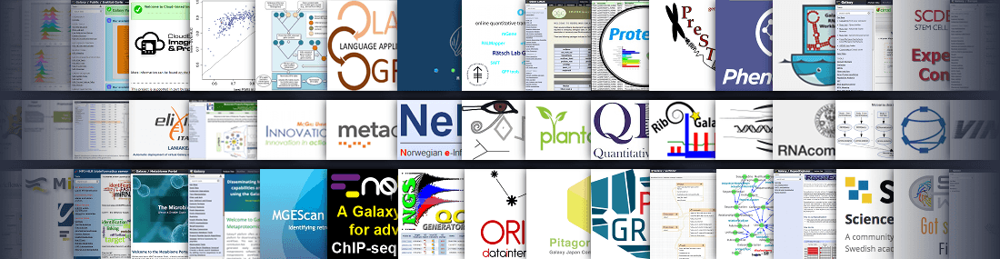{fig-alt="Galaxy resources"}

::: notes
- The Galaxy Team is composed by bioinformaticians and software engineers
- OHSU = Oregon Health & Science University
- Workflows are similar to cooking recipes. This metaphor helps comprehension of workflows for users researchers, citizens and hobbyists that are not familiar with data intensive research.
:::

## Why use Galaxy?

- It's **easy**!
  - No installation, all you need is a browser.
  - No complex commands, just point and click!
- Makes your research **reproducible**
  - Galaxy keeps track of all analysis details
- **Cross-domain**: bioinformatics, chemistry, ecology, climate science, digital humanities ...

::: notes
- Data analysis can be very complex.
- It often requires specialized programming knowledge or command-line skills.
- Galaxy makes this a lot easier by providing a web-based user interface to popular data analysis tools.
- This means you don't have to install anything, just open your browser and go to Galaxy.
- Galaxy also helps you make your research reproducible by keeping track of your analysis steps.
- Galaxy supports many different scientific domains.
:::

## Core values

- **Accessibility**
  - Users without programming experience can easily upload/retrieve data, run complex tools and workflows, and visualize data
- **Reproducibility**
  - Galaxy captures information so that any user can understand and repeat a complete computational analysis
- **Transparency**
  - Users can share or publish their analyses (histories, workflows, visualizations)
  - Pages: online Methods for your paper

::: notes
**accessible** **reproducible** **transparent** research means *sharing everything*.

The Galaxy framework aims to make as simple as possible for researchers to:

- share their analyses
- track all used tools and versions
- check all parameters
- justify each step in the analysis
- publish the findings with all aforementioned information

Pages: interactive, web-based documents that describe a complete analysis.
:::

## Galaxy growth

- More than 10,500 ready to use tools for users
- More than 13,000 [citations](https://www.zotero.org/groups/1732893/galaxy)
- More than 170 [public Galaxy resources](https://galaxyproject.org/use/)
  - 130+ public servers, many more non-public
  - Both general-purpose and domain-specific

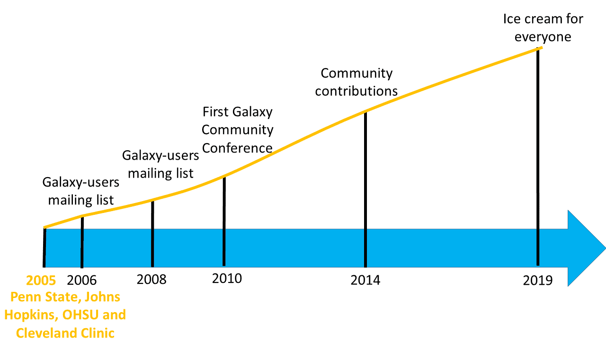{fig-alt="Galaxy timeline" fig-align="center"}

::: notes
- The number of public Galaxy resources should be regularly updated.
:::

## Find a Galaxy server

- **UseGalaxy.\***: Galaxy Main ([usegalaxy.org](https://usegalaxy.org)), Galaxy Europe ([usegalaxy.eu](https://usegalaxy.eu)), Galaxy Australia ([usegalaxy.org.au](https://usegalaxy.org.au)), Galaxy France ([usegalaxy.fr](https://usegalaxy.fr))

  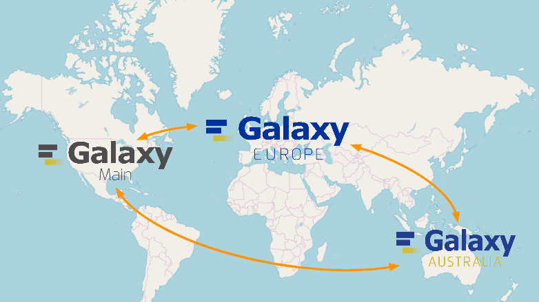{fig-alt="usegalaxy.* servers" width="50%"}

- Many other smaller, often domain-specific Galaxies available
  - List of all public Galaxies (135+): [galaxyproject.org/use](https://galaxyproject.org/use/)

::: notes
- There are three main Galaxy servers: Galaxy Main, Galaxy Europe, and Galaxy Australia.
- These three Galaxies have the biggest teams behind them, and offer the most tools and resources.
- You can register an account for free on any of these servers.
- In addition, there are many smaller Galaxy servers to choose from.
- Many of these are domain-specific. For example, Galaxy Proteomics focuses on proteomics tools and workflows.
- A lot of universities and other institutions have local private servers.
:::

## Galaxy ecosystem

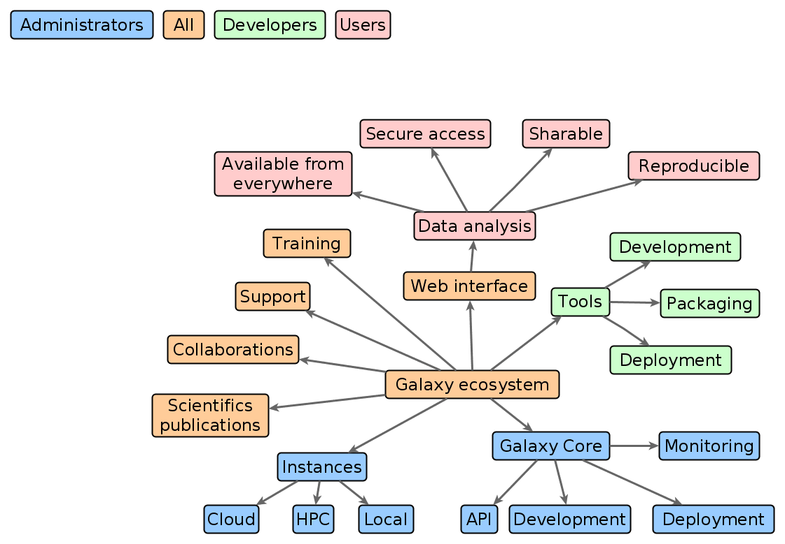{fig-alt="Galaxy ecosystem" fig-align="center"}

# User Interface

::: notes
So now that we know what Galaxy and the Galaxy Project are all about, let's look at the Galaxy interface.
:::

## Main Galaxy interface

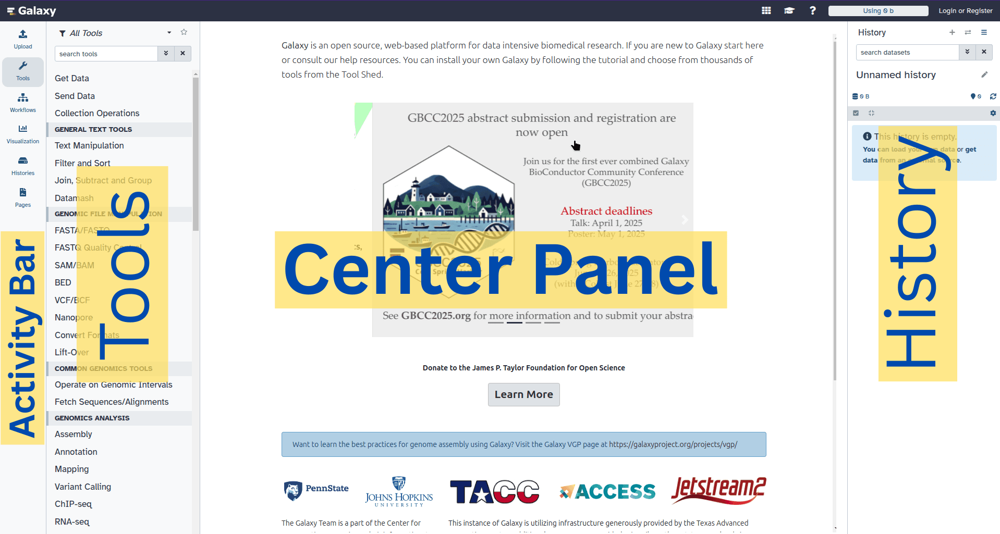{fig-alt="Galaxy user interface" fig-align="center" height="520"}

Home page divided into 4 panels

## Activity Bar

:::: {.columns}
::: {.column width="25%"}
{fig-alt="Activity Bar"}
:::
::: {.column width="75%" .smaller}
| Link                | Usage |
|---------------------|-------|
| *Upload*            | various ways to get data into Galaxy |
| *Tools*             | opens tool bar |
| *Workflows*         | access existing workflows or create new one using the editable diagrammatic pipeline |
| *Interactive Tools* | launch and manage interactive tools |
| *Visualize*         | create new visualisations |
| *Histories*         | view and manage histories |
| *History Multiview* | search and copy datasets among multiple histories at a time |
| *Datasets*          | view all datasets |
| *Pages*             | links to Galaxy pages |
| *Libraries*         | access your private and public data libraries |
| *Notifications*     | notifications on server updates and user data sharing |
:::
::::

## Tools

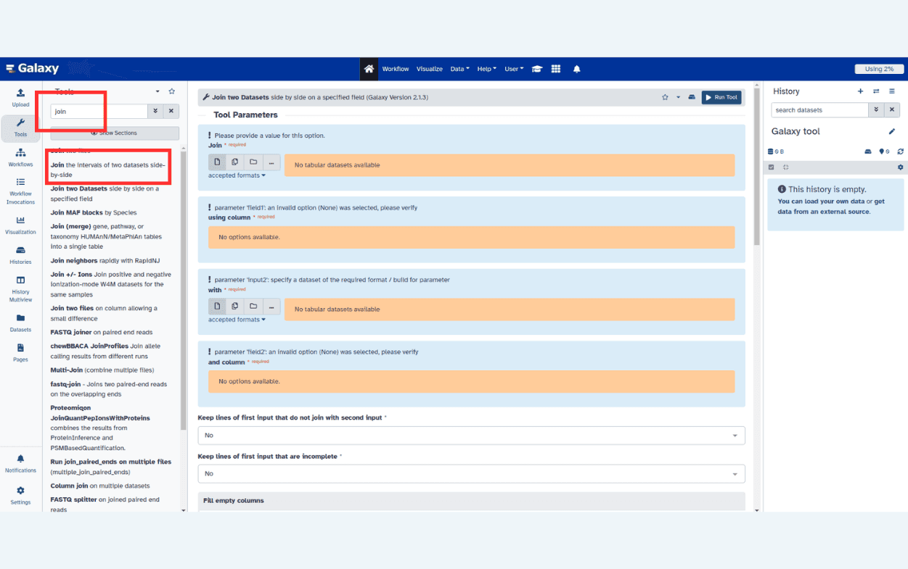{fig-alt="Tool interface" fig-align="center"}

- The tool search helps in finding a tool in a crowded toolbox

## Tool interface

:::: {.columns}
::: {.column width="50%"}
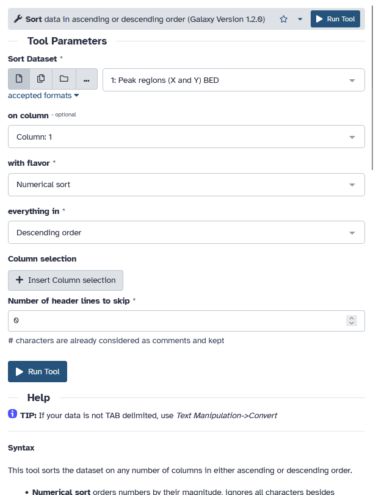{fig-alt="Screenshot of the tool interface for the Sort tool showing some inputs and a Run Tool button."}
:::
::: {.column width="50%"}
- A tool form contains:
  - input datasets and parameters
  - help, citations, metadata
  - a `Run Tool` button to start a job, which will add some output datasets to the history
- New tool versions can be installed without removing old ones to ensure reproducibility
:::
::::

::: notes
The tool form is generated from a simple XML file describing:

- the input datasets and their datatypes
- the tool parameters (numerical, text, boolean, selections, colour)
- the dependencies required to run the tool
- how to generate a command to run the tool with the specified inputs and parameters
- the output datasets the tool should produce and their datatypes
- tests
- help, citations
- various metadata (e.g. the tool version)

Tools can be viewed as tiny LEGO pieces: each one solves a specific problem, and they can be combined together to build complex analysis pipelines.
:::

## Tool Shed

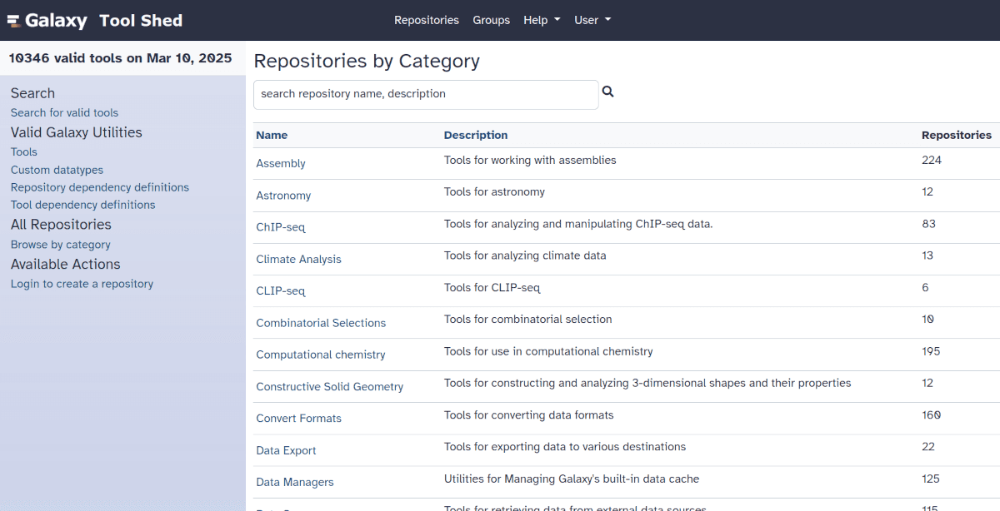{fig-alt="Screenshot of the toolshed homepage" width="50%"}

- Free "app" store: [Galaxy Tool Shed](https://toolshed.g2.bx.psu.edu/)
  - Thousands of tools already available
  - Most software can be integrated
    - If a tool is not available, ask the Galaxy community for help!
  - Only a Galaxy admin can install tools

## History

:::: {.columns}
::: {.column width="75%"}
- Location of all analyses
  - collects all datasets produced by tools
  - collects all operations performed on the data
- For each dataset (the heart of Galaxy's reproducibility), the history tracks
  - name, format, size, creation time, datatype-specific metadata
  - tool id, version, inputs, parameters
  - standard output (`stdout`) and error (`stderr`)
  - state ([waiting]{style="background-color: grey"}, [running]{style="background-color: yellow"}, [success]{style="background-color: green"}, [failed]{style="background-color: red"})
  - hidden, deleted, purged
:::
::: {.column width="25%"}
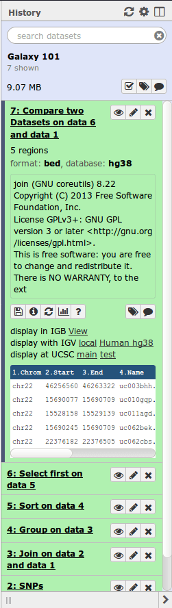{fig-alt="History"}
:::
::::

::: notes
- We say *datasets* to refer to files as well as databases
- Purged means permanently deleted
:::

## Multiple histories

- You can have as many histories as you want
  - each history should correspond to a **different analysis**
  - and should have a meaningful **name**

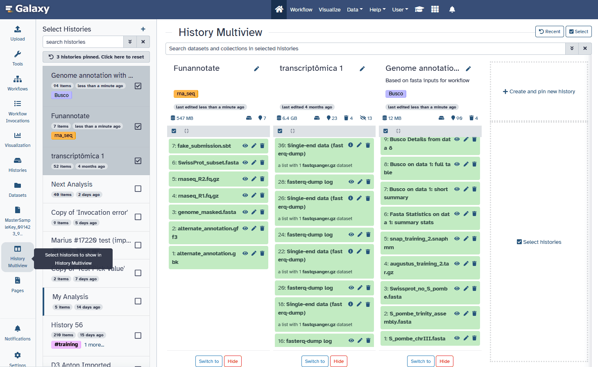{fig-alt="Screenshot of galaxy showing multiple histories next to each other in the multi-history view" fig-align="center" width="75%"}

::: notes
- Give it a good name so you can find it later, which can otherwise become difficult when you have a large number of old histories.
- You can drag and drop datasets between histories
:::

## History options menu

:::: {.columns}
::: {.column width="50%"}
History behavior is controlled by the *History options* (gear icon)

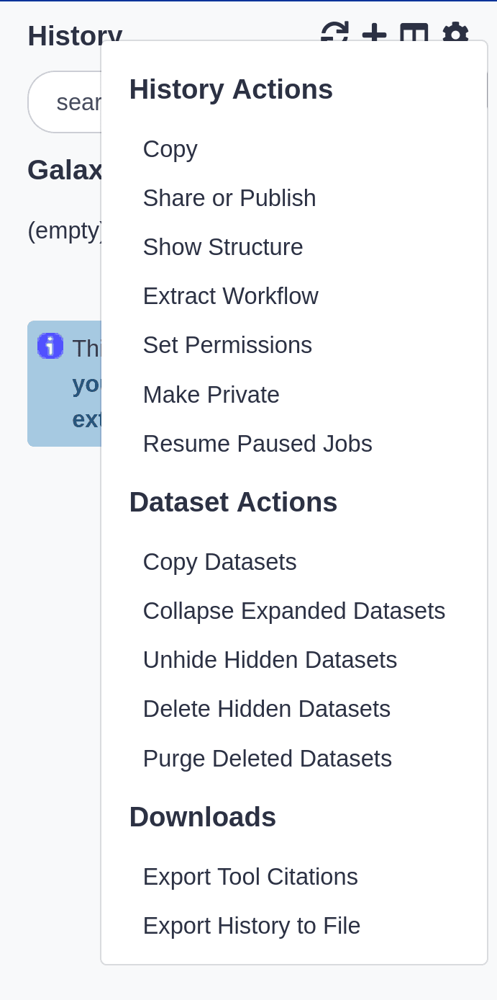{fig-alt="History menu"}
:::
::: {.column width="50%"}
{fig-alt="History options gear button" width="75%"}

- *Create new history* (+ icon) will **not** make your current history disappear
- To see all of your histories, use the history switcher

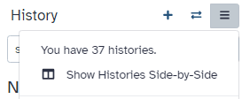{fig-alt="History Switcher" width="75%"}

- *Copy Datasets* from one history to another and save disk space for your quota
:::
::::

::: notes
- Copying datasets between histories does not affect your quota, only a single copy of the file is stored on disk because datasets are never modified after creation.
:::

# Loading data

::: notes
So now you know about the tools to manipulate data and the history where you can see your data, your inputs and outputs. Let's discuss how to get data into Galaxy.
:::

## Importing data

- Copy/paste some text
- Upload files from your local computer
- Upload data from an internet URL
- Upload data from online databases: UCSC, BioMart, ENCODE, modENCODE, Flymine etc.
- Import from Shared Data (libraries, histories, pages)
- Upload data from FTP

See [Getting data into Galaxy](https://training.galaxyproject.org/training-material/topics/galaxy-interface/tutorials/get-data/slides.html)

## Datatypes

- Tools only accept input datasets with the appropriate datatypes
- When uploading a dataset, its datatype can be either:
  - automatically detected
  - assigned by the user
- Datasets produced by a tool have their datatype assigned by the tool
- To change the datatype of a dataset, either:
  - pencil icon *Edit attributes* and *Datatypes* (if original wrong), or
  - pencil icon *Edit attributes* and *Convert*

::: notes
- When you upload data, Galaxy will try to autodetect the format of the data, but can sometimes get it wrong, so you may need to correct it later.
- Edit Attributes → Datatype is used to fix a wrongly assigned datatype
- Edit Attributes → Convert Formats creates a new dataset using a tool that converts the original dataset in the new format
- New datatypes can be added to the Galaxy code base, if missing
:::

## Reference datasets

#### Example: reference Genome

:::: {.columns}
::: {.column width="50%"}
- Genome build specifies which genome assembly a dataset is associated with
  - e.g. mm10, hg38...
- Can be assigned by a tool or by the user
- Users can create custom genome builds
- New builds can be added by the admin
:::
::: {.column width="50%"}
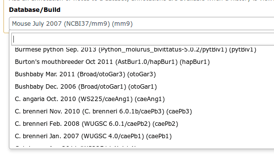{fig-alt="Genome Builds"}
:::
::::

::: notes
- Just like datatypes, you can specify which genome assembly your dataset is about. Some tools need to know this, and Galaxy can tell the tool for you.
:::

# Workflows

::: notes
Now that you've got data into Galaxy, you know you can use tools to manipulate this data, and histories to keep track of what you've done. You're only missing one key part: workflows. These help you easily reproduce the exact analysis that you ran.
:::

## Workflow Editor

- Run **end-to-end analyses** with one click

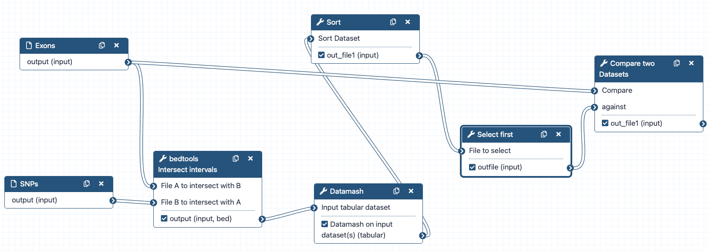{fig-alt="Workflow interface" fig-align="center"}

- **Extracted** from a history
- **Built manually** by adding and configuring tools using the canvas
- **Imported** using an existing shared workflow

::: notes
Biologist:

- workflows are great
- single button to run all of these 50 different tools
- a lot of work once to figure out analysis, but easy in the future to just rerun, go get coffee and wait for thing to be done :)

Bioinf / dev:

- Boxes are workflow steps
  - 2 types: *input* and *tool* steps
- Steps are connected by arrows representing the flow of datasets
- Tool panel on the left with Inputs on top (to add input datasets and collections)
- Small tool form on the right
- Extracting a workflow from a history allows to easily convert an existing history into an analysis workflow
:::

## Why would you want to create workflows?

- **Re-run** the same analysis on different input data sets
- **Change parameters** before re-running a similar analysis
- Make use of the workflow job **scheduling**
  - jobs are submitted as soon as their inputs are ready
- Create **sub**-workflows: a workflow inside another workflow
- **Share** workflows for publication and with the community

::: notes
Potential information overload for newbies
:::

## Visualizations

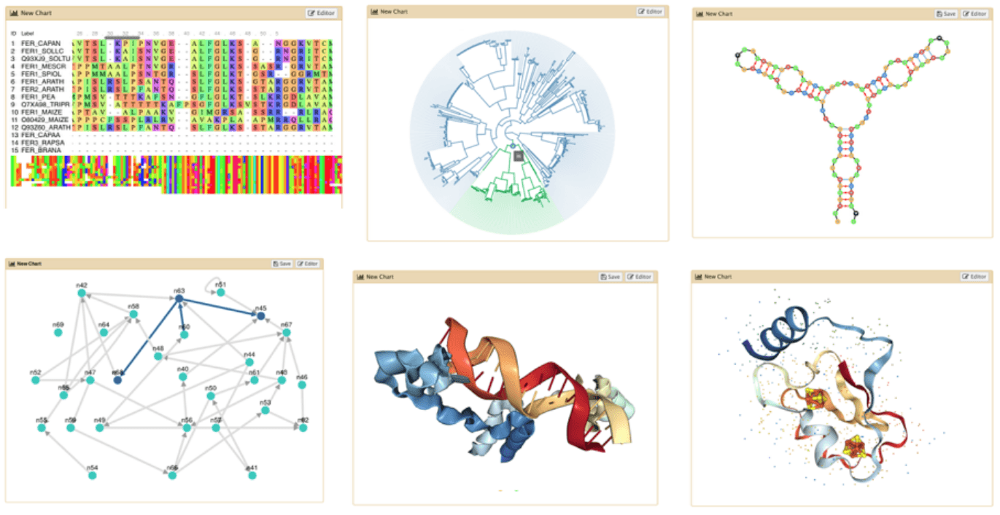{fig-alt="Examples of 6 different visualisations in galaxy features an MSA, a couple graphs, RNA structure, and 3d visualisations of proteins" fig-align="center" width="60%"}

- Datatypes know what tools can be used to visualize datasets:
  - Sequencing data has a button for visualizing in IGV
  - Tabular data will prompt you to build charts
  - Protein data can be seen in a 3D viewer
- Interactive environments: Jupyter, RStudio, etc

## Sharing data

- Share everything you do in Galaxy - histories, workflows, and visualizations
  - Directly using a Galaxy account's email addresses on the same instance
  - Using a web link, with anyone who knows the link
  - Using a web link and publishing it to make it accessible to everyone from the *Shared Data* menu

See [Sharing your History in Galaxy](https://training.galaxyproject.org/training-material/faqs/galaxy/histories_sharing.html)

## Community

- Support forum: [Galaxy Help](https://help.galaxyproject.org/)

  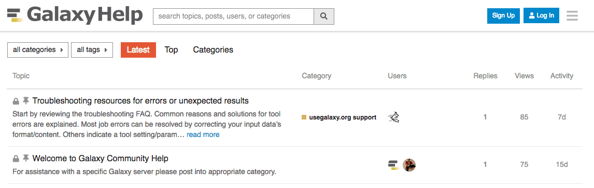{fig-alt="Galaxy Help" height="150"}
- Community curated documentation: [Galaxy Community Hub](https://galaxyproject.org/)
- [Events](https://galaxyproject.org/events/) all around the world
- Galaxy Training for scientists, developers, admins, instructors: [Galaxy Training Network](https://training.galaxyproject.org/)
  - Training questions? Chat with us on [Gitter](https://gitter.im/Galaxy-Training-Network/Lobby)

::: notes
- know was a lot
- we'll come back
- slides are always available online
- first real analysis after the coffee?
:::

## Credits {.smaller}

These slides are adapted from the [Galaxy Training Network](https://training.galaxyproject.org/) material
[*Introduction to Galaxy*](https://training.galaxyproject.org/training-material/topics/introduction/tutorials/introduction/slides.html)
and [*A Short Introduction to Galaxy*](https://training.galaxyproject.org/training-material/topics/introduction/tutorials/galaxy-intro-short/slides.html).

**Original contributors (GitHub):** bagnacan, bebatut, shiltemann, pajanne, nsoranzo, hexylena, chrisbarnettster, michelemaroni, annefou, nagoue, olanag1, tnabtaf, ahmedhamidawan

Licensed under [CC-BY 4.0](https://creativecommons.org/licenses/by/4.0/). Changes were made to the original.
