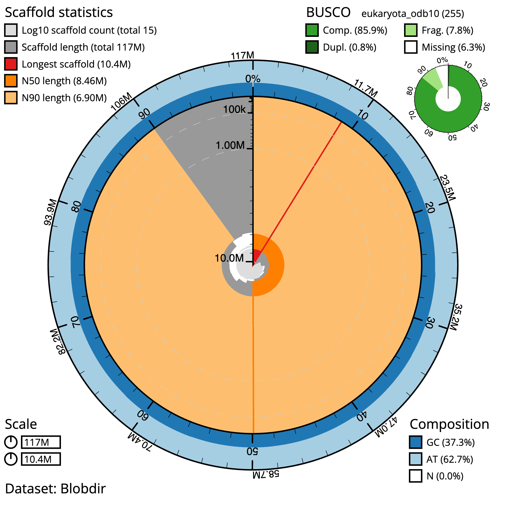

# Quality Check of a Genome Assembly Before Annotation

::: {.callout-note}
**Time:** 30 min

**Objectives:** Be able to check a reference assembly.

**Tools:** Minimap2, DIAMOND, [BUSCO](https://busco.ezlab.org), BlobToolKit, [QUAST](https://quast.sourceforge.net/)

Based on [Galaxy Training!](https://training.galaxyproject.org/training-material/topics/assembly/tutorials/ERGA-post-assembly-QC/tutorial.html#generate-interactive-plots-with-blobtoolkit)
:::


## Genome assembly overview with BlobToolKit

BlobToolKit is a tool designed to assist researchers in analyzing and visualizing genome assembly data. The tool uses information from multiple data sources such as read coverage, sequence length, and taxonomic annotations to generate a comprehensive overview of genome assembly data (Challis et al. 2020). One of the key characteristics of BlobToolKit is its ability to provide with a user-friendly interactive interface for analyzing complex genome assembly data.

In this tutorial, we will use BlobToolKit in order to integrate the following data:

* Read coverage data: BlobToolKit can use read coverage information to identify potential errors or gaps in the genome assembly. By comparing the depth of coverage across the genome, it can highlight regions that may be overrepresented or underrepresented, which can indicate potential issues with the assembly.
* Taxonomic annotations: BlobToolKit can use taxonomic information to identify potential contaminants or foreign DNA in the genome assembly. It does this by comparing the taxonomic profile of the genome assembly to a reference database of known organisms.
* Sequence similarity data: Sequence similarity data can be used to identify potential misassemblies or contaminants in the genome assembly. BlobToolKit can use BLAST/DIAMOND searches to compare the genome assembly to reference databases and identify regions that may be problematic.
* BUSCO reports: BlobToolKit can use BUSCO data to provide additional information about the quality of a genome assembly. It can generate plots of the number of complete and partial BUSCO genes in the genome assembly, as well as the number of missing and fragmented genes.

In the next steps, we will generate the data required for generating the visualization plots with BlobToolKit.

### Generate read coverage data with Minimap2

Read coverage is an essential metric for evaluating the quality of genome assemblies, and it provides valuable information for identifying regions of high and low quality, detecting misassemblies, and identifying potential contaminants. Thus, for example, unexpected regions of low coverage suggests potential errors, such as misassemblies, gaps, or low complexity regions (Koren et al. 2017).

In this tutorial we will use Minimap2 for generation the coverage data. Minimap2 is a multi-purpose aligner which is particularly efficient at aligning long-reads produced by sequencing machines from PacBio or Oxford Nanopore (Li 2018).

::: {.callout-comment } 
How is coverage information encoded in the BAM file?
Coverage information is encoded in the BAM file format through the number of reads that align to each position in the reference genome. Specifically, the BAM file stores each read’s start and end position in the genome, as well as the length and orientation of the read, among other information. To calculate coverage, the number of reads that overlap each position in the reference genome is counted.
:::


### Generate sequence similarity data with DIAMOND

DIAMOND is a sequence alignment tool that utilizes a more efficient algorithm compared to BLAST, allowing for much faster searches of large sequence databases. Specifically, DIAMOND uses a sensitive seed-extension approach that compares a set of small segments (seeds) from the query sequence to a database, and then extends the alignments based on the highest-scoring hits. This approach allows DIAMOND to perform up to 20,000 times faster than BLAST, with comparable or improved sensitivity and accuracy (Buchfink et al. 2014).

::: {.callout-comment}
Orthologs are genes in different species which have usually the same function and have evolved from a common ancestral gene. They are important for new genome assemblies in order to predict gene functions and help with gene annotation (Gennarelli and Cattaneo 2010).
:::

### Generate BUSCO report

BUSCO (Benchmarking Universal Single-Copy Orthologs) is a tool used for quantitative assessment of genome assembly, gene set, and transcriptome completeness. It is based on evolutionarily informed expectations of gene content derived from near-universal single-copy orthologs (Simão et al. 2015)

### Generate interactive plots with BlobToolKit

BlobToolKit is a tool designed to assist researchers in analyzing and visualizing genome assembly data. The tool uses information from multiple data sources such as read coverage, gene expression, and taxonomic annotations to generate a comprehensive overview of genome assembly data (Challis et al. 2020). One of the key characteristics of BlobToolKit is its ability to provide with a user-friendly interactive interface for analyzing complex genome assembly data.

To work with BlobToolKit we need to create a new dataset structure called BlobDir. Therefore the minimum requirement is a fasta file which contains the sequence of our assembly. A list of sequence identifiers and some statistics like length, GC proportion and undefined bases will then be generated.

To get a more meaningful analysis and therefore more useful information about our assembly, it is better to provide as much data as we can get. In our case we will also provide a metadata file if possible, NCBI taxonomy ID and the NCBI taxdump directory (Challis et al. 2020).


Now, we will evaluate three of plots that we can find in the Blobtoolkit interactve interface. First, we will start with the snailplot, which provides a holistic view of the assembly.

{style="width:50%"}

## QUAST

QUAST is a pipeline that combines assembly statistics and completeness checks (via BUSCO).  
It provides the following statistics:

::: {.callout-note}
* *Contigs*: The total number of contigs in the assembly.
* *Largest contig*: The length of the largest contig in the assembly.
* *Total length*: The total number of bases in the assembly.
* *Nx*: The largest contig length, L, such that contigs of length >= L account for at least x% of the bases of the assembly.
* *NGx*: The contig length such that using equal or longer length contigs produces x% of the length of the reference genome, rather than x% of the assembly length.
* *GC content*: the percentage of nitrogenous bases which are either guanine or cytosine.
:::

If a reference genome is provided, the report also indicates:

::: {.callout-note}
* *Genome fraction* (%): total number of aligned bases in the reference genome, divided by the genome size
* *Duplication ratio*: total number of aligned bases in the assembly, divided by the total number of aligned bases in the reference genome
* *NGA50*: NG50 where the lengths of aligned blocks are counted instead of contig lengths. i.e., if a contig has a misassembly with respect to the reference, the contig is broken into smaller pieces. This metric is computed only if a reference genome is provided. LGA50: LG50 where aligned blocks are counted instead of contigs. i.e., if a contig has a misassembly with respect to the reference, the contig is broken into smaller pieces
:::

```bash
    quast assembly_clean.fa
    quast assembly_clean.fa -r reference.fa
```


## References

* Buchfink, B., C. Xie, and D. H. Huson, 2014 Fast and sensitive protein alignment using DIAMOND. Nature Methods 12: 59–60. 10.1038/nmeth.3176
* Challis, R., E. Richards, J. Rajan, G. Cochrane, and M. Blaxter, 2020 BlobToolKit – Interactive Quality Assessment of Genome Assemblies. G3 Genes\vertGenomes\vertGenetics 10: 1361–1374. 10.1534/g3.119.400908
* Koren, S., B. P. Walenz, K. Berlin, J. R. Miller, N. H. Bergman et al., 2017 Canu: scalable and accurate long-read assembly via adaptive \lessi\greaterk\less/i\greater-mer weighting and repeat separation. Genome Research 27: 722–736. 10.1101/gr.215087.116
* Li, H., 2018 Minimap2: pairwise alignment for nucleotide sequences (I. Birol, Ed.). Bioinformatics 34: 3094–3100. 10.1093/bioinformatics/bty191
* Simão, F. A., R. M. Waterhouse, P. Ioannidis, E. V. Kriventseva, and E. M. Zdobnov, 2015 BUSCO: assessing genome assembly and annotation completeness with single-copy orthologs. Bioinformatics 31: 3210–3212. 10.1093/bioinformatics/btv351