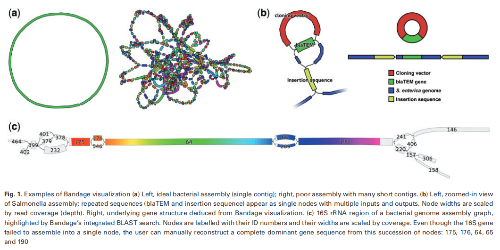

::: {.callout-note title="Lesson overview"}
**Questions**

- What does an assembly graph look like?
- How do the short-read, long-read and hybrid assemblies differ in their structure?

**Objectives**

- Visualise the assembly graphs of the 3 assemblies with **Bandage**.
- Recognise complete circular sequences, repeats and fragmented regions in a graph.
- Compare the 3 assembly strategies visually.
:::

# Assembly Viewer using Bandage

While QUAST provides numerical summaries, it is also useful to **visually explore your assembly graph** to understand the assembly structure.

**Bandage** ([Wick et al. 2015](https://doi.org/10.1093/bioinformatics/btv383)) is a graphical tool designed to visualize assembly graphs generated by assemblers. We can use it to compare the 3 assemblies that we have.

**Why visualize assembly graphs?**

- Assembly graphs reveal complex genome structures such as repeats, branches, and unresolved regions that are not obvious from summary statistics.
- Visual inspection helps identify potential assembly issues such as:

  - **Fragmented assemblies** with many disconnected components.
  - **Repeats and ambiguities** that cause branching in the graph.
  - **Circular elements** like plasmids or phage genomes.
- Understanding graph topology guides troubleshooting and can inform improvements in assembly strategy.

Bandage allows you to:

- Load your assembly graph file (`.gfa`) and interactively explore contigs and connections.
- Extract sequences from specific graph nodes or paths.
- Annotate nodes to identify features or confirm circularity.

## What Does a Good Bandage Graph Look Like?

- **Mostly linear graph:** One or few long, continuous paths representing the chromosome(s).
- **Few branches or bubbles:** Minimal complexity indicating low repeat content or successful repeat resolution.
- **Circular structures (if expected):** Closed loops may represent plasmids or circular chromosomes.
- **No excessive disconnected components:** Indicates little fragmentation or contamination.

### Example interpretations:

| Graph Feature               | Meaning                                          |
|-----------------------------|-------------------------------------------------|
| Long linear contigs          | High-quality, contiguous assembly                |
| Small bubbles or forks       | Possible repeats or heterogeneity to resolve    |
| Multiple disconnected graphs | Possible contamination or unassembled fragments  |
| Circular loops              | Plasmids or circular DNA elements identified     |

First read [this page in the Bandage wiki](https://github.com/rrwick/Bandage/wiki/Simple-example) to help understand what the graph means, and look at these examples of Bandage graphs:

# Create a new history

::: {.callout-tip title="Create a new history"}
1. Go to the **History** panel (right side).
2. Click **✏️ → Create new history**.
3. Rename it to **Assembly visualisation**.
4. Click **Save**.
:::

# Import the 3 assembly graphs

Bandage does not use the FASTA files of the contigs, but the **assembly graphs** (GFA format), which also contain the connections between the contigs.

::: {.callout-tip title="Import the assembly graphs"}
1. Open the **History Multiview** (left panel).
2. Drag the following datasets into the **Assembly visualisation** history:
    - from **Short Read Genome Assembly**: **SPAdes on data X and data X: Assembly graph with scaffolds**
    - from **Long Read Genome Assembly**: **Flye on data X: graphical fragment assembly**
    - from **Hybrid Genome Assembly**: **Unicycler on data X: Final Assembly Graph**
3. Rename them **Short read graph**, **Long read graph** and **Hybrid graph**.
:::

# Bandage in Galaxy

::: {.callout-tip title="Run Bandage"}
1. In **Tools**, search for **Bandage Image, visualize de novo assembly graphs**.
2. In *"Graphical Fragment Assembly"*, select the 3 datasets **Short read graph**, **Long read graph** and **Hybrid graph** (hold *Ctrl* / *Cmd* to select several datasets). Galaxy runs Bandage once for each graph.
3. Keep the default parameters, and click **Run Tool**.
4. Rename the 3 output images **Bandage short read**, **Bandage long read** and **Bandage hybrid**.
:::

::: {.callout-tip title="Compare the images side by side"}
Click on the 👁️ (eye) icon of each image. To see them side by side, enable the **Window Manager** (the grid icon in the top menu bar of Galaxy) before clicking on the eye icons: each image opens in its own window.
:::

::: {.callout-note title="Bandage Info"}
The **Bandage Info** tool, run on the same graphs, gives the statistics of each graph: number of nodes, number of edges, total length, number of dead ends… It is a good complement to the images.
:::

# Compare the 3 assemblies

Remember what we expect: the genome of strain 368 published by the authors is made of **1 circular chromosome** (4.89 Mb) and **6 circular plasmids** (150, 110, 35, 7.9, 3.6 and 2.1 kb).

:::: {.callout-important title="Exercise: Compare the Bandage graphs" collapse="true"}
1. Describe the graph of the **short read** assembly. How many pieces do you see? Are they connected?
2. Describe the graph of the **long read** assembly. Can you recognise the chromosome? The plasmids? Are they circular?
3. Describe the graph of the **hybrid** assembly. How does it compare with the 2 others?
4. Can you find the 7 elements of the published genome in each graph? Which ones are missing?
5. Which assembly would you choose for downstream analyses (MLST, antimicrobial resistance genes, plasmid analysis)? Why?

::: {.callout-tip title="Answer" collapse="true"}
<!-- TODO: add the Bandage images and observations from your own run -->
1. The short read graph is a tangle of many short nodes, connected by many branches. The branching points are **repeats** (insertion sequences, rRNA operons…) longer than the reads: SPAdes cannot know which path to follow through them, so the genome is split into many contigs. We cannot tell which contigs belong to the chromosome and which ones to plasmids.
2. The long read graph should show a few large nodes: the chromosome as one large **circular loop**, and the large plasmids as smaller loops. The long reads span the repeats, so Flye could resolve them. Small plasmids may be missing (see the long read assembly tutorial).
3. The hybrid graph should be the cleanest: one circular loop per element (chromosome and plasmids). Unicycler uses the long reads to resolve the repeats of the short read graph, and the accurate short reads to get a correct sequence. Small plasmids, well covered by short reads, are usually recovered.
4. Compare the number and lengths of the loops with the published genome (use **Bandage Info** or the QUAST report for the lengths).
5. The **hybrid** assembly: it is complete (circular chromosome and plasmids) and accurate. Knowing whether an antimicrobial resistance gene is on the chromosome or on a plasmid, as in the study, requires complete, separated plasmid sequences, which the short read assembly cannot provide.
:::
::::

Visualizing the assembly graph with Bandage helps confirm that your assembly structure matches biological expectations and guides troubleshooting if unusual features are seen.

::: {.callout-tip title="Key Points"}
- Bandage displays the assembly graph: the contigs and the connections between them.
- Branching points in the graph are repeats that the assembler could not resolve.
- A complete bacterial genome appears as one circular loop per replicon (chromosome and plasmids).
- Short read graphs are fragmented by repeats; long read and hybrid graphs resolve them into circular chromosomes and plasmids.
:::
