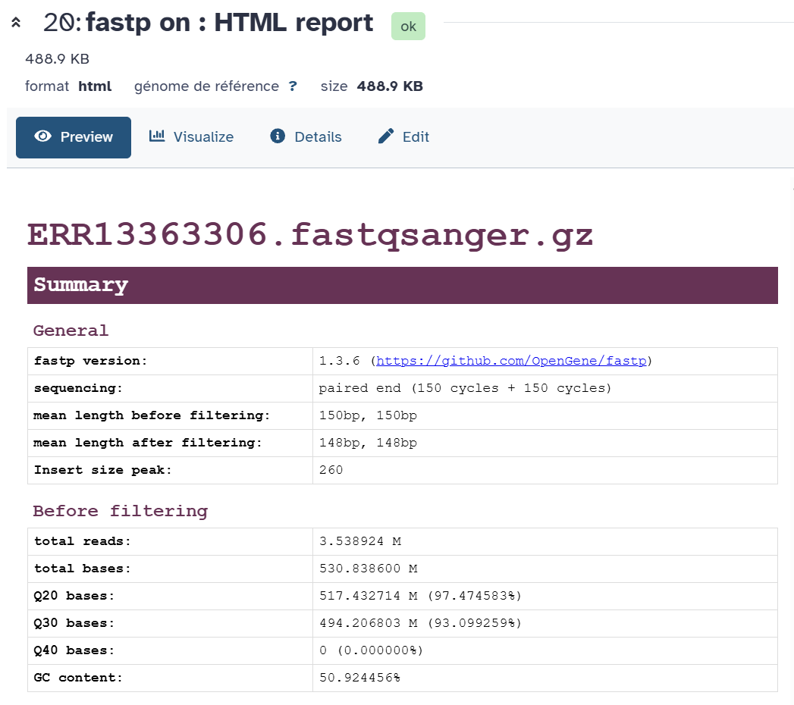
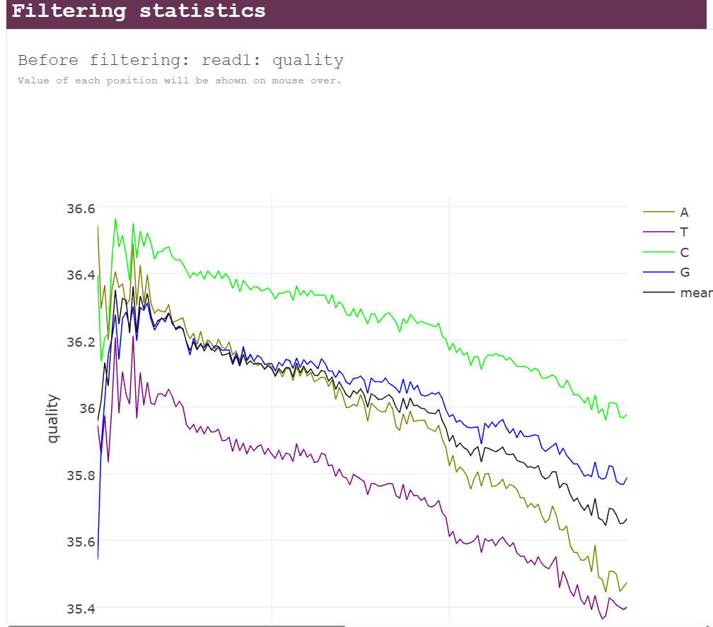
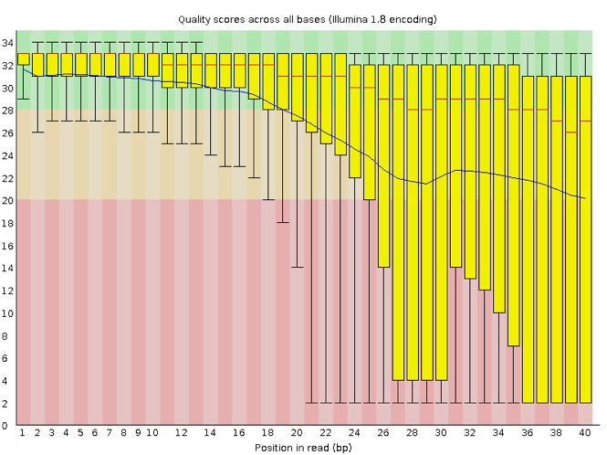

::: {.callout-note title="Lesson overview"}
**Questions**

- How can I describe the quality of my data?
- How can we get rid of sequence data that does not meet our quality standards?

**Objectives**

- Interpret a per-base quality plot summarizing quality across all reads.
- Assess and clean FASTQ reads in a single step using fastp.
- Compare the quality of the reads before and after filtering.
:::

# Why check and clean the reads?

During sequencing, errors are introduced, such as incorrect nucleotides being called. These are due to the technical limitations of each sequencing platform. Sequencing errors might bias the analysis and can lead to a misinterpretation of the data. Adapters may also be present if the reads are longer than the fragments sequenced, and trimming these may improve the number of reads mapped or assembled. Sequence quality control is therefore an essential first step in any analysis.

Before doing any assembly, the first questions we should ask about the input reads include:

- What is the coverage of my genome?
- How good are my reads?
- Do I need to ask/perform for a new sequencing run?
- Is it suitable for the analysis I need to do?

Paired-end sequencing generates 2 FASTQ files:

- One file with the sequences corresponding to **forward orientation of all the fragments**
- One file with the sequences corresponding to **reverse orientation of all the fragments**

Usually we recognize these two files which belong to one sample by the name which has the same identifier for the reads but a different extension, e.g. JC1A_R1.fastq for the forward reads and JC1A_R2.fastq for the reverse reads. It can also be _f or _1 for the forward reads and _r or _2 for the reverse reads.

Illumina sequencing data can contain:

| Problem | What it is | Why it’s bad |
|----------|-------------|--------------|
| **Adapters** | Short artificial sequences added during library preparation | Can look like real DNA and confuse aligners or assemblers |
| **Low-quality bases** | The ends of reads often have unreliable base calls (low Phred scores) | Introduces errors |
| **Very short reads** | After trimming, some reads are too short to be useful | Adds noise |

# fastp: quality control and trimming in one tool

To assess and clean our reads, we will use [fastp](https://github.com/OpenGene/fastp) ([Chen et al. 2018](https://doi.org/10.1093/bioinformatics/bty560)).
Think of it like a “car wash” for raw sequencing reads 🚿: it removes everything dirty or low-quality that could confuse later steps, before any downstream analysis (assembly, mapping, classification, etc.).

**fastp checks the quality and cleans the reads in a single run**:

1. It computes quality statistics on the **raw** reads
2. It trims and filters the reads
3. It computes the same statistics on the **cleaned** reads
4. It writes a report (HTML and JSON) showing the quality **before and after filtering**, side by side

fastp is also very fast, and automatically detects adapters in paired-end data.

## The cleaning steps

We will follow a classic stepwise cleaning process:

1. Remove adapters
2. Remove bad-quality bases at the start of the reads
3. Remove bad-quality sections at the end of the reads, with a sliding window
4. Throw away reads that are now too short

### 1. Remove adapters

For paired-end data, fastp **detects adapters automatically** by looking at the overlap between the forward and reverse reads: when a DNA fragment is shorter than the reads, both reads run into the adapter at the same position.

You can also give the adapter sequence explicitly. Choosing the correct adapter depends on how your Illumina library was prepared. In our case, the [referenced paper](https://doi.org/10.1016/j.jgar.2025.09.003) does not specify the library preparation kit, so we will rely on the **automatic detection**.

### 2. Remove bad-quality bases at the start

fastp slides a window from the **front** (5') of the read and removes the bases as long as the mean quality in the window is below a threshold. We will use a **window of 4 bases** and a **mean quality of 20** (`cut_front`).

### 3. Remove bad-quality sections with a sliding window

fastp slides a window of 4 bases from the front to the **right** (5' → 3') of the read. As soon as the mean quality of the window drops below 20, it cuts the read from that position onward (`cut_right`), meaning it removes everything to the right, not just that small window.

Example:
If the window at positions 32–36 drops below a quality of 20:

- fastp does not remove only those 4 bases.
- It removes everything from base 32 to the end of the read.
- The read becomes shorter — no blank space is left in the middle.

::: {.callout-note title="Summary of the fastp options we will use"}
| fastp option | Value | Meaning |
|---|---|---|
| Adapter trimming | automatic detection (paired-end) | Remove adapters |
| `cut_front` | window 4, mean quality 20 | Cut low-quality bases at the start of the read |
| `cut_right` | window 4, mean quality 20 | Cut the read once the mean quality of the window drops below 20 |
| `length_required` | 100 | Drop reads shorter than 100 bp |
:::

### 4. Throw away reads that are now too short

Finally, we will drop the reads shorter than a certain length.
We will use a **minimum read length of 100 bp**, considering that shorter reads may result in fragmented assemblies.

In addition, by default fastp discards reads with too many low-quality bases (more than 40% of bases with a quality below 15) or with too many undetermined bases (`N`).

# Running fastp on Galaxy

We are going to run fastp on our short reads, the collection **Short Read** (run ERR13363306).

We work in the history **Quality Control and Trimming**, created at the end of the [Introduction to Galaxy](intro_galaxy.md). It should contain the 2 collections **Short Read** and **Long Read**. If not, copy them from the "Galaxy Tutorial" history with the **History Multiview**.

::: {.callout-important title="Exercise: Run fastp" collapse="true"}
Type **fastp** in the tools panel search box, and click on **fastp: fast all-in-one preprocessing for FASTQ files**.

**Input**

- *"Single-end or paired reads"*: `Paired Collection`
- *"Select paired collection(s)"*: `Short Read`

**STEP 1: Adapters**

In **Adapter Trimming Options**, keep adapter trimming enabled. fastp will detect the adapters automatically.

**STEP 2 and 3: Quality cutting**

In **Read Modification Options** → **Per read cutting by quality options**:

- *"Cut by quality in front (5')"*: `Yes`
- *"Cut by quality in right"*: `Yes`
- *"Cutting window size"*: `4`
- *"Cutting mean quality"*: `20`

**STEP 4: Minimum length**

In **Filter Options** → **Length filtering options**:

- *"Length required"*: `100`

Keep the default values for the other filtering options (quality filtering: qualified quality 15, unqualified percent limit 40).

**Reports**

In **Output Options**, make sure the **HTML report** is produced, and tick **JSON report**: we will need it later to aggregate the reports with MultiQC.

**Run the tool**

Once you have selected all the parameters, click on **Run Tool**.
:::

## Output

The tool takes a few minutes to run. It creates:

- **fastp on collection X: Paired-end output**: a paired collection with the cleaned forward and reverse reads. Rename it **Trimmed short reads**.
- **fastp on collection X: HTML report**: the quality report, before and after filtering. Rename it **fastp HTML short read**.
- **fastp on collection X: JSON report**: needed to add the report in MultiQC.

::: {.callout-note title="What happens to reads whose mate was removed?"}
fastp keeps the pairing of the reads: if one read of a pair is discarded (too short, too low quality), its mate is discarded too, so the forward and reverse files still correspond read by read.
fastp can also save these orphan reads in separate *unpaired* outputs, but we will not need them.
:::

# Results

Click on the 👁️ (eye) icon of the **HTML report** to open it.

## Summary

The **Summary** section gives general information (fastp version, sequencing type, read length, detected duplication rate, insert size) and the main statistics **before filtering** and **after filtering**: total reads, total bases, Q20 and Q30 rates (percentage of bases with a quality ≥ 20 or ≥ 30) and GC content.

:::: {.callout-important title="Exercise: Compute the coverage" collapse="true"}
Another important metric is the **coverage**: how many times, on average, each base of the genome is covered by reads.
This helps you understand if you have enough data to assemble confidently.

1. Using the **Before filtering** section, compute the coverage of the raw reads.
2. Using the **After filtering** section, compute the coverage of the cleaned reads.

Discuss your results with a neighbor.

::: {.callout-tip title="Solution" collapse="true"}
Coverage = total bases / genome size.
The *total bases* given by fastp already include both the forward and reverse reads.
Based on [the paper](https://doi.org/10.1016/j.jgar.2025.09.003) and the genome deposited by the authors ([GCA_964200035](https://www.ebi.ac.uk/ena/browser/view/GCA_964200035)), the genome of strain 368 is made of a chromosome of ~4.89 Mb and 6 plasmids (~0.31 Mb in total), so approximately **5.2 Mb**.

1. Before filtering: ~531 Mb / 5.2 Mb ≈ **102x**.
2. After filtering: divide the *total bases* after filtering by 5.2 Mb.
<!-- TODO: add the total bases after filtering and the coverage from your own run -->

A coverage above ~30–40x is good for a bacterial genome assembly.
:::
::::

## Filtering result

The **Filtering result** section shows how many reads passed the filters, and why the other ones were removed:

- **reads passed filters**
- **reads with low quality**: too many bases below the quality threshold
- **reads with too many N**
- **reads too short**: shorter than 100 bp after trimming

:::: {.callout-important title="Exercise: What did fastp do?" collapse="true"}
1. Should the output FASTQ files be smaller or bigger than the input files?
2. What percentage of reads passed the filters?
3. What is the main reason why reads were removed?
4. Were adapters found? (see the **Adapters** section)

::: {.callout-tip title="Answer" collapse="true"}
1. Smaller: we have trimmed bases and removed reads.
2. and 3. Look at the **Filtering result** section.
4. Look at the **Adapters** section: it shows the adapter sequences detected and how many reads were trimmed.
<!-- TODO: add the percentages from your own run -->
:::
::::

## Quality before and after filtering

The **Before filtering** and **After filtering** sections contain, for read 1 and read 2:

- **quality**: the mean quality at each position of the reads
- **base contents**: the proportion of A, T, C, G (and N) at each position. We expect the lines to be roughly flat; deviations at the beginning of the reads are common
- **KMER counting** and **overrepresented sequences** (if enabled): sequences that occur more often than expected, which may reveal adapters or contaminations

:::: {.callout-important title="Exercise: Discuss the quality of the reads" collapse="true"}
Look at the **quality** plots of read 1 and read 2, before and after filtering.

Discuss your results with a neighbor.

1. What is a common trend among the 2 reads before filtering?
2. How did the filtering change the quality profiles?

::: {.callout-tip title="Solution" collapse="true"}
1. The quality decreases toward the end of the reads. For Illumina data it is normal that the first few bases are of some lower quality and the longer the reads get the worse the quality becomes. This is often due to signal decay or phasing during the sequencing run. The reverse reads (read 2) are usually of lower quality than the forward reads.
2. After filtering, the low-quality ends have been removed: the mean quality stays high along the reads, and the reads now have different lengths.
:::
::::

::: {.callout-note title="Quality Encoding"}
fastp automatically detects the quality encoding of the reads (phred33 for all recent Illumina data). If you work with very old data (phred64), you need to tell it explicitly.
:::

# Conclusion

We have just successfully assessed the quality of our reads and cleaned them with fastp, in a single step!
From now on, we will only keep the cleaned paired collection **fastp on collection X: Paired-end output**.
Rename it **Trimmed Short Reads**.

::: {.callout-tip title="Key Points"}
- It is important to know the quality of our data to make decisions in the subsequent steps.
- fastp checks the quality of the reads **and** removes adapters, low-quality bases and short reads in a single run.
- The fastp report shows the quality before and after filtering, which lets us check that the cleaning worked.
- The coverage (total bases / genome size) tells us if we have enough data for the assembly.
:::

# Read Quality and trimming of long reads 

Now we are going to have a look at the long reads of the same sample: the collection **Long Reads** (run **ERR13363634**), downloaded in the [Introduction to Galaxy](intro_galaxy.md) and copied in this history. It contains a single dataset: Nanopore reads are not paired.

::: {.callout-note title="Our long reads"}
According to the [ENA](https://www.ebi.ac.uk/ena/browser/view/ERR13363634), ERR13363634 was sequenced on an Oxford Nanopore **MinION** and contains **133,532 reads** for a total of **912.6 Mb**, i.e. a mean read length of ~6.8 kb.
:::

## Why are long reads cleaned differently?

Nanopore reads are very different from Illumina reads:

| | Illumina (ERR13363306) | Nanopore (ERR13363634) |
|---|---|---|
| Read length | Fixed (150 bp) | Variable, from a few hundred bp to > 50 kb |
| Error rate | ~0.1% (Q30) | A few % (~Q10–Q20, depending on the chemistry and basecalling) |
| Main errors | Substitutions, at the end of the reads | Insertions and deletions, especially in homopolymers (e.g. `AAAAAA`) |

Because of this, the cleaning of long reads focuses on removing **whole reads** that are too short or of too low quality, rather than cutting the end of every read. For an assembly, what matters is to keep the **long** and **accurate** reads.

## fastplong: fastp for long reads

[fastplong](https://github.com/OpenGene/fastplong) is the long-read version of fastp, from the same developers. It works in the same way: in a single run, it computes quality statistics on the raw reads, cleans the reads, computes the same statistics on the cleaned reads, and writes an HTML and a JSON report **before and after filtering**.

What it can do on long reads:

1. **Remove adapters** at the start and at the end of the reads, detected automatically
2. **Split chimeric reads**: reads containing an adapter in their middle are made of two DNA fragments ligated together; fastplong splits them into separate reads
3. **Filter reads by quality**: remove reads with a low mean quality
4. **Filter reads by length**: remove reads that are too short

### Which values should we use?

Several things must be taken into account:

- **Coverage**: our raw reads cover the genome (~5.2 Mb) about **175x**. Flye needs ~30–50x, so we can afford to lose some reads.
- **Length**: very short reads do not help the assembly, as they do not span repeats. But they must not be removed too aggressively: the genome of strain 368 contains **small plasmids of 2.1, 3.6 and 7.9 kb**. Their reads are short, as a read cannot be longer than the circular plasmid it comes from. A high minimum length would remove them, and the plasmids would be lost from the assembly. We will remove reads shorter than **1000 bp**.
- **Quality**: removing the worst reads improves the accuracy of the assembly. We will remove reads with a mean quality below **Q10** (10% of errors): with a median quality around Q14, a higher threshold would remove too many reads.

::: {.callout-note title="Summary of the fastplong options we will use"}
| fastplong option | Value | Meaning |
|---|---|---|
| Adapter trimming | automatic detection (default) | Remove adapters at the start and end of the reads |
| Chimeric reads | split (default) | Split reads with an internal adapter into separate reads |
| `mean_qual` | 10 | Drop reads with a mean quality below Q10 |
| `length_required` | 1000 | Drop reads shorter than 1000 bp |
:::

## Running fastplong on Galaxy

::: {.callout-important title="Exercise: Run fastplong" collapse="true"}
Type **fastplong** in the tools panel search box, and click on the **fastplong** tool.

**Input**

- *"Input Long Reads"*: the **Long Read** collection

**STEP 1 and 2: Adapters and chimeric reads**

In **Adapter Trimming Options**, keep adapter trimming enabled and the default *"Chimeric read handling"* (`Split chimeric reads into segments`). fastplong will detect the adapters automatically.

**STEP 3: Quality filtering**

In **Filter Options** → **Quality filtering options**:

- *"Mean read quality"*: `10`

**STEP 4: Minimum length**

In **Filter Options** → **Length filtering options**:

- *"Length required"*: `1000`

**Reports**

In the output options, make sure the **HTML report** is produced, and tick **JSON report**: we will need it later to aggregate the reports with MultiQC.

**Run the tool**

Once you have selected all the parameters, click on **Run Tool**.
:::

The tool creates:

- **fastplong on data X: Reads**: the cleaned long reads
- **fastplong on data X: HTML report**: the quality report, before and after filtering
- **fastplong on data X: JSON report**: needed to add the report in MultiQC

Rename the cleaned reads **Trimmed Long Read**.

## Results

Click on the 👁️ (eye) icon of the **HTML report** to open it. Its structure is the same as the fastp report.

:::: {.callout-important title="Exercise: What did fastplong do?" collapse="true"}
1. In the **Summary** section, what are the mean read length and the mean quality before filtering?
2. In the **Filtering result** section, what percentage of reads passed the filters? What is the main reason why reads were removed?
3. How did the mean read length and the mean quality change after filtering?
4. What is the coverage of the trimmed long reads?
5. Which graphs are present in fastplong, that are not present in fastp ? 

::: {.callout-tip title="Answer" collapse="true"}
<!-- TODO: add the numbers from your own run -->
1. The mean read length is ~6.8 kb (912.6 Mb / 133,532 reads). The mean quality is much lower than for the Illumina reads, which is normal for Nanopore data.
2. Look at the **Filtering result** section: reads are removed because of a low quality or because they are too short.
3. The mean length and the mean quality increased: the short and low-quality reads were removed.
4. Coverage = total bases / genome size: divide the *total bases* after filtering by 5.2 Mb. It should stay well above 50x.
5. fastplong has graphs that describe each **read as a whole**, which fastp does not have:
    - **Read length distribution**: the percentage of reads and of bases for each read length
    - **Cumulative yield by minimum read length**: how many reads and bases you keep if you only keep reads longer than a given length
    - **Read mean quality distribution** and **Read median quality distribution**: one quality value per read, instead of one per position
    - **Density plot of read median quality and read length**: are the long reads also good reads?
    - **Read GC content distribution**: the GC content of each read

    **Why are they important for long reads, and not for short reads?**

    - **Read length varies a lot.** Illumina reads all have the same length (e.g. 150 bp), so a length graph would be a single bar. Nanopore reads range from a few hundred bases to tens of kilobases, and the length of the reads is what makes them useful: long reads span repeats and connect the contigs of the assembly. The length distribution, the N50 and the cumulative yield tell you how much useful long-read data you have, and help you choose the minimum length filter (here 1000 bp) without losing too many bases.
    - **Quality is a property of each read, not of each position.** With Illumina, quality decreases along the read (the per-position graph shows it), so we trim the ends. With Nanopore, errors are spread along the read, and some reads are bad from start to end. That is why we filter whole reads on their mean quality (here Q10), and the per-read quality graphs show what this filter removes.
    - **Long and good reads are not always the same reads.** The density plot shows if the longest reads are also of good quality, to choose the length and quality filters together.
    - **Read GC content** helps to spot reads from a contaminant with a different GC content, which appear as a second peak.

    On the other hand, fastp has graphs that make sense only for short reads: **duplication rate** and **insert size** (estimated from the overlap of the two reads of a pair).
:::
::::

# Quality Control Comparison

Open the HTML report from **fastp** (short reads), and the HTML report from **fastplong** (long reads).
Look at the average size. Look at the average quality. Discuss the pros and cons of each HTS technology.

## Common problems to check

The two technologies do not make the same kind of errors, so we do not look for the same problems in their QC reports.

**Illumina (short reads)**: few errors, mostly **substitutions** (one base read as another), concentrated at the end of the reads.

| Problem | Why it happens | Where to see it | What to do |
|---------|----------------|-----------------|------------|
| Quality drops at the end of the reads | The sequencing chemistry gets less accurate at each cycle | Quality curve along the read position | Trim the low-quality ends |
| Adapters in the reads | The DNA fragment is shorter than the read, so the sequencer reads into the adapter | **Adapters** section, insert size | Trim the adapters |
| Uneven base composition in the first ~10 bases | Bias of the library preparation (fragmentation, random primers) | Base content curve along the read position | Usually harmless; trim if it is strong |
| Poly-G tails | On 2-colour sequencers (NextSeq, NovaSeq), "no signal" is read as a G with a high quality | Base content curve: G increases at the end of the reads | Poly-G trimming (fastp does it automatically for these sequencers) |
| High duplication rate | Too many PCR cycles, or too little starting DNA | **Duplication** section | Interpret the coverage with caution |
| Ambiguous bases (`N`) | The sequencer could not call the base | N content curve | Filter reads with too many N |

**Nanopore (long reads)**: many more errors, mostly **insertions and deletions** (indels), often in **homopolymers** (e.g. `AAAAAAA`, where the number of A is hard to count), spread along the whole read.

| Problem | Why it happens | Where to see it | What to do |
|---------|----------------|-----------------|------------|
| Low-quality reads | Some reads are bad from start to end (pore problems, damaged DNA) | Read mean quality distribution | Filter on mean read quality (e.g. Q10) |
| Short reads | DNA fragmented during extraction or library preparation | Read length distribution, N50 | Filter on read length; improve the DNA extraction next time |
| Adapters and barcodes | Adapters are ligated to both ends of the DNA | **Adapters** section | Trim the adapters |
| Chimeric reads | Two DNA fragments ligated together and read as one | Adapters found in the **middle** of the reads | Split the reads at the internal adapters |
| Homopolymer errors | The signal does not change along a run of the same base | Not visible in the QC report | Polish the assembly (e.g. with medaka, or with Illumina reads) |

For both technologies, also check for **contamination** (reads from another organism): a second peak in the GC content distribution is a hint, and the [contamination check](contamination.md) confirms it.

# (Optional), Use another tool: FastQC

The most important plot of the FastQC quality report shows the quality score at each position of the reads. The image below shows a very high-quality sample:

The x-axis displays the base position in the read, and the y-axis shows quality scores. In this
example, the sample contains reads that are 40 bp long. This length is much shorter than the reads we
are working on within our workflow. For each position, there is a box-and-whisker plot showing
the distribution of quality scores for all reads at that position. The horizontal red line
indicates the median quality score, and the yellow box shows the 1st to
3rd quartile range. This range means that 50% of reads have a quality score that falls within the
range of the yellow box at that position. The whiskers show the whole range covering
the lowest (0th quartile) to highest (4th quartile) values.

The quality values for each position in this sample do not drop much lower than 32, which is a high-quality score. The plot background is also color-coded to identify good (green),
acceptable (yellow) and bad (red) quality scores.

Now let's look at a quality plot on the other end of the spectrum.

Here, we see positions within the read in which the boxes span a much more comprehensive range. Also, quality scores drop pretty low into the "bad" range, particularly on the tail end of the reads.

fastp shows the same information in a simpler way: one line per nucleotide (A, T, C, G) and one for the mean quality, at each position of the read.