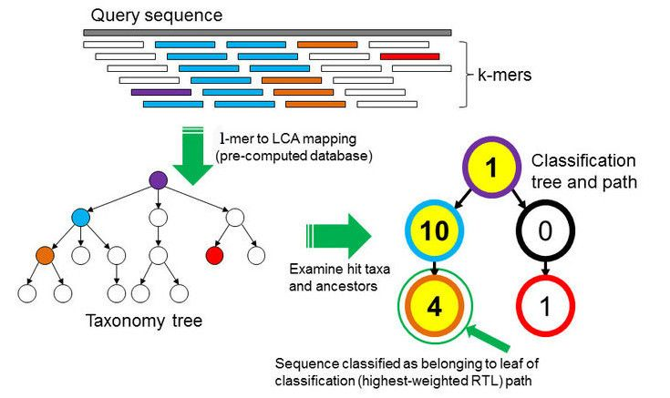

# Contamination or host screen

In this tutorial, we check that our reads come from *E. coli* only. We work in the history **Quality Control and Trimming**, which contains the trimmed reads **Trimmed Short Read** and **Trimmed Long Read**.

## SRA Taxonomy Analysis
ON the SRA sample webpage, the taxonomy analysis is automatically computed for every sample. 

:::: {.callout-important title="Exercice: Taxonomic composition of the sample" collapse="true"}
The taxonomy analysis is automatically computed for every sample submitted to the Sequence Read Archive.
ON the [SRA webpage from our sample](https://trace.ncbi.nlm.nih.gov/Traces/?view=run_browser&page_size=10&acc=ERR13363306&display=analysis), look at the taxonomy analysis.
Discuss with your neighbour about the composition.

::: {.callout-tip title="Answer" collapse="true"}
<!-- TODO: add the percentages shown by the SRA taxonomy analysis for ERR13363306 -->
Most reads should be assigned to *Escherichia coli*. A part of the reads is usually classified only to genus level (*Escherichia*), or to closely related genera such as *Shigella*, which is normal and likely reflects:

- Conserved genomic regions shared between *Escherichia* species and *Shigella* (genetically, *Shigella* are *E. coli*)
- Strain-specific sequences (e.g. plasmids, mobile elements) not well-represented in the reference database used for taxonomic classification
- Database limitations rather than actual contamination

Minor contaminants are acceptable: trace amounts of other bacteria are likely:

- Environmental flora from sample collection
- Cross-contamination during culture/handling (inevitable at trace levels)
- These tiny amounts won't affect genome assembly quality

You should  if filter if Contamination is >5-10% of total reads.
:::
::::

## How does it work ? 

To find out which microorganisms are present, we will compare the reads of the sample to a reference database, i.e. sequences of known microorganisms stored in a database, using [Kraken2](https://link.springer.com/article/10.1186/s13059-019-1891-0).

:::: {.callout-important title="Discussion: Taxonomic level of assignment" collapse="true"}
What do you think is harder to assign, a species (like _E. coli_) or a phylum (like Proteobacteria)?

::: {.callout-tip title="See a Discussion" collapse="true"}
Assigning a species is generally much harder than assigning a phylum. Here’s why:

**Sequence similarity**

At the phylum level, organisms are very different from each other. Even short reads often contain enough signal to confidently place them in a broad category like Proteobacteria.

At the species level, differences can be very small. For example, E. coli shares a huge portion of its genome with Shigella or other Escherichia species. Short reads might not capture unique sequences, making it difficult to distinguish between closely related species.

**Database coverage**

All taxonomic mapping  tools rely on reference databases. Some species are underrepresented or missing, while higher-level taxa are well-covered. This makes phylum assignments more robust.

**Genomic variability**

Within a species, there can be large genomic diversity (e.g., different E. coli strains). This intra-species variation can confuse classifiers and lead to ambiguous assignments.

**Conclusion**

Phyla are defined by broader evolutionary signals, so natural variability within them doesn’t affect classification as much.
In short: Assigning E. coli (species) is harder than assigning Proteobacteria (phylum) because species-level differences are subtler, databases may be incomplete, and intra-species variability can obscure signals.
:::
::::

# How does Kraken work: 

In the k-mer approach for taxonomy classification, we use a database containing DNA sequences of genomes whose taxonomy we already know. On a computer, the genome sequences are broken into short pieces of length k (called k-mers), usually 30bp.

Kraken examines the k-mers within the query sequence, searches for them in the database, looks for where these are placed within the taxonomy tree inside the database, makes the classification with the most probable position, then maps k-mers to the lowest common ancestor (LCA) of all genomes known to contain the given k-mer.

Kraken2 uses a compact hash table, a probabilistic data structure that allows for faster queries and lower memory requirements. It applies a spaced seed mask of s spaces to the minimizer and calculates a compact hash code, which is then used as a search query in its compact hash table; the lowest common ancestor (LCA) taxon associated with the compact hash code is then assigned to the k-mer.

You can find more information about the Kraken2 algorithm in the paper Improved metagenomic analysis with Kraken 2.

## Kraken Reference dataset : Standard

A Kraken dataset is essentially a collection of reference sequences (genomes or proteins) that the software uses to classify sequencing reads.
The process to build it involves:

1. Collecting reference sequences – For example, complete bacterial, viral, or human genomes from RefSeq. Optionally, plasmids, fungi, plants, and vector sequences can be included.

2. Breaking sequences into k-mers – Each reference sequence is split into short, fixed-length DNA fragments called k-mers (commonly 35 bp).

For this tutorial, we will use the prebuilt **Standard-Full** database, which contains archaea, bacteria, viral, plasmid, human and UniVec_Core sequences. It uses a k-mer size of **35**.

The table below lists the reference libraries that can be included in a Kraken2 database, and which ones are in Standard-Full. Other prebuilt databases add more libraries: for example, **PlusPF** adds protozoa and fungi.

| Database    | Origin | In Standard-Full |
|-------------|--------|:----------------:|
| Archaea     | RefSeq complete archaeal genomes/proteins | ✅ |
| Bacteria    | RefSeq complete bacterial genomes/proteins | ✅ |
| Plasmid     | RefSeq plasmid nucleotide/protein sequences | ✅ |
| Viral       | RefSeq complete viral genomes/proteins | ✅ |
| Human       | GRCh38 human genome/proteins | ✅ |
| UniVec_Core | A subset of UniVec, NCBI-supplied database of vector, adapter, linker, and primer sequences that may be contaminating sequencing projects and/or assemblies, chosen to minimize false positive hits to the vector database | ✅ |
| Fungi       | RefSeq complete fungal genomes/proteins | ❌ |
| Plant       | RefSeq complete plant genomes/proteins | ❌ |
| Protozoa    | RefSeq complete protozoan genomes/proteins | ❌ |

::: {.callout-note title="What Standard-Full cannot detect"}
A contamination by a fungus, a plant or a protozoan will not be identified with this database: most of its reads will appear as **unclassified**. A large fraction of unclassified reads can therefore also be a hint of contamination.
:::

::: {.callout-important title="Exercice: Run Kraken2 on Galaxy" collapse="true"}
1. Search the tool **Kraken2**.
2. Select paired reads, and the collection **Trimmed Short Read**.
3. In *Minimum Base Quality*, select **20**.
4. In *Select a Kraken2 Database*, select **Prebuilt Refseq indexes: Standard-Full (archaea, bacteria, viral, plasmid, human,UniVec_Core) (Version: 2022-06-07 - Downloaded: 2022-07-06T094102Z)**.
5. In *Create Report*, click **Yes** for *Print a report with aggregrate counts/clade to file*.
:::

The default confidence threshold of 0.0 will result in the most sensitive classification, while higher thresholds will increase precision at the cost of sensitivity, and we want to detect any contamination (even low-level).

## Run Kraken2 in Galaxy 

## Kraken2 Output Overview

Kraken2 generates **two output files per dataset** (e.g., one per sample):

- Classification table
- Report: 

Classification

Each line corresponds to one sequence and has **5 columns**:

| Column | Meaning |
|--------|---------|
| **C/U** | `C` = classified, `U` = unclassified |
| **Sequence ID** | Identifier from the input file |
| **Taxonomy ID** | NCBI taxonomy ID assigned to the sequence (`0` if unclassified) |
| **Length** | Length of the sequence in bp (`read1|read2` for paired reads) |
| **LCA Mapping** | A space-delimited list indicating the lowest common ancestor (LCA) mapping of each k-mer in the sequence |

For example for the **LCA Mapping**, the result `562:13 561:4 A:31 0:1 562:3` would indicate that:

  1. The **first 13 k-mers** mapped to taxonomy ID **562**  
  2. The **next 4 k-mers** mapped to taxonomy ID **561**  
  3. The **next 31 k-mers** contained **ambiguous nucleotides** (`A`)  
  4. The **next k-mer** was **not found** in the database (`0`)  
  5. The **last 3 k-mers** mapped to taxonomy ID **562**  

## Visualization of taxonomic assignment

Once we have assigned the corresponding taxa to each sequence, the next step is to properly visualize the data. There are several tools for that. In our case, we will use **Krona**. 

Krakentools (Lu et al. 2017) is a suite of tools to work on Kraken outputs. It include a tool designed to translate results of the Kraken metagenomic classifier to the full representation of NCBI taxonomy. The output of this tool can be directly visualized by the Krona tool

::: {.callout-important title="Exercice: Convert Kraken report file" collapse="true"}
1. In the Tool, type : **Krakentools: Convert kraken report file to krona text file**
2. Kraken report file, select **Kraken2 on collection X: Report**
3. Click, Run tools
:::

Let’s now run Krona !

::: {.callout-important title="Generate Krona visualisation" collapse="true"}
1. In the Tool, type **Krona pie chart from taxonomic profile**
2. *Input file*: output of Krakentools
3. Click *Run Tool*
:::

# Contamination screen of the long reads

The long reads come from the same DNA extraction of the same sample, but it is still worth checking them: a contamination can also be introduced during the Nanopore library preparation, or come from another sample sequenced on the same flow cell (barcode cross-talk).

Kraken2 works on reads of any length, as it only looks at the k-mers of each read. We can therefore use the same tool and the same database on the long reads **Trimmed Long Read**.

## What changes for long reads?

- **Single-end reads**: Nanopore reads are not paired.
- **Base quality**: for the short reads, we masked the bases with a quality below 20. Our Nanopore reads have a median quality around **Q14**: with the same threshold, most of their bases would be masked, and many reads would stay unclassified. We keep the default value (`0`).
- **Sequencing errors**: with ~4% of errors, many 35-mers of a long read contain an error and are not found in the database. But a read of several kb contains thousands of k-mers: enough of them are correct to classify the read.

::: {.callout-important title="Exercice: Run Kraken2 on the long reads" collapse="true"}
1. Search the tool **Kraken2**.
2. Select single-end reads, and the collection **Trimmed Long Read**.
3. Keep the default *Minimum Base Quality* (**0**).
4. In *Select a Kraken2 Database*, select the same database as for the short reads: **Prebuilt Refseq indexes: Standard-Full (archaea, bacteria, viral, plasmid, human,UniVec_Core) (Version: 2022-06-07 - Downloaded: 2022-07-06T094102Z)**.
5. In *Create Report*, click **Yes** for *Print a report with aggregrate counts/clade to file*.
6. Click *Run Tool*
:::

::: {.callout-important title="Exercice: Visualise the long read classification with Krona" collapse="true"}
1. Run **Krakentools: Convert kraken report file to krona text file** on the new Kraken2 report.
2. Run **Krona pie chart from taxonomic profile** on its output.
:::

:::: {.callout-important title="Exercice: Compare the short and long reads" collapse="true"}
Open the 2 Krona charts (short reads and long reads) side by side.

1. Which species is the most abundant in each dataset? What percentage of the reads is assigned to it?
2. Is the proportion of unclassified reads the same in both datasets? Why?
3. Do you see the same minor organisms in both datasets? Is there evidence of contamination?

::: {.callout-tip title="Answer" collapse="true"}
<!-- TODO: add the percentages from your own Kraken2 runs -->
1. *Escherichia coli* should be the most abundant species in both datasets, as expected for a pure culture of strain 368.
2. The proportions differ. The Nanopore reads contain more sequencing errors, so fewer of their k-mers match the database exactly, and some reads are classified at a higher level (e.g. genus *Escherichia*) or not at all. On the other hand, each long read contains many more k-mers than a short read, which gives more evidence for its classification.
3. Organisms found in both datasets at more than a few percent would point to a contamination of the sample itself. Organisms found only in one dataset at low levels are more likely due to the library preparation, to the sequencing run (e.g. barcode cross-talk with other samples), or to classification errors. As for the short reads, filtering is only needed if the contamination is above ~5–10% of the reads.
:::
::::