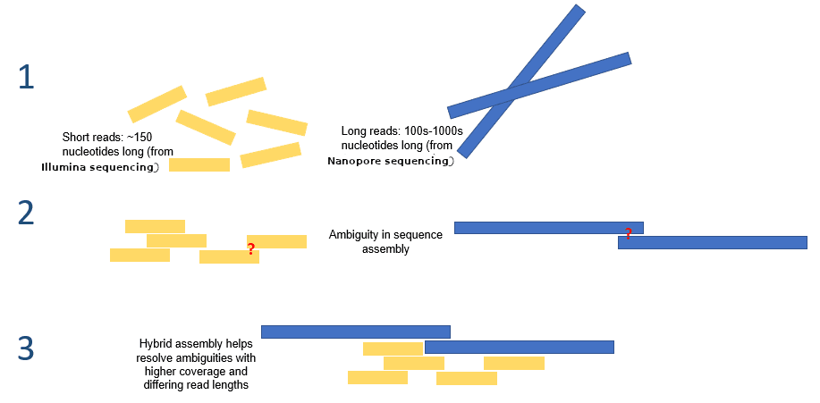
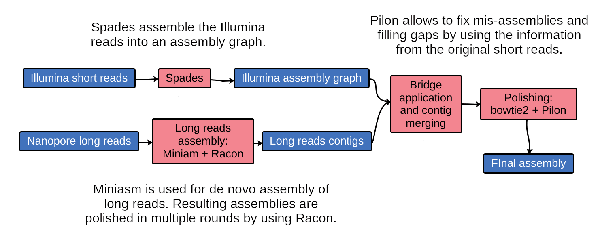

#  Acknowledgment
Some of the material, including schemes, comes from this [Unicycler Galaxy Training](https://training.galaxyproject.org/training-material/topics/assembly/tutorials/assembly-with-preprocessing/slides-plain.html)

# Hybrid Assembly

The best option, when you have long read and short reads for the same sample, is to use "hybrid sequencing".
Hybrid sequencing usually means combining two sequencing technologies on the same sample, most often short reads (Illumina: accurate, cheap, ~150 bp) with long reads (PacBio or Oxford Nanopore: 10 kb to 100+ kb, historically more error-prone). The goal is to get the strengths of both : Long reads are used to resolve ambiguities that exist in genomes previously assembled using the short reads. In addition, low rate-error short reads are used to correct errors that exist in the error-prone long reads.

We will use a tool named **Unicycler**. 

# How does Unicycler work ?

Put a shceme of Unicycler, and explain how the results is better than short read assembly, or long read assembly alone. 

# Unicycler in Galaxy

-- Use the filtered long read output from **Filtlong** 
-- Use the filtered short read output from **fastp**. 

Look at the parameters of Unicycler. What does they mean according to you ? Which parameters should we use ? 