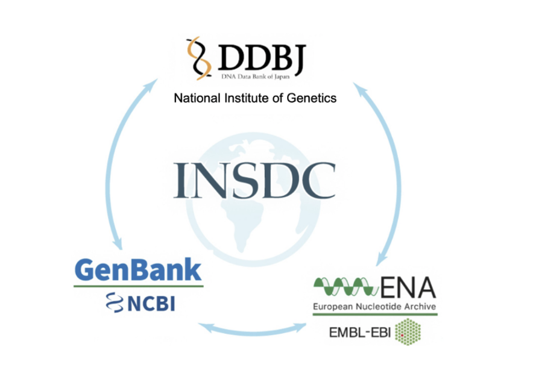
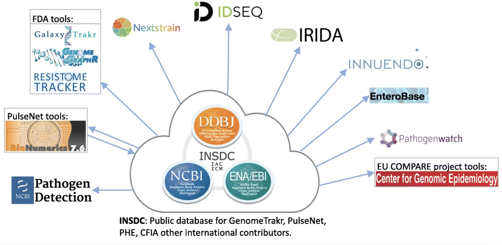

::: {.callout-note title="Lesson overview"}
**Questions**

- How to get started in Galaxy ?

**Objectives**

- Learn how to upload a file
- Learn how to use a tool
- Learn how to view results
- Learn how to view histories
- Learn how to extract and run a workflow
- Learn how to share a history
:::

# Overview

* This is a short introduction to the Galaxy user interface - the web page that you interact with.
* We will cover key tasks in Galaxy: uploading files, using tools, viewing histories, and running workflows.

## Create an account on a Galaxy instance/server

If you already have an account, skip to the next section!

In Galaxy, *server* and *instance* are often used interchangeably. These terms basically mean that different regions have different Galaxy servers/instances, with slightly different tool installations and appearances. If you don't have a specific server/instance in mind, we recommend registering at one of the main public servers/instances, detailed below.

## Galaxy Introduction Slide

put the pdf file on Galaxy Introduction. 
Explain what it the concept, that it is present that they are servers all around the world. 
Explain that bioinformatic is a world made out of tools for specific uses, and Galaxy allows you to use all these tools. 

<iframe src="../../lectures/galaxy/intro_galaxy_slides.html" width="1280" height="720" style="border: 1px solid #ccc;" allowfullscreen="true"></iframe>

[Open the slides in full screen](../../lectures/galaxy/intro_galaxy_slides.html){target="_blank"} — adapted from the [Galaxy Training Network](https://training.galaxyproject.org/training-material/topics/introduction/tutorials/introduction/slides.html) (CC-BY 4.0).

## What does Galaxy look like?

:::: {.callout-tip title="Log in to Galaxy"}
1. Open your favorite browser (Chrome, Safari, Edge or Firefox, not Internet Explorer!)
2. Browse to your Galaxy instance ([usegalaxy.org.au](https://usegalaxy.org.au/))
3. Log in or register


::: {.callout-note title="Different Galaxy servers"}
This is an image of Galaxy Australia, located at [usegalaxy.org.au](https://usegalaxy.org.au/)

You can also find more possible Galaxy servers depending on your region.
:::
::::

The Galaxy homepage is divided into four sections (panels):

* The Activity Bar on the left: _This is where you will navigate to the resources in Galaxy (Tools, Workflows, Histories etc.)_
* Currently active "Activity Panel" on the left: _By default, the  **Tools** activity will be active and its panel will be expanded_
* Viewing panel in the middle: _The main area for context for your analysis_
* History of analysis and files on the right: _Shows your "current" history; i.e.: Where any new files for your analysis will be stored_


The first time you use Galaxy, there will be no files in your history panel.

# Key Galaxy actions

## Name your current history

Your "History" is in the panel at the right. It is a record of the actions you have taken.

:::: {.callout-tip title="Name history"}
1. Go to the **History** panel (on the right)
2. Click ✏️ (**Edit**) next to the history name (which by default is "Unnamed history")

    

3. Type in a new name, for example, "Galaxy Tutorial"
4. Click **Save**

::: {.callout-note title="Renaming not an option?"}
If renaming does not work, it is possible you aren't logged in, so try logging in to Galaxy first. Anonymous users are only permitted to have one history, and they cannot rename it.
:::
::::


### Upload the files from SRA
 
In the **Data availability** part of [the E.Coli Paper](https://www.sciencedirect.com/science/article/pii/S2213716525002061?via%3Dihub), it is written:

"Data availability: All sequencing data and assembled genomes are deposited at the European Nucleotide Archive under study PRJEB77560. A table with all accession numbers is in Supplementary Data (S13)."

## What is European Nucleotide Archive ? 

. 
The International Nucleotide Sequence Database Collaboration (INSDC) archives nucleotide sequence data, from raw to assembled and annotated sequences, from around the world.
There are three primary members DDBJ (DNA Databank Japan), NLM-NCBI (National Library Medicine – National Center for Biotechnology Information) and ENA (European Nucleotide Archive), which are mirrored, thus sequences shared with one are shared with all.Each of the repositories, DDBJ, ENA and NLM-NCBI all hold the same data, however each one has a different interface and mechanisms for uploading and downloading.

| | **NCBI** | **ENA** | **DDBJ** |
|---|---|---|---|
| Full name | National Center for Biotechnology Information | European Nucleotide Archive | DNA Data Bank of Japan |
| Host institution | NLM / NIH | EMBL-EBI | National Institute of Genetics (NIG) |
| Region | USA | Europe (UK) | Japan |
| Assembled / annotated sequences | GenBank | ENA sequence records | DDBJ sequence records |
| Raw sequencing reads | SRA (Sequence Read Archive) | ENA read archive | DRA (DDBJ Sequence Read Archive) |
| Raw-read accession prefixes | SRR, SRX, SRS, SRP | ERR, ERX, ERS, ERP | DRR, DRX, DRS, DRP |
| BioProject prefix | PRJNA | PRJEB | PRJDB |
| BioSample prefix | SAMN | SAMEA | SAMD |
| Main submission portal | NCBI Submission Portal | Webin | D-way (DDBJ submission system) |
| Website | ncbi.nlm.nih.gov | ebi.ac.uk/ena | ddbj.nig.ac.jp |

This data is used in many tools:
. 

## The product of INSDC

Every object in the INSDC system, whether a project, a sample, an experiment, a run, or an assembled sequence, gets its own unique accession number, and that number is the key to retrieving it : 

| Level | What it describes | NCBI | ENA | DDBJ |
|---|---|---|---|---|
| **Project / Study** | The overall research effort | BioProject (`PRJNA`) | Study (`PRJEB`) | BioProject (`PRJDB`) |
| **Sample** | The biological material sequenced | BioSample (`SAMN`) | Sample (`SAMEA`) | BioSample (`SAMD`) |
| **Experiment** | Library prep and sequencing method | SRX | ERX | DRX |
| **Run** | A set of reads from one sequencing run | SRR | ERR | DRR |
| **Assembled sequences** | Genomes, genes, transcripts | GenBank | ENA records | DDBJ records |

The hierarchy is like this : 
Project / Study → Sample → Experiment → Run
                     ↘ Assembled sequences (GenBank / ENA / DDBJ)

 A project is retrieved through its BioProject accession (e.g., PRJNA…, PRJEB…, PRJDB…), a sample through its BioSample accession (e.g., SAMN…, SAMEA…, SAMD…), raw reads through run accessions (SRR/ERR/DRR), and assembled sequences through GenBank/ENA/DDBJ accessions (e.g., MN908947). Because the three databases synchronize daily, any of these accessions can be searched in NCBI, ENA, or DDBJ, regardless of where the data was first submitted. The accessions are also cross-linked: a BioProject page lists its associated BioSamples, runs, and sequences, and each sequence or run record points back to its BioProject and BioSample. This means you can start from any one accession and navigate to the rest of the related data, which makes records stable, citable in publications, and reproducible.

## The ENA project of our study.

Indeed, if you dug into the European Nucleotide Archive (ENA) website. You can find the project [PRJEB77560](https://www.ebi.ac.uk/ena/browser/view/PRJEB77560).

In total, You have 12 run accessions from 6 Sample accessions: for each of the 6 samples you have 2 runs, one for the long reads, and another one for the short reads ! 

Throughout the tutorial, we will work on **1 sample**: [SAMEA115834835](https://www.ebi.ac.uk/ena/browser/view/SAMEA115834835) (strain **368**), and its 2 runs:

| Run accession | Technology | Reads |
|---|---|---|
| *ERR13363306* | Illumina NovaSeq 6000 | Short reads, paired-end (2 × 150 bp) |
| *ERR13363634* | Oxford Nanopore MinION | Long reads, single-end |

We will download both runs now, and start by looking at the short reads.


### Galaxy Tool

There are tools that allows to upload directly sequences using the accession number !
To download several runs at once, we first give Galaxy the list of accessions in a text file.

::: {.callout-important title="Exercice: Create the list of accessions" collapse="true"}
1. Click on **Upload** (in the activity bar on the left)
2. Click on **Paste/Fetch data**
3. Copy and paste the 2 accession numbers, one per line:

    ```
    ERR13363306
    ERR13363634
    ```

4. Name the dataset **SRA accessions**
5. Click **Start**, then **Close**
:::

The dataset is automatically recognised as a `txt` file and should appear in your history.

::: {.callout-important title="Exercice: Upload the FASTQ from SRA to Galaxy" collapse="true"}
1. Type **fastq sra** in the tools panel search box (top)
2. Click the tool (**Faster Download and Extract Reads in FASTQ**
format from NCBI SRA)

    

    The tool will be displayed in the central Galaxy panel.

3. Select the following parameters:
    - *select input type*: List of SRA accession, one per line
    - *sra accession list*: **SRA accessions**
    - In **Advanced Options**, define format specification for sequence, type:

        ```
        @$ac.$sn/$ri length=$rl
        ```

    - No change in the other parameters
4. Click **Run Tool**
:::

The parameter `@$ac.$sn/$ri length=$rl` will produce headers like:

```
@ERR13363306.1/1 length=150
@ERR13363306.2/1 length=150
```

Where:

- `$ac` = accession (*ERR13363306*)
- `$sn` = spot number (read number)
- `$ri` = read index (1 for forward, 2 for reverse; always 1 for the single-end long reads)
- `$rl` = read length

This tool will run and 4 new output datasets will appear at the top of your history panel :

- Pair-end data (fasterq-dump)
- Single-end data (fasterq-dump)
- Other data (fasterq-dump)
- fasterq-dump log

### OUTPUT

Your uploaded file is now in your current history.
When the file has uploaded to Galaxy, it will turn green.

After this you will see your first history item (called a "dataset") in Galaxy's right panel. It will go through
the gray (preparing/queued) and yellow (running) states to become green (success).

### LOG FILE

First, we wil look at the **fasterq-dump log** file.

:::: {.callout-important title="Excercise: View log contents" collapse="true"}
1. Click the 👁️ (eye) icon next to the file **fasterq-dump log**, to look at the file content.
The contents of the file will be displayed in the central Galaxy panel.

The log contains one block of statistics for each of the 2 accessions.

- How many spots have been read for each run ?
- How many reads have been read for each run ?
- How can you explain the difference between the number of spots and reads ?
- Look at the metadata of the runs ([ERR13363306](https://trace.ncbi.nlm.nih.gov/Traces/?view=run_browser&page_size=10&acc=ERR13363306&display=metadata) and [ERR13363634](https://trace.ncbi.nlm.nih.gov/Traces/?view=run_browser&page_size=10&acc=ERR13363634&display=metadata)). Compare the number of spots to make sure we have retrieved all the data.

::: {.callout-tip title="Answer" collapse="true"}
| Run | spots read | reads read |
|---|---|---|
| ERR13363306 (short reads) | 1,769,462 | 3,538,924 |
| ERR13363634 (long reads) | 133,532 | 133,532 |

A **spot** is one sequenced DNA fragment. The short reads are paired: each fragment is read from both ends, so this run has two reads per spot, hence : **N reads = 2 × N spots**. The long reads are single-end: each fragment gives one read, so **N reads = N spots**.

- The numbers of spots in the metadata are the same as in the log file, Good News !
:::
::::

### Reads retrieved from NCBI

The reads were sorted in the output collections according to their type:

- **Pair-end data (fasterq-dump)** contains the short reads of **ERR13363306** (a forward and a reverse file)
- **Single-end data (fasterq-dump)** contains the long reads of **ERR13363634** (one file)
- **Other data (fasterq-dump)** should be empty. You can delete it by clicking on the 🗑️ (bin) icon.

::: {.callout-tip title="Rename the collections"}
1. Next to **Pair-end data (fasterq-dump)**, click the ✏️ (pencil) icon and rename it to **Short Read**. Click **Save**.
2. Next to **Single-end data (fasterq-dump)**, click the ✏️ (pencil) icon and rename it to **Long Read**. Click **Save**.
:::

Let's first look at the content of the short reads.

::: {.callout-tip title="View forward reads"}
1. Click on the **Short Read** collection, inside you have a pair (ERR13363306) with 2 datasets, click on it.
2. Click the 👁️ (eye) icon next forward, to look at the file content.
:::

The contents of the file will be displayed in the central Galaxy panel. If the dataset is large, you will see a warning message which explains that only the first megabyte is shown.

This file contains DNA sequencing reads from a bacteria, in FASTQ format:

{width="620px" fig-alt="preview of a fastq file showing the 4 line structure described in fig caption. 3 reads are shown."}

:::: {.callout-important title="Extract the fastq file" collapse="true"}
What is the name of the first read ? What is the length of the first read ?

::: {.callout-tip title="Answer" collapse="true"}
The name of the first read is **@ERR13363306.1/1**. The length is this read is **150**.
:::
::::

# Use a tool: FastQE

The quality symbol in **FASTQ Format** can be hard to interpret, that's why we are going to use our first tool to have a better understanding of the data: **FastQE**.
FastQE turns ASCII characters into emojis that are easy to interpret.

We will run it on the long reads, the **Long Read** collection (run ERR13363634). This collection is a simple list with one dataset, so FastQE can use it directly.

By default, FastQE only handles reads up to 500 bp, which is enough for Illumina reads, but not for Nanopore reads, which are several kb long. We need to increase the *Maximum read length*.

::: {.callout-important title="Exercice: Run FastQE tool" collapse="true"}
1. Type **FastQE** in the tools panel search box (top)
2. Click the tool (**FASTQE** visualize fastqfiles with emoji's)

    

    The tool will be displayed in the central Galaxy panel.

3. Select the following parameters:
    - *FastQ data*: Select the format *Dataset Collection*, and select **Long Read**
    - *Maximum read length*: `5000`
    - No change in the other parameters
4. Click **Run Tool**
:::

FastQE shows one emoji per position of the reads: with a maximum read length of 5000, we get the quality of the first 5000 positions. This is just an overview of the quality of the reads.

Let's look at the quality of the reads in this file.
This tool will run and one new output dataset will appear at the top of your history panel.

{width="620px"}

## View results

We will now look at the output dataset called *FastQE on data 1*.

::: {.callout-note title="Comment"}
* Note that Galaxy has given this dataset a name according to both the tool name ("FastQE") and the input ("data 1") that it used.
* The name "data 1" means the dataset number 1 in Galaxy's current history (our FASTQ file).
:::

::: {.callout-important title="View results" collapse="true"}
* Once it's green, click the 👁️ (eye) icon next to the "Webpage" output dataset.


The information is displayed in the central panel


:::

:::: {.callout-important title="Best and worst Quality" collapse="true"}
- What is the best and worst quality for the mean ?
- What is the best and worst quality for the min ?
- What is the best and worst quality for the max ?

Look on the [fastqe website](https://github.com/fastqe/fastqe/) or at the scale displayed below :


::: {.callout-tip title="Answer" collapse="true"}
<!-- TODO: add the emojis and scores from your own FastQE run on ERR13363634 -->
- For the max: the worst is … and the best is …
- For the min: the worst is … and the best is …
- For the mean: the worst is … and the best is …

Note: our long reads were sequenced on an **Oxford Nanopore MinION**. Their quality is lower than for Illumina reads: the median quality of the reads is around **Q14** (~4% of errors), while most Illumina bases are above Q30 (0.1% of errors). Unlike our Illumina reads (NovaSeq 6000), whose quality scores are **binned** into only 4 values, Nanopore quality scores can take any value, so you see many different emojis.
:::
::::

## Share your history

::: {.callout-tip title="Share your history"}
Imagine you had a problem in your analysis and want to ask for help.


In the main panel, click **Make History accessible**.
It creates an url, that you can share !
:::

## Create a new history

Now, let's create a new history for our next analysis, which will be the quality control and trimming of the reads.

::: {.callout-tip title="New history"}
1. Create a new history
2. Rename it "Quality Control and Trimming"
:::

This new history has no datasets yet.

## Copy the previous datasets in the new history

We want to do the quality control on the reads of our sample.
Because we already downloaded them, we are going to copy the 2 collections **Short Read** and **Long Read** from our first history "Galaxy Tutorial" to the history "Quality Control and Trimming".

::: {.callout-tip title="View histories in History Multiview"}
1. Open **History Multiview** in the activity bar

    

2. Or click **Show Histories side-by-side**
3. Copy the collections **Short Read** and **Long Read** into your new history by dragging them from "Galaxy Tutorial" to "Quality Control and Trimming"

    

4. Return to the main Galaxy window
:::

::: {.callout-note title="Comment"}
This is not the only way to view your histories in Galaxy:

1. You can also click on **Datasets**, click on the needed file, and click **Copy to current history**
:::

# Conclusion

Well done! You have completed the short introduction to Galaxy:

* Named a history
* Downloaded the short and long reads of our sample from the SRA
* Used a tool
* Viewed results
* Copied datasets to a new history

