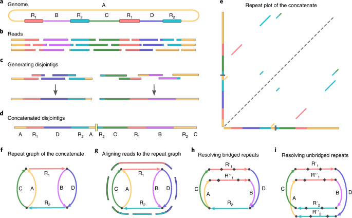

::: {.callout-note title="Lesson overview"}
**Questions**

- How do long-read assemblers reconstruct a genome?
- How do we choose the parameters of Flye for our data?
- Can a long-read assembly recover a complete bacterial chromosome and its plasmids?

**Objectives**

approach and how Flye works.
- Assemble the trimmed Nanopore reads of sample 368 with **Flye** in Galaxy.
- Interpret the Flye outputs: contigs, circularity, coverage and assembly graph.
- Compare the assembly with the genome published by the authors.
:::

# Introduction

Congratulations, we have now done the short read assembly.
We can now assemble the long reads of the same sample, using the tool named **Flye** ([Kolmogorov et al. 2019](https://doi.org/10.1038/s41587-019-0072-8)).

Short reads (150 bp) are very accurate, but they are shorter than many repeated regions of the genome (insertion sequences, rRNA operons, transposons…). The assembler cannot know how to connect the regions on each side of a repeat, and the assembly breaks into many contigs. Nanopore reads are much longer (several kb, sometimes more than 100 kb): a single read can span a whole repeat, which allows the assembler to resolve it. The price is a higher error rate, which the assembler must tolerate.

## How does Flye work?

The Flye assembly is based on finding overlapping reads of variable length with a high error tolerance. Flye then builds a **repeat graph**, in which every repeated region of the genome is collapsed into a single edge, and uses the long reads to find the correct path through the repeats.

Here is an analogy. The genome is a book that was shredded into strips, and the book repeats some paragraphs many times. The strips are the reads.

- **Step 1, draft chunks (disjointigs)**: you tape strips together into rough pages. Some are taped wrongly, but no text is lost.
- **Step 2, road map (repeat graph)**: you notice the repeated paragraphs and merge them into one shared stretch of road. The book becomes a map of roads and junctions.
- **Step 3, pick the road (repeat resolution)**: a long strip that runs through a repeated paragraph, with text visible on both sides, shows which road leads in and which leads out.
- **Step 4, proofreading (polishing)**: you compare all the strips covering each page to correct the typos.

# Our data

We assemble the long reads of sample **368** ([SAMEA115834835](https://www.ebi.ac.uk/ena/browser/view/SAMEA115834835)), run **ERR13363634**:

| | Long reads of sample 368 |
|---|---|
| Platform | Oxford Nanopore **MinION** |
| Number of reads (raw) | 133,532 |
| Total bases (raw) | 912.6 Mb |
| Mean read length (raw) | ~6.8 kb |

Flye needs a coverage of at least ~30x for a good bacterial assembly: we have more than enough.
:::
::::

# Running Flye on Galaxy

## Create a new history

::: {.callout-tip title="Create a new history"}
1. Go to the **History** panel (right side).
2. Click **✏️ → Create new history**.
3. Click **Edit** next to the history name.
4. Rename it to **Long Read Genome Assembly**.
5. Click **Save**.
:::

## Import the trimmed long reads

We use the long reads cleaned with **fastplong** in the [Read Quality Control](assessing-read-quality.md) tutorial.

::: {.callout-tip title="Import input reads"}
1. Open the **History Multiview** (left panel).
2. Drag **Trimmed Long Reads** (the fastplong output) from the previous history (e.g., "Quality Control and Trimming").
3. Drop it into the **Long Read Genome Assembly** history.
:::

## Choose the parameters

Flye has few parameters, but the most important one, the type of reads, must be chosen according to the data.

### Type of reads

Flye models the errors of the reads differently depending on the sequencing technology and the basecalling quality:

| Mode | Reads |
|---|---|
| `--nano-raw` | ONT regular reads, basecalled with older models (pre-Guppy 5), up to ~20% errors |
| `--nano-hq` | ONT high-quality reads: Guppy 5+ / Dorado **SUP** models, or Q20+ chemistry (< 5% errors) |
| `--nano-corr` | ONT reads already corrected by another tool |
| `--pacbio-raw`, `--pacbio-corr`, `--pacbio-hifi` | PacBio reads |

The paper does not specify the basecalling model. A sample of the reads of ERR13363634 has a median quality of **~Q14**, and almost no read reaches Q20: these are not Q20+ reads. We will therefore use `--nano-raw`.

:::: {.callout-important title="Question: Read quality" collapse="true"}
Using the **fastplong** HTML report (Read Quality Control tutorial), what is the mean quality of the reads before filtering? Does it support the choice of `--nano-raw`?

::: {.callout-tip title="Answer" collapse="true"}
A quality of Q14 corresponds to an error rate of 10^(−14/10) ≈ **4%**. Without reads reaching Q20 (1% errors), the reads do not qualify as "high-quality" Q20+ reads, so `--nano-raw` is the safe choice.
<!-- TODO: add the mean quality from your own fastplong report -->
:::
::::

### Other parameters

- *"Number of polishing iterations"*: Flye corrects the consensus sequence of the contigs with the reads. We keep the default value (`1`).
- *"Perform metagenomic assembly"*: `No`, as we assemble a single bacterial isolate. The metagenomic mode is designed for uneven coverage, and is sometimes used to better recover small plasmids.
- Scaffolding: `No` (default). Flye does not need it here: the long reads should give complete contigs.

## Run Flye

::: {.callout-important title="Exercise: Run Flye" collapse="true"}
1. In the Galaxy tools panel, search for **Flye** and click **Flye de novo assembler for single-molecule sequencing reads**.
2. Select the following parameters:
    - *"Input reads"*: `Trimmed Long Reads`
    - *"Mode"*: `Nanopore raw (--nano-raw)`
    - *"Number of polishing iterations"*: `1`
    - *"Perform metagenomic assembly"*: `No`
    - No change in the other parameters
3. Click **Run Tool**
:::

The assembly takes from several minutes to about an hour, depending on the coverage and on the load of the server.

## Galaxy outputs

Flye generates several outputs:

- **Flye on data X: consensus**: the assembled contigs, in FASTA format
- **Flye on data X: assembly info**: a table describing each contig
- **Flye on data X: graphical fragment assembly**: the assembly graph, in GFA format, to visualise with **Bandage**
- **Flye on data X: assembly graph**: the same graph, in Graphviz format
- **Flye on data X: log**: the log of the run, with the summary statistics at the end

The **assembly info** table has one line per contig:

| Column | Meaning |
|---|---|
| `seq_name` | Contig name |
| `length` | Contig length (bp) |
| `cov.` | Mean coverage of the contig by the reads |
| `circ.` | `Y` if the contig is circular (its two ends join) |
| `repeat` | `Y` if the contig is a repeat |
| `mult.` | Multiplicity: number of copies of the contig in the genome |
| `alt_group` | Alternative group (for haplotypes, not used here) |
| `graph_path` | Path of the contig through the assembly graph |

# Results

:::: {.callout-important title="Exercise: Explore the assembly" collapse="true"}
Open the **assembly info** and the end of the **log**.

1. How many contigs did Flye assemble? What is the total length of the assembly?
2. Is there a contig with the size of the chromosome? Is it circular?
3. Which plasmids of the published genome did you recover? Compare the lengths of the contigs with the table above.
4. Compare the coverage of the chromosome and of the plasmids. What does it tell you about the number of copies of each plasmid?

::: {.callout-tip title="Answer" collapse="true"}
1. and 2. With ~175x of long reads, Flye should recover the chromosome as a single circular contig of ~4.89 Mb.
3. The large plasmids (p1, p2, p3) should be recovered as circular contigs. The **small plasmids** (p4–p6, 2–8 kb) are often missing or incomplete in long-read assemblies: they are shorter than many reads, and fastplong may have removed their reads with the minimum read length (500 bp) or the mean quality filter. This is one reason why the authors used a hybrid assembly.
4. The coverage of a plasmid relative to the chromosome estimates its **copy number** per cell: small plasmids often have a much higher coverage than the chromosome.
<!-- TODO: add the contigs, lengths, coverage and circularity from your own run -->
:::
::::

::: {.callout-note title="Where are my small plasmids?"}
If small plasmids are missing, you can:

- check the fastplong parameters: a high *"Length required"* or a high *"Mean read quality"* removes the short reads that come from small plasmids
- run Flye again with *"Perform metagenomic assembly"*: `Yes`, which handles the uneven coverage of high-copy plasmids better
- use a hybrid assembly (see [Hybrid assembly](hybrid-assembly.md)), as the authors did
:::

# Conclusion

We assembled the Nanopore reads of sample 368 with Flye. Thanks to the length of the reads, Flye could resolve the repeats of the genome and recover the chromosome and the large plasmids as complete, circular contigs, which is not possible with short reads only. In the next steps, we will evaluate the quality of the assemblies and compare them with a hybrid assembly.

