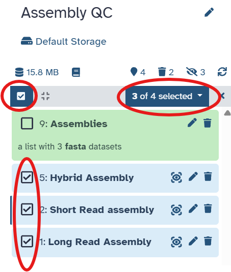
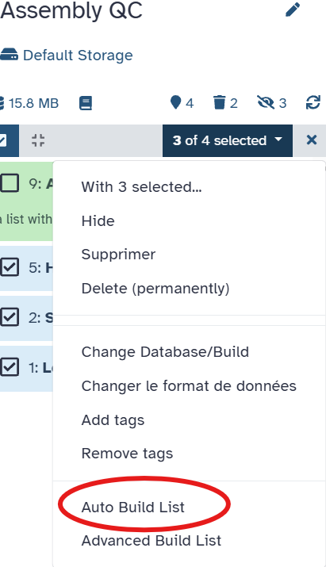
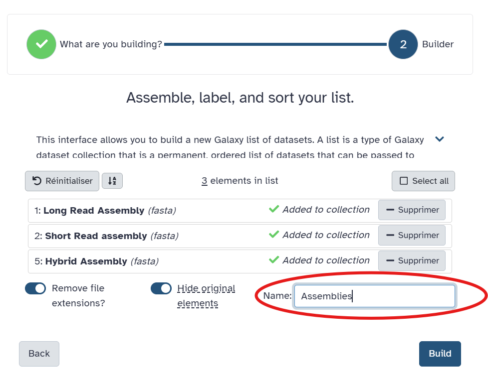

::: {.callout-note title="Lesson overview"}
**Questions**

- How do we evaluate the quality of a genome assembly?
- Which assembly strategy (short reads, long reads or hybrid) gives the best assembly for our sample?

**Objectives**

- Run **QUAST** on the short-read, long-read and hybrid assemblies in a single run.
- Interpret the main assembly metrics: number of contigs, total length, N50, L50, GC content.
- Compare the 3 assemblies with each other and with the genome published by the authors.
:::

# Assembly Metrics using QUAST

Once your assembly is complete, it is essential to evaluate its quality before proceeding to downstream analyses. This is where **QUAST** (QUality ASsessment Tool, [Gurevich et al. 2013](https://doi.org/10.1093/bioinformatics/btt086)) comes in.
As the outputs of the short read assembly, the long read assembly and the hybrid assembly are all assemblies (FASTA files of contigs), we can evaluate the 3 of them in a single QUAST run, and compare the results!

# What is QUAST ?

**Why is assessing assembly quality important?**

- Assemblies can vary greatly in quality depending on input data and parameters.
- Poor-quality assemblies may be fragmented, contain errors, or miss important regions, leading to inaccurate biological conclusions.
- Quality metrics help you determine if your assembly is good enough or if you need to revisit earlier steps (e.g., trimming, coverage, assembly parameters).

**QUAST provides a comprehensive set of metrics, including:**

- **Number of contigs:** Fewer contigs usually indicate a more contiguous assembly.
- **Total assembly length:** Should approximate the expected genome size; large deviations can indicate contamination or missing data.
- **N50:** The length of the contig such that the contigs of this length or longer contain **half** of the assembly; a higher N50 means a more contiguous assembly.
- **L50:** The **number** of contigs needed to reach half of the assembly (the number of contigs ≥ N50); a lower L50 means a more contiguous assembly.
- **N90 / L90:** The same, for 90% of the assembly.
- **Largest contig:** The length of the longest contig.
- **GC content:** Helps detect contamination or unusual biases.
- **Misassemblies and mismatches:** Identify errors or inconsistencies in the assembly (only when a reference genome is given).

By reviewing these metrics, you can objectively assess your assembly's completeness and accuracy, which is crucial for reliable downstream analyses.

::: {.callout-note title="N50 in practice"}
Imagine an assembly of 100 kb made of 5 contigs of 40, 25, 15, 12 and 8 kb. Sorted from the longest to the shortest, the cumulative lengths are 40, 65, 80, 92 and 100 kb. Half of the assembly (50 kb) is reached with the 2nd contig: the **N50 is 25 kb** and the **L50 is 2**.
:::

# Create a new history

::: {.callout-tip title="Create a new history"}
1. Go to the **History** panel (right side).
2. Click **✏️ → Create new history**.
3. Rename it to **Assembly QC**.
4. Click **Save**.
:::

# Import the 3 assemblies

We need the contigs (FASTA files) produced by the 3 assemblers, from the 3 previous histories.

::: {.callout-tip title="Import the assemblies"}
1. Open the **History Multiview** (left panel).
2. Drag the following datasets into the **Assembly QC** history:
    - from **Short Read Genome Assembly**: **SPAdes contigs Short Reads**
    - from **Long Read Genome Assembly**: **Flye on data X: consensus**
    - from **Hybrid Genome Assembly**: **Unicycler on data X: Final Assembly**
3. Rename them **Short read assembly**, **Long read assembly** and **Hybrid assembly**.
:::

::: {.callout-note title="Contigs or scaffolds?"}
For SPAdes, we use the **contigs** and not the scaffolds: scaffolds contain runs of `N` where SPAdes guessed a connection between contigs, which may not be biologically real. Flye and Unicycler only output contigs.
:::

Before running QUAST on the 3 assemblies, we will create a collection !

First, we need to extract the hybrid assembly, as the output is already a collection of 1 files. 
For this, we will use the tool "Extract Dataset", on "Hybrid Assembly". And select "the first dataset"  to "How should be dataset be selected ?". 

**ERR13363634** should be extracted. You can rename it to **Hybrid Assembly**. 

### Create a collection 

1. Select the 3 assemblies that we want to compile in a collection : 

2. Select **Auto Build List**:

3. Select the name **Assemblies**, and Click on **Build**. 

### Import the reference genome from E.Coli

QUAST needs the reference genome to ...

The primary official reference genome for Escherichia coli is E. coli str. K-12 substr. MG1655 (refseq accession number :: **NC_000913.3**)

Run a Tool: Use **NCBI Accession Download**
Download sequences from GenBank/RefSeq by accession through the NCBI ENTREZ API.
Type the refseq  accession number : **NC_000913.3**. 

# Run QUAST on the 3 assemblies

We expect a genome of ~**5.2 Mb**: the genome of strain 368 deposited by the authors ([GCA_964200035](https://www.ebi.ac.uk/ena/browser/view/GCA_964200035)) is 5,202,684 bp long. Giving this size to QUAST lets it compute the **NG50**, the N50 computed on the expected genome size rather than on the assembly size.

::: {.callout-tip title="Run QUAST"}
1. Search for **QUAST** in the Galaxy Tools panel.
2. Select the following parameters:
    - *"Assembly mode?"*: `Co Assembly`
    - *"Reference genome"*: `No reference`
    - *"Estimated reference genome size (in bp) for computing NGx statistics"*: `5200000`
    - In Reference, select **Reference E.Coli**.
3. Click **Run Tool**.
:::

When several assemblies are given, QUAST produces a **single report** with one column per assembly, which makes the comparison easy.

QUAST produces a summary table and plots showing the assembly quality.

## Example of Good Assembly Metrics (QUAST)

| Metric              | Good Assembly Characteristics                   | Why it matters                                   |
|---------------------|------------------------------------------------|-------------------------------------------------|
| **Number of contigs**| Low number (e.g., < 100 for bacterial genomes) | Indicates high contiguity and fewer gaps         |
| **N50**             | High value (e.g., > 50 kb for bacterial genomes)| Shows large contigs covering most of the genome  |
| **Total length**     | Close to expected genome size (here ~5.2 Mb)  | Confirms completeness without excess contamination|
| **GC content**      | Matches the organism (~50.8% for *E. coli*)    | Suggests low contamination and accurate assembly  |
| **Misassemblies**    | Few or none                                     | Reflects assembly correctness and reliability    |
| **Mismatch rate**    | Low (few errors per 100 kb)                      | Ensures sequence accuracy                          |

**Note:** These values depend on the species and data quality. For bacteria, a near-complete genome with a few large contigs is ideal.

For comparison, here are the statistics of the genome published by the authors (hybrid assembly with Unicycler, 1 circular chromosome and 6 circular plasmids):

| Metric | Published genome of strain 368 |
|---|---|
| Number of contigs | 7 |
| Total length | 5,202,684 bp |
| Largest contig | 4,894,004 bp (chromosome) |
| N50 | 4,894,004 bp |
| L50 | 1 |
| GC (%) | 50.76 |

## Compare the 3 assemblies

:::: {.callout-important title="Exercise: Compare the major statistics" collapse="true"}
Open the file **Quast on data X: HTML report** and fill in the table:

| Metric | Short read | Long read | Hybrid |
|---|---|---|---|
| Number of contigs (≥ 0 bp) | | | |
| Number of contigs (≥ 1000 bp) | | | |
| Total length (≥ 0 bp) | | | |
| Largest contig | | | |
| **N50** | | | |
| **L50** | | | |
| N90 | | | |
| L90 | | | |
| NG50 | | | |
| GC (%) | | | |

1. Which assembly has the highest **N50** and the lowest **L50**? Which one has the lowest?
2. Why is the N50 of the short read assembly so much lower than the one of the long read assembly, although the short reads are much more accurate?
3. Is the N50 of the long read and hybrid assemblies close to the length of a known element of the genome? Which one?
4. Compare the total length and the GC content with the published genome. Are they coherent?
5. Does a higher N50 always mean a better assembly?

::: {.callout-tip title="Answer" collapse="true"}
<!-- TODO: add the values from your own QUAST run -->
1. The long read and hybrid assemblies should have the highest N50 and an L50 of 1, while the short read assembly has the lowest N50 and a higher L50.
2. The short reads (150 bp) cannot span the repeated regions of the genome (insertion sequences, rRNA operons, transposons…), which are often several kb long. SPAdes cannot know how to connect the regions around each repeat, so the assembly breaks into many contigs. Nanopore reads (several kb) span most repeats, so Flye and Unicycler can resolve them.
3. If the chromosome is assembled in a single contig, the N50 is the length of the **chromosome** (~4.89 Mb): this one contig holds more than half of the genome, so N50 = largest contig and L50 = 1.
4. The total length should be close to 5.2 Mb and the GC content close to 50.8%. A total length much smaller suggests missing regions (e.g. lost plasmids), much larger suggests duplicated regions or contamination. Note that the GC content of the small plasmids differs from the chromosome (e.g. 46.0% for p2, 42.5% for p5).
5. No. The N50 only measures **contiguity**, not **correctness**: an assembler that wrongly joins contigs (misassemblies) increases the N50. It also says nothing about the small plasmids, which barely change the N50. The long read assembly may also contain more small errors (insertions and deletions) than the hybrid one, which QUAST can only detect with a reference genome. N50 must be read together with the total length, the number of contigs and, when possible, a comparison to a reference.
:::
::::

## QUAST Graphs

You can think of QUAST graphs as adding depth and context to the QUAST summary table.
The summary table gives you key numbers (N50, total length, number of contigs).

The graphs reveal patterns you cannot see from the summary table alone:

- The **Cumulative length** plot: genome coverage by the largest contigs; a steeper curve means a more complete assembly with fewer contigs.
- The **Nx plot**: contigs ranked by size vs cumulative assembly completeness. It shows how quickly your largest contigs accumulate to cover the genome, helping you see how contiguous or fragmented your assembly is, cumulating the information of L50 and N50 (as well as any Lx and Nx).
- The **GC content** plot: unusual peaks suggest contamination.

:::: {.callout-important title="Assembly Graphs Evaluation" collapse="true"}
Navigate to the **Plots** section and examine the following:

1. In the **Nx plot**, compare the shape of the 3 curves. Which ones are steep, which ones are gradual? What does it indicate about the contig size distribution?
2. In the **Cumulative length** plot, how many contigs are needed to reach 5 Mb for each assembly?
3. In the **GC content** plot, how many peaks do you observe? Is there evidence of contamination?

::: {.callout-tip title="Answer" collapse="true"}
1. The long read and hybrid curves stay flat at the length of the chromosome up to 90% of the assembly, then drop: almost the whole genome is in one contig. The short read curve drops gradually: the genome is split into many contigs of decreasing sizes.
2. A few contigs (the chromosome and the large plasmids) for the long read and hybrid assemblies, many more for the short read assembly.
3. A single peak around 50–51% GC is expected for a pure *E. coli* culture. A second peak would suggest a contamination by another organism.
<!-- TODO: add the observations from your own QUAST run -->
:::
::::

# Common Pitfalls in Bacterial Assembly

### 1. Low coverage
Below 20–30× makes assemblies fragmented.

### 2. Contamination
Foreign reads produce extra contigs. In this workshop we will not look at contamination, but 

### 3. Repeats and mobile elements
Plasmids and insertion sequences cause breaks in contigs.

### 4. Mixed strains
Can result in chimeric contigs.

### 5. Untrimmed adapters
Lead to errors in graph construction.

## Conclusion
In this tutorial, we compared the short read, long read and hybrid assemblies of the same sample. The short read assembly is fragmented but accurate, the long read assembly is contiguous, and the hybrid assembly combines the contiguity of the long reads with the accuracy of the short reads. The hybrid assembly is the one to use in downstream analyses, like MLST or AMR.

# Summary

::: {.callout-tip title="Key Points"}
- Assembly quality should be evaluated using QUAST, which can compare several assemblies in a single report.
- N50 and L50 measure the contiguity of an assembly: a high N50 and a low L50 mean few, long contigs.
- Long reads span repeats and give much more contiguous assemblies than short reads.
- A high N50 does not guarantee a correct assembly: the total length, the GC content and the comparison to a reference must be checked too.
:::

