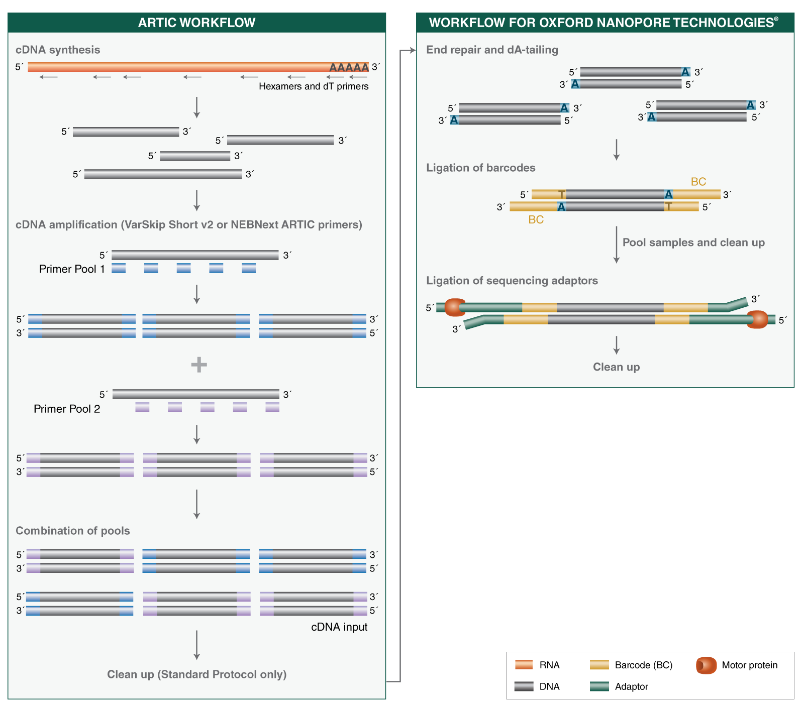
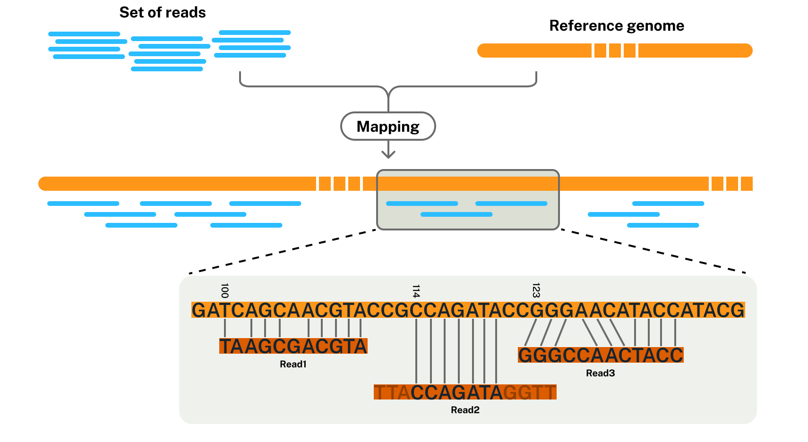
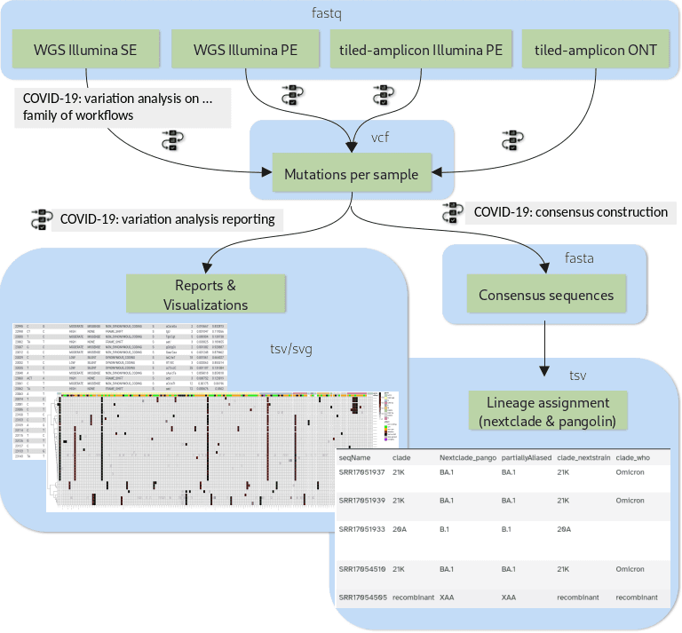
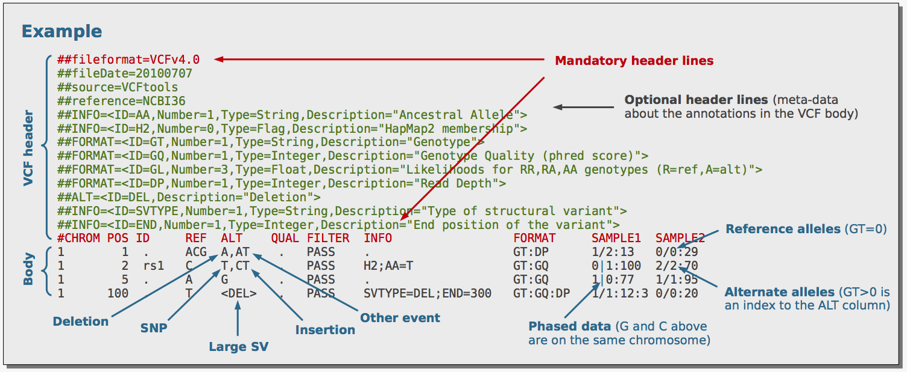

::: {.callout-note title="Lesson overview"}
**Questions**

- How can a complete analysis, including viral consensus sequence reconstruction and lineage assignment, be performed on a batch of samples?
- How are tiled-amplicon (ARTIC) ONT data handled differently from other sequencing data?
- What are key results beyond consensus genomes and lineage assignments that need to be understood to avoid inappropriate conclusions about samples?

**Objectives**

- Obtain the recommended Galaxy workflows for SARS-CoV-2 ONT tiled-amplicon data
- Run a workflow to discover mutations in a batch of viral samples amplified with the ARTIC v5.3.2 primers
- Run a workflow to summarise and visualise the mutations of a batch of samples
- Run a workflow to construct viral consensus sequences
- Assign the samples to lineages with **Pangolin** and **Nextclade**
- Combine information from different analysis steps to draw appropriate conclusions about individual samples and batches
:::

::: {.callout-note title="Sources"}
This tutorial is adapted from the Galaxy Training Network tutorial [Mutation calling, viral genome reconstruction and lineage/clade assignment from SARS-CoV-2 sequencing data](https://training.galaxyproject.org/training-material/topics/variant-analysis/tutorials/sars-cov-2-variant-discovery/tutorial.html) (Wolfgang Maier, Bérénice Batut), restricted to the analysis of **tiled-amplicon ONT data**.
:::


# ARTIC Protocol

https://artic.readthedocs.io/en/latest/primer-schemes/



We use Artic v 5.3.2 primers. 

# Mapping Assembly


# Introduction

Sequence-based monitoring of global infectious disease crises, such as the COVID-19 pandemic, requires capacity to generate and analyse large volumes of sequencing data in near real time. These data have proven essential for surveilling the emergence and spread of new viral variants, and for understanding the evolutionary dynamics of the virus.

For efficient genome surveillance, we want to:

- use the mutations of each sample to construct its consensus genome
- use the consensus genomes to assign the samples to SARS-CoV-2 lineages, as defined by the major lineage classification systems ([Nextstrain clades](https://nextstrain.org/blog/2022-04-29-SARS-CoV-2-clade-naming-2022) and [PANGO](https://www.pango.network/)).
- decrease hands-on time and data manipulation errors by combining analysis steps into workflows

In this tutorial, we use a set of workflows developed by the [Galaxy Covid-19 project](https://galaxyproject.org/projects/covid19/), together with a handful of additional tools:



1. The **variation analysis** workflow discovers the mutations of each sample of the batch. Different versions of this workflow exist for different types of data; we use the one for **tiled-amplicon ONT** data.
2. The **consensus construction** workflow reconstructs the full viral genome of each sample by modifying the SARS-CoV-2 reference genome with the mutations of the sample.
3. **Pangolin** and **Nextclade** assign the consensus genomes to lineages.

A few highlights of these workflows:

- The consensus workflow expresses uncertainty about any base position of the consensus sequence by masking it with an **N**, according to user-defined thresholds.
- All the workflows are openly developed and available as defined releases through public workflow registries.

## Tiled-amplicon sequencing with ARTIC primers

The SARS-CoV-2 genome is ~30 kb long. In clinical samples, viral RNA is often present in low amounts and mixed with a lot of human RNA. To sequence it efficiently, the viral genome is first amplified by **multiplex PCR** with a set of primers producing short, overlapping amplicons that together tile the whole genome.

The most widely used primer sets were designed by the [ARTIC network](https://artic.network/). In this tutorial, we use **ARTIC v5.3.2**: the genome is covered by ~100 amplicons of ~400 bp, split into two pools so that overlapping amplicons are not amplified in the same reaction. The primer schemes are regularly updated, because mutations of new variants can prevent some primers from binding: ARTIC v5 was released in 2022 to restore the amplification of regions affected by the mutations of the Omicron variants.

This approach has consequences for the analysis:

- **The primer sequences must be removed** from the reads: they come from the synthetic primers, not from the virus, and would hide the mutations located in primer binding sites. To do so, the workflow needs to know the positions of the primers on the genome (a **BED** file).
- Reads that look like duplicates are expected, because all reads of an amplicon start and end at the same positions. Unlike for whole-genome sequencing data, they are **not removed**.
- With **ONT** sequencing, each read usually covers a whole amplicon. Reads much shorter or longer than an amplicon (e.g. chimeric reads formed by two ligated amplicons) can be removed by filtering on read length.

## Analysis of ONT data

The workflow for ONT tiled-amplicon data runs:

- fastp filters reads by length 
- minimap2 aligns the reads to the reference
- samtools view drops unmapped and secondary alignments.
- ivar trim removes primer sequences using the ARTIC BED file.
- bamleftalign .
- [Clair3](https://github.com/HKU-BAL/Clair3) ([Zheng et al. 2022](https://doi.org/10.1038/s43588-022-00387-x)) calls the variants and gives a VCF.
- Samtools stats, Qualimap and MultiQC produce QC reports.

::: {.callout-note title="Clair3 needs a model matching your data"}
Clair3 calls variants with a neural network trained on reads from a specific **ONT chemistry** (flow cell and kit, e.g. R10.4.1 E8.2) and **basecaller model** (e.g. Dorado v5.0.0 SUP). To run it on your own data, you need to know both, and choose the Clair3 model that matches them (e.g. `r1041_e82_400bps_sup_v500`). This information is usually in the run report of the sequencer, or in the header of the basecalled files.

Only a few models are available by default in Galaxy. If the model matching your data is not there, you may need to download it from the [Clair3 pre-trained models](https://github.com/HKU-BAL/Clair3#pre-trained-models) (HKU or ONT Rerio models) and run Clair3 directly on your laptop.
:::

# Prepare Galaxy and data

## Prepare a new Galaxy history

::: {.callout-tip title="History creation"}
1. Create a new history for this analysis
2. Rename it, e.g. `SARS-CoV-2 ONT`
:::

## Get sequencing data

We will get the sequencing data from [a COVID-19 household cohort study in Chiang Mai, Thailand](https://pmc.ncbi.nlm.nih.gov/articles/PMC12810560).
If we look at the data sharing in the paper, we can see that the data is available under [the ENA Project PRJEB104853](https://www.ebi.ac.uk/ena/browser/view/PRJEB104853).

The workflow expects a **list** collection with one FASTQ file per sample (ONT reads are single reads, not pairs). You need at least two samples, sequenced with ONT after amplification with the ARTIC v5.3.2 primers.


::: {.callout-tip title="Import the reads from SRA"}
1. Create a new file with **Upload** → **Paste/Fetch data**, containing the SRA accessions of the samples, one per line:

    ```
    ERR16054783
    ERR16054815
    ERR16054829  
    ERR16054845
    ERR16054945
    ERR16054982
    ERR16055005
    ERR16055067
    ERR16055110
    ```

    Set the datatype to `txt` and name it `SRA accessions`.

2. Open **Faster Download and Extract Reads in FASTQ format from NCBI SRA** with:
    - *"select input type"*: `List of SRA accession, one per line`
    - *"sra accession list"*: `SRA accessions`
3. Click **Run Tool**
4. Rename the `Single-end data (fasterq-dump)` collection to `ONT reads`
:::

## Import the reference sequence and auxiliary datasets

Besides the reads, we need The reference sequence to call the mutations:

- the SARS-CoV-2 reference sequence, to map the reads and compare our samples against. We use the original Wuhan-Hu-1 genome, known as [MN908947.3](https://www.ebi.ac.uk/ena/browser/view/MN908947.3) in the INSDC databases and as [NC_045512.2](https://www.ncbi.nlm.nih.gov/nuccore/NC_045512.2) in NCBI RefSeq


::: {.callout-tip title="Get the reference sequence"}
1. Upload the reference sequence with **Upload** → **Paste/Fetch data**, using this link, and set the datatype to `fasta`:

    ```
  
    https://raw.githubusercontent.com/pha4ge/primer-schemes/main/schemes/artic-sars-cov-2/400/v5.3.2/primer.bed
    https://raw.githubusercontent.com/pha4ge/primer-schemes/main/schemes/artic-sars-cov-2/400/v5.3.2/reference.fasta
    ```
2. Click on "Start". 

:::

### What is a BED file?

The **Browser Extensible Data** (BED) format is a simple text format to describe **regions of a genome**: genes, exons, peaks, or, in our case, primer binding sites. It is a tab-separated file with one line per region and no header. Only the first 3 columns are mandatory; the following ones are optional, but must appear in a fixed order.

Here are the first lines of the ARTIC v5.3.2 primer BED file:

```
MN908947.3	47	78	SARS-CoV-2_1_LEFT_1	1	+	CTCTTGTAGATCTGTTCTCTAAACGAACTTT
MN908947.3	419	447	SARS-CoV-2_1_RIGHT_1	1	-	AAAACGCCTTTTTCAACTTCTACTAAGC
MN908947.3	344	366	SARS-CoV-2_2_LEFT_0	2	+	TCGTACGTGGCTTTGGAGACTC
MN908947.3	707	732	SARS-CoV-2_2_RIGHT_0	2	-	TCTTCATAAGGATCAGTGCCAAGCT
```

| Column | BED field | In the ARTIC primer BED |
|--------|-----------|-------------------------|
| 1 | `chrom`: name of the reference sequence | `MN908947.3`, the INSDC name of the Wuhan-Hu-1 genome (same sequence as `NC_045512.2`) |
| 2 | `chromStart`: start position of the region | Start of the primer binding site |
| 3 | `chromEnd`: end position of the region | End of the primer binding site |
| 4 | `name`: name of the region | `SARS-CoV-2_<amplicon>_<LEFT/RIGHT>_<variant>`: the amplicon number, whether it is the forward (`LEFT`) or reverse (`RIGHT`) primer, and an identifier for alternative versions of the same primer |
| 5 | `score` | Used here to store the **pool** (`1` or `2`) in which the primer is used |
| 6 | `strand` | `+` for `LEFT` primers, `-` for `RIGHT` primers |
| 7 | Extra column | The primer sequence |

Two lines with the same amplicon number (e.g. `SARS-CoV-2_1_LEFT_1` and `SARS-CoV-2_1_RIGHT_1`) delimit one amplicon. The file contains 193 primers for 96 amplicons: some amplicons have alternative primers, added to keep amplifying variants with mutations in the original binding site. You can also see that amplicons 1 and 2 overlap (amplicon 2 starts at position 344, before amplicon 1 ends at position 447), which is why they are amplified in different pools.

::: {.callout-warning title="BED coordinates are 0-based"}
Unlike VCF files (see below), BED coordinates are **0-based and half-open**: the first base of the genome is position `0`, and the `chromEnd` base is not included in the region. The first primer, `47	78`, therefore covers positions 48 to 78 of the genome in the usual 1-based numbering, i.e. 31 nucleotides, the length of its sequence. Keep this in mind when you compare positions between a BED file and a VCF file.
:::

**ivar trim** uses this file to know where the primers are on the genome, and removes the primer sequences from the reads that overlap these positions.

# Analysis

## Import the workflows

All the originals workflows of the Galaxy Covid-19 project are published by the **IWC** (Intergalactic Workflow Commission) on [Dockstore](https://dockstore.org/) and [WorkflowHub](https://workflowhub.eu/), and can be imported directly into Galaxy. I have updated them for this training. 

::: {.callout-tip title="Import the workflows"}
1.  click on the [workflow link](https://usegalaxy.org.au/u/mathis-arnal/w/covid-19-variation-analysis-of-artic-ont-data).
It should open the workflow preview:

3. Click on **Import Worflow**.  
:::

## From sequencing data to mutations per sample

::: {.callout-tip title="Run the variation analysis workflow"}
1. Open the **COVID-19: variation analysis of ARTIC ONT data** workflow and set:
    - *"ONT-sequenced reads"*: `ONT reads`
    - *"NC_045512.2 FASTA sequence of SARS-CoV-2"*: `SARS-CoV-2 reference`
    - *"Primer binding sites info in BED format"*: `ARTIC v5.3.2 primers`
2. Click **Run Workflow**
:::

### Outputs of the variation analysis workflow

Each output is a **collection** with one element per sample. In the order in which the tools run, the workflow produces:

| Step | Tool | Output | Format | What it is |
|------|------|--------|--------|------------|
| Read filtering | **fastp** | Length-filtered reads | `fastqsanger` | The reads that pass the minimum and maximum read length filters |
| | | fastp report | `html` | Read statistics before and after filtering |
| Mapping | **minimap2** | Mapped reads | `bam` | The reads aligned to the reference genome |
| | **Samtools view** | Filtered mapped reads | `bam` | Mapped reads only: unmapped reads, secondary alignments and reads with a mapping quality of 0 are removed |
| | **Samtools stats** | Mapped reads stats | `tabular` | Mapping statistics (number of mapped reads, error rate...) |
| Primer removal | **ivar trim** | Primer-trimmed reads | `bam` | The primer sequences are cut from the reads using the primer BED file |
| | **BamLeftAlign** | Realigned reads | `bam` | Insertions and deletions are shifted to their left-most position, so that the same indel is always reported at the same position. These are the **fully processed reads** used for variant calling |
| Coverage QC | **QualiMap BamQC** | BamQC report | `html` | Coverage of the genome by the reads, per sample |
| | **MultiQC** | Preprocessing and mapping reports | `html` | One report gathering the Samtools stats and QualiMap results of **all** samples |
| Variant calling | **Clair3** | Variant calls | `vcf` | The mutations found in each sample, annotated with read depth information |

The most important outputs for the rest of the tutorial are:

- the **Preprocessing and mapping reports** (MultiQC), to check the quality of the samples (see below)
- the **VCF file** ( VCF), the mutations used to build the consensus sequences. 
- the **fully processed reads** (BamLeftAlign BAM), used to calculate the coverage in the consensus workflow

### What is a BAM file?

    The **Sequence Alignment/Map** format (SAM) is the standard text format to store reads aligned to a reference genome: for each read, where it maps and how it differs from the reference. A **BAM** file is the compressed, binary version of a SAM file: it is much smaller and faster to read for the tools, but it cannot be read directly by a human. BAM files are usually **sorted** by position on the reference and **indexed** (`.bai` file), so that the tools can quickly retrieve the reads covering a given region. When a dataset of type BAM is created, Galaxy automatically builds the .bai index and stores it as hidden metadata attached to that dataset. Tools that need an index (ivar trim, bamleftalign, Qualimap, bedtools and so on) get it transparently. Like VCF, SAM has two parts:

1. The **header**: lines starting with `@` that describe the file: the reference sequence(s) and their length (`@SQ`), how the file is sorted (`@HD`), and the programs that produced the file (`@PG`).
2. The **body**: one line per alignment, with 11 mandatory columns, optionally followed by extra `TAG:TYPE:VALUE` fields:

| Column | Meaning | In our SARS-CoV-2 BAMs |
|--------|---------|------------------------|
| `QNAME` | Name of the read | The read ID given by the ONT basecaller |
| `FLAG` | Properties of the alignment, encoded as a sum of bit values (see below) | e.g. `0` (forward strand) or `16` (reverse strand) |
| `RNAME` | Name of the reference sequence | Always `NC_045512.2` |
| `POS` | Leftmost position of the alignment on the reference (1-based) | Between 1 and 29,903 |
| `MAPQ` | Mapping quality: confidence that the read is mapped at the right place, as a [Phred score](https://en.wikipedia.org/wiki/Phred_quality_score) | Reads with a `MAPQ` of 0 are removed by **Samtools view** |
| `CIGAR` | Description of the alignment, as a series of lengths and operations (see below) | e.g. `31S350M2D18M` |
| `RNEXT`, `PNEXT`, `TLEN` | Position of the mate read and length of the fragment, for paired-end data | Always `*`, `0` and `0`: ONT reads are single reads |
| `SEQ` | Sequence of the read | The full ONT read (~400 bp, the size of an amplicon) |
| `QUAL` | Base qualities of the read | The Phred qualities from the FASTQ file |

The `FLAG` is the sum of the properties that apply to the alignment. The most common ones for ONT data are `4` (read unmapped), `16` (read on the reverse strand), `256` (secondary alignment: another possible position of the same read) and `2048` (supplementary alignment: part of a chimeric read mapped elsewhere). The [Explain SAM Flags](https://broadinstitute.github.io/picard/explain-flags.html) website decodes any value.

The `CIGAR` string describes how the read is aligned, base by base. The most common operations are `M` (alignment match: the base can be identical or different from the reference), `I` (insertion in the read), `D` (deletion from the read) and `S` (soft clipping: bases kept in `SEQ` but not aligned). For example, `31S350M2D18M` means: 31 unaligned bases, then 350 aligned bases, a deletion of 2 bases, and 18 more aligned bases.

::: {.callout-note title="How ivar trim removes the primers"}
**ivar trim** does not delete the primer bases from the reads: it **soft-clips** them. The primer bases are still in `SEQ`, but they are added to the `S` operations of the `CIGAR`, and `POS` is shifted to the first aligned base after the primer. Variant callers ignore soft-clipped bases, so the primer sequences no longer influence the mutation calls.
:::

:::: {.callout-important title="Question: BAM files" collapse="true"}
1. Convert one of the fully processed BAM files to SAM with **Samtools view** (*"Output format"*: `SAM`, with the header) and open it with the eye icon. Which reference sequence is described in the header?
2. Do the `CIGAR` strings of the reads start or end with soft-clipped bases (`S`)? Why?

::: {.callout-tip title="Answer" collapse="true"}
1. The `@SQ` line describes the single reference sequence, `MN908947.3`, with its length: `LN:29903`.
2. Yes: most reads start and end with soft-clipped bases. Some of them were already clipped by minimap2 (e.g. sequencing adapters that do not align), and **ivar trim** soft-clipped the primers.
:::
::::

### What is a VCF file?

The **Variant Call Format** (VCF) is the standard text format to store genetic variants: the positions where a sample differs from the reference genome. It is a tab-separated file with two parts:



1. The **header**: lines starting with `##` that describe the file: the format version, the reference genome, the tools that created the file, and the meaning of each field used in the `INFO`, `FILTER` and `FORMAT` columns. **Read the header** when you don't understand a field: its definition is there.
2. The **body**: one line per variant, with 8 mandatory columns, optionally followed by a `FORMAT` column and one column per sample:

| Column | Meaning | In our SARS-CoV-2 VCFs |
|--------|---------|------------------------|
| `CHROM` | Name of the reference sequence | Always `NC_045512.2`: the viral genome is a single sequence |
| `POS` | Position of the variant on the reference (1-based) | Between 1 and 29,903, the length of the genome |
| `ID` | Identifier of the variant in a database (e.g. dbSNP) | Usually `.` (empty) |
| `REF` | Base(s) in the reference genome | e.g. `A` |
| `ALT` | Base(s) observed in the sample | e.g. `G` |
| `QUAL` | Confidence that the variant is real, as a [Phred score](https://en.wikipedia.org/wiki/Phred_quality_score) | Higher is better |
| `FILTER` | `PASS` if the variant passed all filters, otherwise the name of the failed filter | `PASS`, or `LowQual` for low-quality calls flagged by Clair3 |
| `INFO` | Additional information, as `KEY=value` pairs separated by `;` | `P` or `F`: whether the variant was called by Clair3's pileup or full-alignment model |
| `FORMAT` + sample | Names of the per-sample fields, then their values for the sample | `GT:GQ:DP:AD:AF`: genotype, genotype quality, read depth, read counts per allele and allele frequency |

The type of variant can be read from the `REF` and `ALT` columns:

- **SNP** (single nucleotide polymorphism): one base replaced by another, e.g. `REF=A`, `ALT=G`
- **Deletion**: `REF` is longer than `ALT`, e.g. `REF=ATAC`, `ALT=A`
- **Insertion**: `ALT` is longer than `REF`, e.g. `REF=A`, `ALT=ATT`

::: {.callout-note title="VCF files of viruses"}
VCF was designed for diploid organisms such as humans, where a sample can carry 0, 1 or 2 copies of a variant (its *genotype*, `GT`). A SARS-CoV-2 sample is a population of viral genomes: what matters is the **allele frequency** (the fraction of reads carrying the mutation), not the genotype. The consensus construction workflow uses it to decide which mutations to include in the consensus sequence.
:::

:::: {.callout-important title="Question: VCF files" collapse="true"}
1. Open the VCF of one sample with the eye icon. How many mutations were found in this sample?
2. Do all the mutations have `PASS` in the `FILTER` column?

::: {.callout-tip title="Answer" collapse="true"}
1. Count the lines of the body (the lines that don't start with `#`). Expanding the dataset in the history shows the number of lines, but it includes the header lines.
2. Not necessarily: Clair3 flags low-quality calls with `LowQual` in the `FILTER` column, but keeps them in the file. Only filter-passing mutations are used to build the consensus sequence.
:::
::::

::: {.callout-note title="Read length filtering"}
The optional parameters *"Minimum read length"* and *"Maximum read length"* should match the amplicon sizes of the primer scheme. The workflow defaults are appropriate for the ARTIC primers. For another primer scheme, the [ARTIC network's recommendations](https://artic.network/ncov-2019/ncov2019-bioinformatics-sop.html) (section "Read filtering") are a good starting point: set the minimum to the size of the smallest amplicon, and the maximum to the size of the largest amplicon plus 200 nucleotides, to exclude obviously chimeric reads.
:::


:::: {.callout-important title="Question: Preprocessing and mapping" collapse="true"}
1. Are there samples with a much lower number of reads or a lower coverage than the others?
2. In the *Cumulative genome coverage* plot, which fraction of the genome is covered by at least 20 reads in each sample?

::: {.callout-tip title="Answer" collapse="true"}
1. Look at the *General Statistics* section. Samples with a critically low coverage will give unreliable mutation calls, and probably incomplete consensus sequences.
2. A curve that drops early means that large parts of the genome are poorly covered, for example because some amplicons failed.
<!-- TODO: add the problematic samples from your own run -->
:::
::::

## From mutations per sample to consensus sequences

Here is the link to the last workflow, the [COVID-19 CONSTRUCTION WORKFLOW](https://usegalaxy.org.au/u/mathis-arnal/w/covid-19-simple-consensus-from-clair3-af-filter-depth-mask). 

The last workflow generates consensus sequences according to transparent criteria:

- Each consensus sequence contains all the filter-passing mutations of its sample that reach a user-defined **consensus allele frequency** threshold.
- Positions of filter-passing mutations with an allele frequency between the two thresholds are masked with **N**.
- Positions with a coverage below a **depth threshold** are masked with **N** too, unless they are sites of consensus mutations.

::: {.callout-tip title="Run the consensus construction workflow"}
1. Open the **COVID-19: consensus construction** workflow and set:
    - *"Variant calls"*: the Clair3 `Variant calls` collection produced by the first workflow
    - *"aligned reads data for depth calculation"*: `Fully processed reads for variant calling` (the BAM files produced by the first workflow)
    - *"Reference genome"*: `SARS-CoV-2 reference`
2. Leave *"min-AF for consensus variant"*, *"min-AF for failed variants"* and *"Depth-threshold for masking"* at their default values
3. Click **Run Workflow**
:::

The main outputs of the workflow are:

- a collection of consensus sequences, useful to look at the consensus sequence of one sample

## Open your VCF file in a Genome Viewer

We can use Jbrowse2. 

# From consensus sequences to lineage assignments

Open [Nextclade](https://clades.nextstrain.org/), you need your consensus sequences.
Download them from Galaxy, using the "Download" button. 

# Conclusion

In this tutorial, we used a set of Galaxy workflows to analyse a batch of SARS-CoV-2 samples sequenced with ONT after amplification with the ARTIC v5.3.2 primers:

1. The **variation analysis** workflow filtered the reads, mapped them to the reference genome, removed the primers and called the mutations of each sample
2. The **consensus construction** workflow reconstructed the genome of each sample, masking the uncertain positions
3. **Pangolin** and **Nextclade** assigned the samples to lineages

The workflows can analyse many samples with little hands-on time, while still allowing detailed dives into individual samples. To scale up further, workflow runs can be automated through the Galaxy API, as the Galaxy Covid-19 project did to analyse hundreds of thousands of public SARS-CoV-2 sequencing datasets ([Infectious Diseases Toolkit](https://www.infectious-diseases-toolkit.org/showcase/covid19-galaxy)).

::: {.callout-tip title="Key Points"}
- For tiled-amplicon data, the workflow needs the **primer scheme** (BED file) to remove the primer sequences, which would otherwise hide mutations in primer binding sites.
- The ONT workflow uses **minimap2** for mapping and **Clair3** for variant calling, with a model matching the ONT chemistry and basecaller; reads are filtered on length to match the amplicon sizes.
- Always check the coverage of the samples: low coverage leads to missed mutations, N-masked consensus sequences and unreliable lineage assignments.
- Mutations at intermediate allele frequencies can reveal contaminations or co-infections, which a single consensus sequence cannot represent.
- Pangolin and Nextclade use different algorithms and nomenclatures; comparing them, together with their quality columns, helps to spot unreliable assignments.
:::
