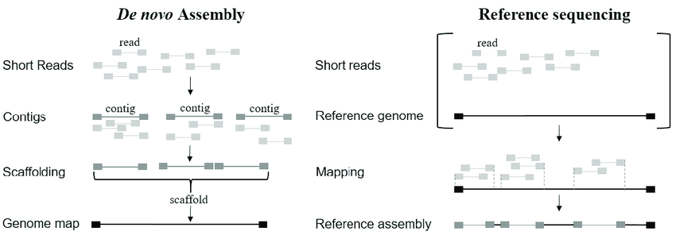
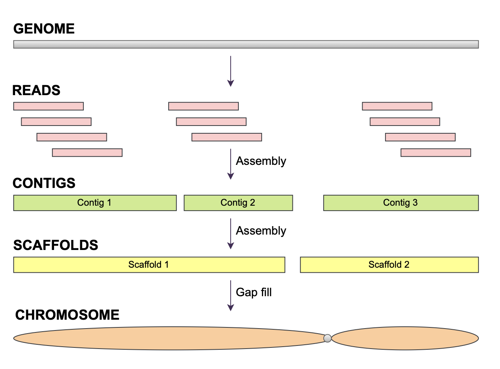
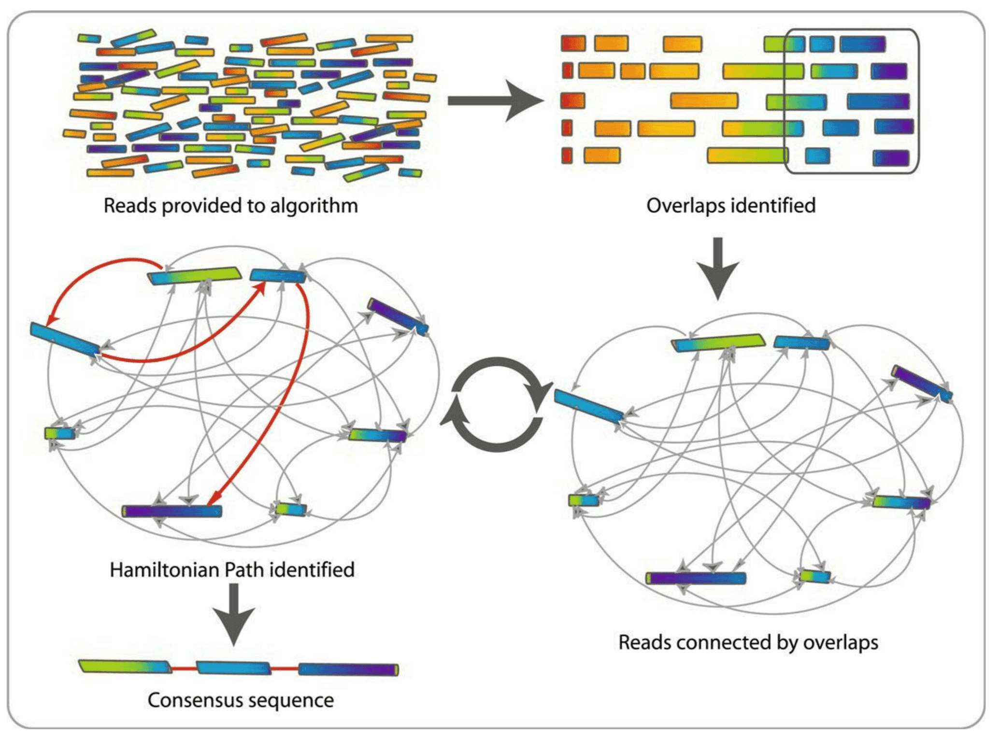

# Bacterial Genome Assembly

::: {.callout-note title="Lesson overview"}
**Questions**

- Why do bacterial genomes need to be assembled?
- What is the difference between reads, contigs, and scaffolds?
- How do assemblers reconstruct a bacterial genome?
- How do we assess the quality of an assembly?

**Objectives**

- Understand what a genome assembly is.
- Know the main assembly algorithms (Greedy, OLC, De Bruijn Graphs).
- Perform a bacterial genome assembly using **SPAdes**.
- Evaluate the assembly using **QUAST**.
:::

# What is an assembly ? 

Modern sequencing technologies generate **millions of short DNA fragments (reads)**, but not complete chromosomes.  
For bacterial genomics, our goal is to reconstruct the full genome of a bacterial isolate from these fragments.  
The process of stitching reads together into longer sequences is called **de novo assembly**.

# Introduction

When the quality of the reads is determined and the data is filtered (like we did with fastp) and/or trimmed (like is more often done with short read data) an assembly can be made.

Assembling a genome is conceptually similar to solving a jigsaw puzzle:

- The full genome is the picture we want to reconstruct.
- Reads are the small pieces of the puzzle.
- Overlaps and repeated patterns determine how the pieces fit together.

Unlike real puzzles, genome assembly is complicated by:

- **Sequencing errors**  
- **Repeated regions** that appear identical  
- **Uneven sequencing depth**  
- **Contaminations** in the sample  

Despite these challenges, bacterial genomes (~1–7 Mb) are typically easier to assemble than metagenomes because they come from **one organism** and generally have **uniform coverage**.

# The type of assembly

## Reference-Based Assembly (Mapping)

Reference-based assembly aligns sequencing reads to an existing reference genome. This approach:
- **Requires** a high-quality reference genome from the same or closely related species
- Is **faster and computationally lighter** than de novo assembly
- Works well for **variant detection**, SNP calling, and comparative genomics
- **Limitations**: Cannot detect novel sequences, large structural variations, or genomic regions absent from the reference

## De Novo Assembly

De novo assembly reconstructs the genome from scratch without using a reference. This approach:
- Builds consensus sequences by finding **overlaps between reads**
- Is **essential** when no reference genome exists or when studying novel organisms
- Can detect **structural variations, insertions, deletions**, and novel genetic elements
- **Limitations**: More computationally intensive, may produce fragmented assemblies (multiple contigs instead of complete chromosomes)

:::: {.callout-important title="Which Assembly to choose ?" collapse="true"}
Read the [referenced paper](https://www.sciencedirect.com/science/article/pii/S2213716525002061) and answer the following questions:

1. What kind off assembly has been chosen in the paper ?
2. Discuss with your neighbor, about this choice.

::: {.callout-tip title="Answer" collapse="true"}
The authors chose a **de novo hybrid assembly**, combining Illumina short reads and Nanopore long reads. While reference-based assembly is faster, de novo assembly was essential for this study because the authors wanted to:

- Capture the complete and unique genomic content of each strain, including its **plasmids**, which vary a lot between *E. coli* strains and are absent from reference genomes
- Locate the antibiotic resistance genes (ESBL and carbapenemase genes) on the chromosome or on plasmids, to understand how they spread between strains
- Compare whole plasmid sequences between strains, which requires complete, circular plasmids
- Understand genomic diversity without bias from an existing reference

The hybrid approach was needed to recover complete plasmids: short reads alone give fragmented assemblies in which plasmid and chromosome contigs cannot be told apart.
:::
::::

# How Do DE NEVO Assemblers Work?

## Reads → Contigs → Scaffolds

During de novo assembly, the algorithm steps are typically:

1. **Reads** (raw sequencing fragments)  
2. **Contigs**: overlapping reads merged into longer continuous sequences  
3. **Scaffolds**: contigs ordered and oriented using paired-end information  (Mainly useuful for visualization)

The figure below shows the hierarchy:

There are several strategies to assemble genomes. Most modern short-read assemblers use **De Bruijn Graphs**.

 

Reads are broken into **k-mers** (short subsequences of length *k*).  
A graph is built from overlapping k-mers, and contigs are extracted as paths through the graph.

This method is extremely efficient for large numbers of short reads.
For further explanations, see this [assembly presentation](https://training.galaxyproject.org/training-material/topics/assembly/tutorials/debruijn-graph-assembly/slides.html#1). 

# Short read assembly

# SPAdes: A Popular Bacterial Genome Assembler

[SPAdes](https://github.com/ablab/spades) (St. Petersburg genome assembler) is one of the most recommended tools for bacterial genomes.

Why SPAdes?

- Designed specifically for single bacterial genomes  
- Handles uneven coverage (useful for plasmids or mixed samples)  
- Uses multi-*k* De Bruijn Graphs for improved assembly  
- Widely used, well tested, fast  

SPAdes takes **FASTQ** files as input and outputs:

- **contigs.fasta**
- **scaffolds.fasta**
- **assembly graph files**

---

# Running SPAdes on Galaxy

We will use the trimmed short reads of run *ERR13363306* (collection **Trimmed Short Reads**), from  [the E.Coli Paper](https://www.sciencedirect.com/science/article/pii/S2213716525002061?via%3Dihub). 

What parameters do I need to choose for SPAdes ? 
the most important is k-mers.

Always check the read length distribution and median/mean length of the trimmed reads (in the **After filtering** section of the fastp report) before finalizing k choices.
Choosing an appropriate k-mer range for SPAdes assembly requires balancing sensitivity and contiguity.
Smaller k values (e.g., 21–33–55) are more sensitive and help assemble low-coverage regions and short or repetitive sequences, whereas larger k values (e.g., 77–99–127) improve contiguity and repeat resolution but require longer, high-quality reads. Therefore, the k-mer range should always be chosen according to the read-length distribution and expected coverage after trimming

## Create a new history

::: {.callout-tip title="Create a new history"}
1. Go to the **History** panel (right side).
2. Click **✏️ → Create new history**.
3. Click **Edit** next to the history name.
4. Rename it to **Short Read Genome Assembly**.
5. Click **Save**.
:::

## Import the trimmed reads

Use the **History Multiview** panel.

::: {.callout-tip title="Import input reads"}
1. Open the **History Multiview** (left panel).
2. Drag your trimmed paired-end reads (**Trimmed Short Reads**) from the previous history (e.g., “Quality Control and Trimming”).
3. Drop them into the **Short Read Genome Assembly** history.
:::

# Assembly with SPAdes

## Launch the SPAdes tool

1. In the Galaxy tools panel, search for **SPAdes**.  
2. Click **SPAdes genome assembler**.

## Tool parameters

### 1. Input Data
Choose:

- **Paired-end: list of dataset pairs**  
- Ensure the correct trimmed R1/R2 files are selected.

### 2. Options to select  

- in **Operation mode**, select : **Assembly and error correction**.
SPAdes performs BayesHammer/Hammer error correction on the raw reads before doing the assembly.
(fixes substitutions & small indels, removes low-quality kmers), which improve assembly quality but takes longer.

- in **Pipeline Options**: tick **Isolate** (`--isolate`).
  This mode is recommended for the DNA of a single bacterial culture sequenced at high coverage, which is our case (~100x): it improves the assembly and reduces the running time.

- **Select additional outputs**:  
  - Contigs  
  - Scaffolds  
  - Assembly graph with scaffolds
  - Log 

- **Select k-mer detection option**: Select Auto, or use "21, 33, 55, 77", commonly used for ILLUMINA for max length 150pb.

- Click **Run Tool**.

Assembly usually takes a few minutes depending on coverage and read depth.

## Galaxy Outputs 

SPAdes generates several output files with different assembly representations. Rename them as indicated, so that you can find them easily in the next tutorials.

| Galaxy output | Rename it | Content |
|---|---|---|
| **SPAdes on data X and data X: Contigs** | **SPAdes contigs Short Reads** | Basic contigs without scaffolding. No gaps (`N`): the most conservative assembly. |
| **SPAdes on data X and data X: Scaffolds** | **SPAdes scaffolds Short Reads** | Contigs linked together using paired-end information. Gaps are represented as runs of `N` where SPAdes inferred a connection: longer sequences, but with uncertainties. |
| **SPAdes on data X and data X: Assembly graph with scaffolds** | **SPAdes assembly graph Short Reads** | The de Bruijn graph, with the scaffolding information (how the contigs connect). Used for the visualisation with Bandage. |
| **SPAdes on data X and data X: Log** | **SPAdes log Short Reads** | The messages written by SPAdes during the run: the k-mer sizes used, the steps, and the errors if the run failed. |

