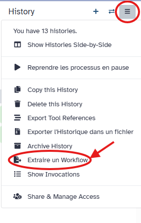
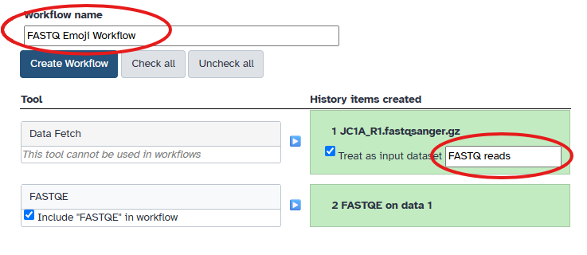

## Convert your analysis history into a workflow

Galaxy records every tool you run and the parameters used. You can convert this history into a workflow to reuse later.

::: {.callout-tip title="Extract workflow"}
1. Clean up your history: remove any failed (red) jobs
2. Click (**History options**) → **Extract workflow**

    

3. Select the steps to include
4. Replace the workflow name (e.g., `FASTQ Emoji Workflow`)
5. Rename the workflow input (e.g., `FASTQ reads`)

    

6. Click **Create Workflow**
:::

::: {.callout-tip title="Key Points"}
- The Galaxy interface has an activity bar on the left, a tool (or other activated)
  panel next to it (if expanded), viewing pane in the middle, and a history of your
  data analysis on the right.
- You can create a new history for each analysis. All your histories are saved.
- To get data into Galaxy, you can upload a file by pasting in a web address. There
  are other ways to get data into Galaxy (not covered in this tutorial): you can upload
  a file from your computer, and you can import an entire history.
- Choose a tool and change any settings for your analysis.
- Run the tool. The output files will be saved at the top of your history.
- View the output files by clicking the eye icon.
- View all your histories and move files between them. Switch to a different history.
- Log out of your Galaxy server. When you log back in (to the same server), your histories
  will all be there.
:::
