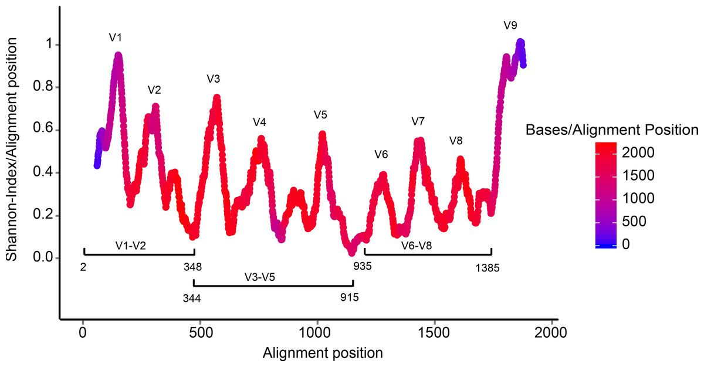
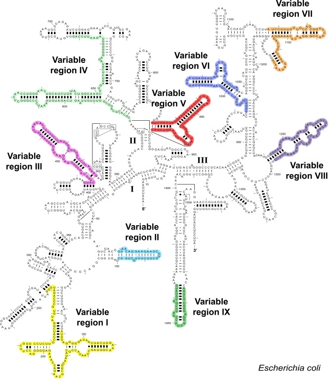

::: {.callout-note title="Lesson overview"}
**Questions**

- What are the primary steps involved in generating an ASV table from 16S rRNA gene sequencing data with QIIME 2?
- How does denoising (DADA2) improve the accuracy of microbial community analysis compared to traditional OTU-based methods?
- Why are quality inspection and read truncation important, and how do they impact downstream analyses?
- How can we assign taxonomy to ASVs and explore the diversity of the samples?

**Objectives**

- Import paired-end FASTQ files into QIIME 2 artifacts in Galaxy
- Choose truncation parameters from the read quality profiles
- Denoise the reads with **qiime2 dada2 denoise-paired** to produce an ASV table
- Assign taxonomy with a pre-trained naive Bayes classifier
- Compute and compare alpha and beta diversity between groups of samples
:::

::: {.callout-note title="Sources"}
This tutorial is adapted from the Galaxy Training Network tutorial [Building an amplicon sequence variant (ASV) table from 16S data using DADA2](https://training.galaxyproject.org/training-material/topics/microbiome/tutorials/dada-16S/tutorial.html) (Bérénice Batut et al.), rewritten to use the **QIIME 2** tools available on [Galaxy Australia](https://usegalaxy.org.au/). It also uses information from [Metabarcoding of bacteria in dunnart faecal samples across Australia (wild + captive) using QIIME 2](https://training.galaxyproject.org/topics/microbiome/tutorials/dunnart_metabarcoding/tutorial.html). It also draws on the [QIIME 2 "Moving Pictures" tutorial](https://docs.qiime2.org/).
:::

# Introduction

The investigation of environmental microbial communities and microbiomes has been revolutionized by the
development of high-throughput amplicon sequencing. In amplicon sequencing a particular genetic locus,
for example the 16S rRNA gene (or a part of it) in bacteria, is amplified from DNA extracted from the community of interest,
and then sequenced on a next-generation sequencing platform. This technique removes the need to culture
microbes in order to detect their presence, and cost-effectively provides a deep census of a microbial community.

# What is the 16S ribosomal RNA gene ? 





# How to process 16S amplicon sequencing data ? 

To process 16S amplicon sequencing data, several tools exist: **QIIME 2** ([Bolyen et al. 2019](https://doi.org/10.1038/s41587-019-0209-9)), **Mothur**, **Lotus2** and **DADA2** ([Callahan et al. 2016](https://doi.org/10.1038/nmeth.3869)). All these tools can be used in Galaxy. In this tutorial we will use **QIIME 2**.

**QIIME 2** is not a single algorithm but a platform that wraps many methods as *plugins*. Here we will use, among others:

- **q2-dada2**, to denoise the reads with the DADA2 algorithm
- **q2-feature-classifier** ([Bokulich et al. 2018](https://doi.org/10.1186/s40168-018-0470-z)), to assign taxonomy
- **q2-phylogeny** and **q2-diversity**, to build a tree and compute diversity metrics

## ASVs instead of OTUs

The output of the denoising step is a feature table of amplicon sequence variants (an ASV table): a matrix with columns corresponding to samples and rows to ASVs, in which the value of each entry is the number of times that ASV was observed in that sample. This table is analogous to the traditional OTU table, except that one gets the actual sequences of the "true" sequence variants instead of rather anonymous and abstract entities called OTU1, OTU2, etc.

The process of amplicon sequencing introduces errors into the sequencing data, and these errors
severely complicate the interpretation of the results. **DADA2** implements an algorithm that models the errors introduced during amplicon sequencing, and uses that error model to infer the true sample composition. As shown in the DADA2 paper and in [further benchmarking](http://benjjneb.github.io/dada2/SotA.html), this method is more sensitive and specific than traditional OTU methods: it detects real biological variation missed by OTU methods while outputting fewer spurious sequences.

In QIIME 2, the whole DADA2 pipeline (filter and trim, learn error rates, denoise, merge pairs, remove chimeras) is run by **one** tool: **qiime2 dada2 denoise-paired**.

## The dataset

The data come from a gut microbiome study of **pediatric ulcerative colitis (UC)**, a chronic inflammatory bowel disease:

> Zuo W, Wang B, Bai X, Luan Y, Fan Y, Michail S, Sun F. *16S rRNA and metagenomic shotgun sequencing data revealed consistent patterns of gut microbiome signature in pediatric ulcerative colitis.* Scientific Reports (2022). [doi:10.1038/s41598-022-07995-7](https://www.nature.com/articles/s41598-022-07995-7)

The authors collected stool samples from **19 children and young adults with UC** and **23 healthy controls** (7–21 years old) at the Children's Hospital of Los Angeles. Each sample was sequenced in two ways: **16S rRNA amplicon sequencing** and **shotgun metagenomic sequencing**, to check whether both approaches give the same picture of the gut microbiome.

| | 16S data used in this tutorial |
|---|---|
| Sample | Human stool (fecal DNA extracted with the QIAamp PowerFecal kit) |
| Target | **V4** region of the 16S rRNA gene |
| Primers | 515FB `GTGYCAGCMGCCGCGGTAA` / 806RB `GGACTACNVGGGTWTCTAAT` |
| Sequencing | Illumina MiSeq, **2 × 150 bp** paired-end |
| Data | NCBI BioProject [PRJNA759642](https://www.ncbi.nlm.nih.gov/bioproject/PRJNA759642) |

### What did the authors do?

Their 16S workflow is very close to the one we will follow:

1. **QIIME 2** with **DADA2** to denoise the reads into ASVs
2. Taxonomy assigned with a **naive Bayes classifier trained on SILVA 138 (99%, 515F/806R region)**, the same classifier we will use

### Our subset

To keep the analysis short, we will use **4 samples** out of the 42:

| SRA run | Sample name |
|---|---|
| [SRR15702564](https://www.ncbi.nlm.nih.gov/sra/SRR15702564) | 012618.SM92 |
| [SRR15702563](https://www.ncbi.nlm.nih.gov/sra/SRR15702563) | 012618.SM97 |
| [SRR15702530](https://www.ncbi.nlm.nih.gov/sra/SRR15702530) | PT.36 |
| [SRR15702529](https://www.ncbi.nlm.nih.gov/sra/SRR15702529) | PT.40 |

<!-- TODO: add the group (UC / healthy control) of each sample -->

::: {.callout-note title="A small dataset"}
With only 4 samples, we can learn every step of the workflow, but statistical tests (e.g. comparing groups) will have very little power. The results will not necessarily reproduce the conclusions of the paper, which were obtained on 42 samples.
:::

# Prepare Galaxy and data

## Create a history

::: {.callout-tip title="History creation"}
1. Create a new history for this analysis
2. Rename it, e.g. `16S Gut Microbiome`
:::

## Import the reads from SRA

QIIME 2 expects a set of **demultiplexed** FASTQ files: one forward and one reverse file per sample. It also expects that there are no non-biological bases (primers, adapters) in the reads: in this dataset, the primers are not present in the reads.

As in the Galaxy introduction, we download the reads directly from the SRA with their accession numbers.

::: {.callout-tip title="Import the FASTQ files from SRA"}
1. Create a new file with **Upload** → **Paste/Fetch data**, containing the 4 accessions, one per line:

    ```
    SRR15702564
    SRR15702563
    SRR15702530
    SRR15702529
    ```

    Set the datatype to `txt` and name it `SRA accessions`.

2. Open **Faster Download and Extract Reads in FASTQ format from NCBI SRA** with:
    - *"select input type"*: `List of SRA accession, one per line`
    - *"sra accession list"*: `SRA accessions`
3. Click **Run Tool**
4. Rename the `Pair-end data (fasterq-dump)` collection to `16S Raw Reads`
:::

The tool creates a **list of dataset pairs**: one element per sample, named with its SRA accession (e.g. `SRR15702564`), containing a forward and a reverse file.

::: {.callout-note title="Sample names matter"}
QIIME 2 links reads, tables and metadata through **sample IDs**. Here the sample IDs are the **SRA accessions** (the names of the elements of the collection). We will use exactly the same IDs in the metadata table later.
:::

:::: {.callout-important title="Question: Read lengths" collapse="true"}
Click on the collection and look at the reads of a sample of each batch (`SRR15702564` and `SRR15702530`). Are all reads 150 bp long?

::: {.callout-tip title="Answer" collapse="true"}
No. The two pairs of samples were not sequenced in the same run: the forward reads are 150 bp for all samples, but the reverse reads of `SRR15702564` and `SRR15702563` are shorter (140 bp) than those of `SRR15702530` and `SRR15702529` (~151 bp). We need to keep this in mind when choosing the truncation lengths: with DADA2, reads **shorter** than the truncation length are discarded.
:::
::::

# Inspect read quality

Before denoising, we look at the quality of the reads to decide where to truncate them.

::: {.callout-tip title="Summarize the reads"}
1. Open **dada2: plotQualityProfile** with:
    - Processing mode”: Joint
    -  “Paired short read data”: **16S Raw Reads**
    - “Aggregate data”: No
2. Click **Run Tool**
:::

::: {.callout-note title="Import errors"}
- Galaxy doesn't visualize QIIME 2 `.qzv` file.
You need to first download the file, and import it in [qiime2-view website](https://view.qiime2.org/)
:::


:::: {.callout-important title="Question: Where to truncate?" collapse="true"}
Inspect **plotQualityProfile forward read** output:

1. Are the forward reads good quality?
2. We generally advise trimming the last few nucleotides to avoid less well-controlled errors that can arise there. What would you recommend as truncation position for the forward reads?
3. Are the reverse reads good quality?
4. What would you recommend as truncation position for the reverse reads?

::: {.callout-tip title="Answer" collapse="true"}
1. The forward reads are good quality over most of their length.
2. We will truncate the forward reads at position **145**, trimming the last few nucleotides.
3. The reverse reads are of worse quality, especially at the end, which is common in Illumina sequencing. DADA2 incorporates quality information into its error model, but trimming the low-quality end improves its sensitivity to rare sequence variants.
4. We will truncate the reverse reads at position **135**. This is also below the length of the shortest reverse reads (140 bp), so no sample loses all its reads.

We cannot truncate much more than this: the reads must still overlap to be merged (see below).
:::
::::

::: {.callout-note title="Truncation and read overlap"}
Your reads must still overlap after truncation in order to be merged! DADA2 requires at least **12 nucleotides of overlap**, plus some margin for the natural length variation of the amplicon.

In this dataset, the primers are not in the reads, so the reads cover the region **between** the primers: about **253 bp** for V4. With 2 × 150 bp reads, the room for truncation is small:

| Truncation (forward + reverse) | Overlap on a 253 bp region | |
|---|---|---|
| 150 + 140 = 290 | ~37 bp | OK |
| **145 + 135 = 280** | **~27 bp** | **Used here** |
| 140 + 130 = 270 | ~17 bp | Risky |
| < 265 | < 12 bp | Merging fails |

So with short reads, the truncation is guided by the overlap as much as by the quality scores. With longer amplicons, like V3-V4 (~430 bp), even 2 × 250 bp reads leave little room for truncation.
:::

::: {.callout-warning title="Check that the primers are really absent"}
If the primers were still in the reads, the sequenced fragment would be ~292 bp, and 2 × 150 bp reads would overlap by only ~8 bp: almost no reads would merge. You can check it by searching the beginning of the forward reads for the 515F primer (`GTGYCAGCMGCCGCGGTAA`). If you find it, remove the primers with **qiime2 cutadapt trim-paired** before denoising.
:::

## QIIME 2 artifacts and visualizations

QIIME 2 does not work directly on FASTQ or tabular files. Every piece of data is stored in an **artifact**, a zipped archive with the extension **`.qza`**. An artifact contains the data, its *semantic type* (what the data represents, e.g. `FeatureTable[Frequency]`) and its *provenance* (the full history of how it was produced).

Results meant to be looked at are stored in **visualizations**, with the extension **`.qzv`**.

| Extension | Name | Contains | How to look at it |
|---|---|---|---|
| `.qza` | Artifact | Data (reads, tables, trees…) | Used as input of other QIIME 2 tools |
| `.qzv` | Visualization | Plots, tables, interactive views | 👁️ (eye) icon in Galaxy, or [view.qiime2.org](https://view.qiime2.org) |

::: {.callout-note title="Viewing a .qzv file"}
In Galaxy, click the 👁️ (eye) icon of a `.qzv` dataset to open it. If it does not display, download it (💾 icon) and drag it onto [view.qiime2.org](https://view.qiime2.org): the file is opened in your browser, nothing is uploaded.
:::

## Import the collection into QIIME 2

::: {.callout-tip title="Import the reads as a QIIME 2 artifact"}
1. Open the **qiime2 tools import-fastq** tool with the following parameters:
    - *"Import"*: select the `16S Raw Reads` collection
2. Click **Run Tool**
3. Rename the output `demux.qza`
:::

# Denoising with DADA2

Trimmed sequences are processed using the DADA2 plugin within QIIME2. DADA2 denoises data by modelling and correcting Illumina amplicon sequencing errors, and infers exact amplicon sequence variants (ASVs), resolving differences of as little as a single nucleotide. Its workflow includes filtering, dereplication, paired-end read merging, and reference-free chimera detection, resulting in a feature (ASV) table.

For paired-end data, an additional and critical consideration is read overlap. After truncation, the forward and reverse reads must still overlap sufficiently to merge. While the absolute minimum overlap is ~12 bp, an overlap of ~50 bp is recommended to ensure robust merging and reduce the risk of losing reads during this step. As a result, truncation lengths are often chosen by balancing two factors: maintaining high-quality sequence and preserving enough overlap for successful merging.


**qiime2 dada2 denoise-paired** runs the whole DADA2 pipeline on each sample:

1. **Filter and trim**: truncate the reads at the chosen positions and remove reads with too many *expected errors*
2. **Learn the error rates**: DADA2 learns a parametric error model from the data itself (every sequencing run has different error rates)
3. **Denoise**: the core algorithm uses this model to infer the true sequences present in each sample
4. **Merge pairs**: forward and reverse denoised reads are aligned and merged into full-length sequences. By default they must overlap by at least 12 bases and be identical in the overlap
5. **Remove chimeras**: chimeras are artefactual sequences made from two "parent" sequences during PCR. Thanks to the accuracy of ASVs, they can be identified as exact combinations of a left and a right segment of two more abundant sequences

::: {.callout-tip title="Denoise the reads"}
1. Open **qiime2 dada2 denoise-paired** with the following parameters:
    - *"demultiplexed_seqs"*: `demux.qza`
    - *"trunc_len_f"*: `145`
    - *"trunc_len_r"*: `140`
    - *"trim_left_f"*: `0`
    - *"trim_left_r"*: `0`
    - Leave the other parameters at their default values (*"max_ee_f"* / *"max_ee_r"*: `2`, *"chimera_method"*: `consensus`, *"pooling_method"*: `independent`)
2. Click **Run Tool**
3. Rename the outputs:
    - `table.qza`: the ASV table (`FeatureTable[Frequency]`)
    - `rep-seqs.qza`: the sequence of each ASV (`FeatureData[Sequence]`)
    - `denoising-stats.qza`: the number of reads kept at each step
:::

::: {.callout-note title="The DADA2 parameters"}
| Parameter | Meaning |
|---|---|
| `trunc_len_f` / `trunc_len_r` | Position at which forward / reverse reads are truncated. Reads shorter than this are discarded |
| `trim_left_f` / `trim_left_r` | Number of bases removed at the start of the reads (e.g. to remove primers) |
| `max_ee_f` / `max_ee_r` | Maximum number of **expected errors** allowed in a read, [a better filter than averaging quality scores](https://academic.oup.com/bioinformatics/article/31/21/3476/194979) |
| `chimera_method` | How chimeras are detected: `consensus` (per sample, then consensus), `pooled`, or `none` |
| `pooling_method` | `independent` processes each sample separately; `pseudo` shares information between samples to detect rare variants |

These values are starting points, not set in stone. If too few reads pass the filter, consider relaxing `max_ee_r` (e.g. to `5`). With 2 × 150 bp reads, truncating more is rarely an option: the reads would no longer overlap.
:::


## Track reads through the pipeline

As a sanity check, we look at the number of reads that made it through each step.

::: {.callout-tip title="Inspect the denoising statistics"}
1. Open **qiime2 metadata tabulate** with:
    - Select "Metadata from Artifact"
    - *"input"*: `denoising-stats.qza`
2. Click **Run Tool**, download the `.qzv` output and drop it in [qiime2-view]("https://view.qiime2.org/). 
:::

The table contains, for each sample, the number of reads: `input`, `filtered`, `denoised`, `merged` and `non-chimeric`, with the percentage kept.

:::: {.callout-important title="Question: Where are reads lost?" collapse="true"}
1. Have we kept the majority of the raw reads for each sample?
2. Is there any exceptionally large drop associated with a single step for any sample?

::: {.callout-tip title="Answer" collapse="true"}
1. Yes, most of the raw reads are kept as non-chimeric reads.
2. No. The largest loss is at the filtering step, which is expected. Merging and chimera removal only remove a small fraction of reads.
<!-- TODO: add the percentages from your own run -->
:::
::::

::: {.callout-note title="What if many reads are lost?"}
Outside of filtering, there should be no step in which a majority of reads are lost.

- If most reads **failed to merge**, the truncation lengths are probably too short: the reads no longer overlap.
- If most reads were **removed as chimeric**, primers were probably not removed: ambiguous nucleotides in primers interfere with chimera identification. Use `trim_left_f` / `trim_left_r`, or **qiime2 cutadapt trim-paired** before denoising.
:::

## Summarise the ASV table and sequences

::: {.callout-tip title="Summarise the feature table and the ASVs"}
1. Open **qiime2 feature-table summarize** with:
    - *"table"*: `table.qza`
2. Open **qiime2 feature-table tabulate-seqs** with:
    - *"data"*: `rep-seqs.qza`
3. Open both `.qzv` outputs
:::

:::: {.callout-important title="Question: Exploring the ASV table" collapse="true"}
1. How many ASVs (features) have been identified?
2. What is the total number of reads (frequency) in the table?
3. What is the range of ASV lengths? Does it make sense for a V4 amplicon?

::: {.callout-tip title="Answer" collapse="true"}
1. and 2. In the **Overview** tab of the `feature-table summarize` visualization, look at *Number of features* and *Total frequency*.
3. In the `tabulate-seqs` visualization, the *Sequence Length Statistics* show lengths around **251–255 bp**, the expected size of the V4 region.
<!-- TODO: add the number of features and total frequency from your own run -->
:::
::::

The **Interactive Sample Detail** tab of the `feature-table summarize` visualization shows the number of reads per sample after denoising. **Keep it open**: we will use it to choose the rarefaction depth for the diversity analysis.

::: {.callout-note title="Sequences too long or too short"}
Sequences much longer or shorter than expected may be the result of non-specific priming. They can be removed with **qiime2 feature-table filter-seqs** / **filter-features**, the "cutting a band" in-silico equivalent.
:::

# Assign taxonomy

It is common at this point, especially in 16S/18S/ITS amplicon sequencing, to assign a taxonomy to the sequence variants. QIIME 2 uses a **naive Bayes classifier** (the same family of method as the RDP classifier) trained on a reference database of sequences with known taxonomy.

The classifier works best when it is trained on the exact region amplified by your primers. Pre-trained classifiers are provided by QIIME 2 for **SILVA** and **Greengenes2**, both for full-length 16S and for the **V4 515F/806R** region used in this dataset.

::: {.callout-tip title="Get a pre-trained classifier"}
1. Go to the [QIIME 2 data resources](https://docs.qiime2.org/) page **for the QIIME 2 version installed on Galaxy Australia** (shown in the help section of the QIIME 2 tools)
2. Copy the link of the **Silva 138 99% OTUs from 515F/806R region of sequences** naive Bayes classifier (`.qza`)
3. Upload it in Galaxy with **Upload** → **Paste/Fetch data**, datatype `qza`
4. Rename it `classifier.qza`
:::

::: {.callout-note title="Classifier version"}
A classifier only works with the version of QIIME 2 (more precisely of scikit-learn) it was trained with. If **classify-sklearn** fails with a version error, download the classifier matching the QIIME 2 version of the Galaxy tool. If your server provides a built-in reference classifier, you can use it instead of uploading one.
:::

::: {.callout-tip title="Assign taxonomy"}
1. Open **qiime2 feature-classifier classify-sklearn** with:
    - *"reads"*: `rep-seqs.qza`
    - *"classifier"*: `classifier.qza`
2. Click **Run Tool** and rename the output `taxonomy.qza`
3. Open **qiime2 metadata tabulate** with:
    - *"input"*: `taxonomy.qza`
4. Open the `.qzv` output
:::

The table lists, for each ASV, its taxonomy (`d__` domain, `p__` phylum, `c__` class, `o__` order, `f__` family, `g__` genus, `s__` species) and the **confidence** of the assignment.

:::: {.callout-important title="Question: Taxonomic assignments" collapse="true"}
1. Which domain(s) have been identified?
2. Which phyla are the most represented?
3. Are many ASVs assigned down to species level? Why?

::: {.callout-tip title="Answer" collapse="true"}
1. Bacteria.
2. **Firmicutes** (Bacillota) and **Bacteroidetes** (Bacteroidota) are well represented, which is expected for human stool samples.
3. Few ASVs have a species assignment, because closely related species often have identical or nearly identical sequences over a ~250 bp fragment of the 16S gene. This is why the authors of the study worked at **genus** level with their 16S data.
:::
::::

::: {.callout-note title="Wrong kingdom"}
If your reads do not seem to be appropriately assigned, for example lots of bacterial 16S sequences assigned as `Eukaryota` or `Unassigned`, check that the classifier matches your amplified region and that your reads are in the same orientation as the reference database.
:::

## Basic Visualisations and Statistics


###  Rarefaction curves
Generate rarefaction curves to determine whether the samples have been sequenced deeply enough to capture all the community members. The max depth setting will depend on the number of sequences in your samples. In our case, we will use **75000**. 

using "qiime2 diversity alpha-rarefaction"". 

questions : 
-when is the plateau for the 4 samples ? How do you interpret this results ? 

# Visualise the taxonomic composition

::: {.callout-tip title="Taxonomy barplot"}
1. Open **qiime2 taxa barplot** with:
    - *"table"*: `table.qza`
    - *"taxonomy"*: `taxonomy.qza`
    - *"metadata"*: `Metadata table`
2. Open the `.qzv` output
3. Set:
    - *"Taxonomic Level"*: `Level 5` (family)
    - *"Sort Samples By"*: `sequencing_run`
:::

:::: {.callout-important title="Question: Taxonomic composition" collapse="true"}
1. Which families dominate the samples?
2. Do you find the families highlighted by the authors (*Lachnospiraceae*, *Oscillospiraceae*, *Akkermansiaceae*, *Enterobacteriaceae*)?
3. The two pairs of samples come from different sequencing runs. If they look different, can you tell whether the difference is biological?

::: {.callout-tip title="Answer" collapse="true"}
1. and 2. Look at the families with the largest bars.
<!-- TODO: add the main families from your own run -->
3. No. When two groups of samples are sequenced in different runs, a technical **batch effect** can be mistaken for a biological difference. In a real study, cases and controls should be spread across runs, and the run should be recorded in the metadata.
:::
::::

::: {.callout-note title="Heatmaps instead of barplots"}
Stacked barplots become hard to read with many taxa. A heatmap is often clearer: collapse the table at family level with **qiime2 taxa collapse** (*"level"*: `5`), then run **qiime2 feature-table heatmap** on the collapsed table with the metadata column `sequencing_run`.
:::

