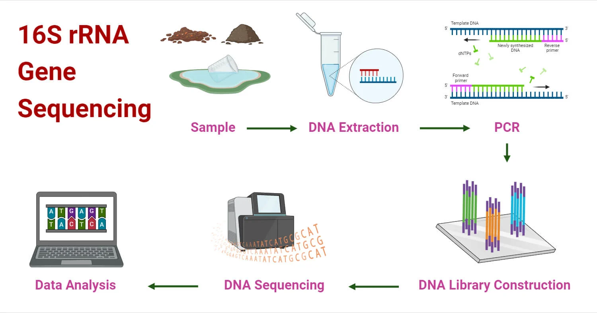

::: {.callout-note title="Lesson overview"}
**Questions**

- What are the primary steps involved in generating an ASV table from 16S rRNA gene sequencing data?
- How does denoising (DADA2) improve the accuracy of microbial community analysis compared to traditional OTU-based methods?
- Why are quality inspection and read truncation important, and how do they impact downstream analyses?
- How can we assign taxonomy to ASVs and prepare them for diversity analysis?

**Objectives**

- Inspect the quality of paired-end 16S reads and choose truncation parameters
- Run the DADA2 pipeline step by step in Galaxy: filter and trim, learn error rates, denoise, merge pairs, remove chimeras
- Track the number of reads kept at each step
- Assign taxonomy with the DADA2 naive Bayesian classifier and the SILVA database
- Build a phyloseq object for the diversity analysis
:::

::: {.callout-note title="Sources"}
This tutorial is adapted from the Galaxy Training Network tutorial [Building an amplicon sequence variant (ASV) table from 16S data using DADA2](https://training.galaxyproject.org/training-material/topics/microbiome/tutorials/dada-16S/tutorial.html) (Bérénice Batut et al.), applied to a human gut dataset and run on [Galaxy Australia](https://usegalaxy.org.au/). Some graphics come from [a note in microbenotes](https://microbenotes.com/16s-rrna-gene-sequencing/).
:::

# Introduction

The investigation of environmental microbial communities and microbiomes has been revolutionized by the
development of high-throughput amplicon sequencing. In amplicon sequencing a particular genetic locus,
for example the 16S rRNA gene (or a part of it) in bacteria, is amplified from DNA extracted from the community of interest,
and then sequenced on a next-generation sequencing platform. This technique removes the need to culture
microbes in order to detect their presence, and cost-effectively provides a deep census of a microbial community.



# What is the 16S ribosomal RNA gene ? 


# How to process 16S amplicon sequencing data ? 

To process 16S amplicon sequencing data, several tools exist: **QIIME 2** ([Bolyen et al. 2019](https://doi.org/10.1038/s41587-019-0209-9)), **Mothur**, **Lotus2** and **DADA2** ([Callahan et al. 2016](https://doi.org/10.1038/nmeth.3869)). All these tools can be used in Galaxy. In this tutorial we will use **DADA2**.

In Galaxy, each function of the DADA2 R package is available as a separate tool (**dada2: filterAndTrim**, **dada2: learnErrors**, **dada2: dada**…). Running them one by one lets us look at the result of every step of the pipeline.

## ASVs instead of OTUs

The output of the DADA2 pipeline is a feature table of amplicon sequence variants (an ASV table): a matrix with rows corresponding to samples and columns to ASVs, in which the value of each entry is the number of times that ASV was observed in that sample. This table is analogous to the traditional OTU table, except that one gets the actual sequences of the "true" sequence variants instead of rather anonymous and abstract entities called OTU1, OTU2, etc.

The process of amplicon sequencing introduces errors into the sequencing data, and these errors
severely complicate the interpretation of the results. **DADA2** implements an algorithm that models the errors introduced during amplicon sequencing, and uses that error model to infer the true sample composition. As shown in the DADA2 paper and in [further benchmarking](http://benjjneb.github.io/dada2/SotA.html), this method is more sensitive and specific than traditional OTU methods: it detects real biological variation missed by OTU methods while outputting fewer spurious sequences.

## The dataset

The data come from a gut microbiome study of **pediatric ulcerative colitis (UC)**, a chronic inflammatory bowel disease:

> Zuo W, Wang B, Bai X, Luan Y, Fan Y, Michail S, Sun F. *16S rRNA and metagenomic shotgun sequencing data revealed consistent patterns of gut microbiome signature in pediatric ulcerative colitis.* Scientific Reports (2022). [doi:10.1038/s41598-022-07995-7](https://www.nature.com/articles/s41598-022-07995-7)

The authors collected stool samples from **19 children and young adults with UC** and **23 healthy controls** (7–21 years old) at the Children's Hospital of Los Angeles. Each sample was sequenced in two ways: **16S rRNA amplicon sequencing** and **shotgun metagenomic sequencing**, to check whether both approaches give the same picture of the gut microbiome.

| | 16S data used in this tutorial |
|---|---|
| Sample | Human stool (fecal DNA extracted with the QIAamp PowerFecal kit) |
| Target | **V4** region of the 16S rRNA gene |
| Primers | 515FB `GTGYCAGCMGCCGCGGTAA` / 806RB `GGACTACNVGGGTWTCTAAT` |
| Sequencing | Illumina MiSeq, **2 × 150 bp** paired-end |
| Data | NCBI BioProject [PRJNA759642](https://www.ncbi.nlm.nih.gov/bioproject/PRJNA759642) |

### What did the authors do?

1. **DADA2**  to denoise the reads into ASVs, as we will do here with the Galaxy DADA2 tools.
2. Taxonomy assigned with a **naive Bayes classifier** on the **SILVA 138** database. We will use the DADA2 implementation of the same type of classifier, also with SILVA
3. **Alpha diversity** with the Shannon index, and **beta diversity** with Bray–Curtis distances and PCoA (see the diversity analysis page)

### Our subset

To keep the analysis short, we will use **4 samples** out of the 42:

| SRA run | Sample name | Metadata |
|---|---| ---|
| [SRR15702564](https://www.ncbi.nlm.nih.gov/sra/SRR15702564) | 012618.SM92 | UC |
| [SRR15702563](https://www.ncbi.nlm.nih.gov/sra/SRR15702563) | 012618.SM97 |UC |
| [SRR15702530](https://www.ncbi.nlm.nih.gov/sra/SRR15702530) | SM030818.140 |Healthy |
| [SRR15702529](https://www.ncbi.nlm.nih.gov/sra/SRR15702529) | SM030818.141 | Healthy |


::: {.callout-note title="A small dataset"}
With only 4 samples, we can learn every step of the workflow, but statistical tests (e.g. comparing groups) will have very little power. The results will not necessarily reproduce the conclusions of the paper, which were obtained on 42 samples.
:::

# Prepare Galaxy and data

## Import the workflow

You can either follow the tutorial below, or [import the dada2 workflow](https://usegalaxy.org.au/u/mathis-arnal/w/binder-dada2-amplicon-analysis-pipeline-for-paired-end-reads).

## Create a history

::: {.callout-tip title="History creation"}
1. Create a new history for this analysis
2. Rename it, e.g. `16S Gut Microbiome`
:::

## Import the reads from SRA

DADA2 expects a set of **demultiplexed** FASTQ files: one forward and one reverse file per sample. It also expects that there are no non-biological bases (primers, adapters) in the reads: in this dataset, the primers are not present in the reads.

As in the Galaxy introduction, we download the reads directly from the SRA with their accession numbers.

::: {.callout-tip title="Import the FASTQ files from SRA"}
1. Create a new file with **Upload** → **Paste/Fetch data**, containing the 4 accessions, one per line:

    ```
    SRR15702564
    SRR15702563
    SRR15702530
    SRR15702529
    ```

    Set the datatype to `txt` and name it `SRA accessions`.

2. Open **Faster Download and Extract Reads in FASTQ format from NCBI SRA** with:
    - *"select input type"*: `List of SRA accession, one per line`
    - *"sra accession list"*: `SRA accessions`
3. Click **Run Tool**
4. Rename the `Pair-end data (fasterq-dump)` collection to `16S Raw Reads`
:::

The tool creates a **list of dataset pairs**: one element per sample, named with its SRA accession (e.g. `SRR15702564`), containing a forward and a reverse file.

::: {.callout-note title="Sample names matter"}
The DADA2 tools name the samples after the **element identifiers** of the collection, here the **SRA accessions**. We will use exactly the same names in the metadata table later.
:::

:::: {.callout-important title="Question: Read lengths" collapse="true"}
Click on the collection and look at the reads of a sample of each batch (`SRR15702564` and `SRR15702530`). Are all reads 150 bp long?

::: {.callout-tip title="Answer" collapse="true"}
No. The two pairs of samples were not sequenced in the same run: the forward reads are 150 bp for all samples, but the reverse reads of `SRR15702564` and `SRR15702563` are shorter (140 bp) than those of `SRR15702530` and `SRR15702529` (~151 bp). We need to keep this in mind when choosing the truncation lengths: with DADA2, reads **shorter** than the truncation length are discarded.
:::
::::

## Sort the collection

Some DADA2 tools process the samples one after the other in a single job and expect the collection to be sorted.

::: {.callout-tip title="Sort the collection"}
1. Open **Sort collection** with:
    - *"Input Collection"*: `16S Raw Reads`
    - *"Sort type"*: `alphabetical`
2. Rename the output `Sorted Raw Reads`
:::

# Processing data using DADA2

Once demultiplexed FASTQ files without non-biological nucleotides are in hand, the **DADA2** pipeline proceeds as follows:

1. Prepare reads
    1. Inspect read quality profiles
    2. Filter and trim
    3. Learn the error rates
    4. Infer sample composition
    5. Merge forward/reverse reads
2. Construct sequence table
    1. Make sequence table
    2. Remove chimeras
3. Assign taxonomy

# Prepare reads

## Inspect read quality profiles

Before filtering, we look at the quality of the reads to decide where to truncate them.

::: {.callout-tip title="Inspect read quality profiles"}
1. Open **dada2: plotQualityProfile** with:
    - *"Processing mode"*: `Joint`
        - *"Paired reads"*: `paired - in a data set pair`
            - *"Paired short read data"*: `Sorted Raw Reads`
        - *"Aggregate data"*: `No`
    - *"sample number"*: `10000000`
2. Click **Run Tool**
:::

**dada2: plotQualityProfile** generates 2 PDF files with the quality profiles of each sample: one for the forward reads and one for the reverse reads.

In gray-scale is a heatmap of the frequency of each quality score at each base position. The mean quality score at each position is shown by the green line, and the quartiles of the quality score distribution by the orange lines. The red line shows the scaled proportion of reads that extend to at least that position.

:::: {.callout-important title="Question: Where to truncate?" collapse="true"}
Inspect the forward and reverse outputs of **plotQualityProfile**:

1. Are the forward reads good quality?
2. We generally advise trimming the last few nucleotides to avoid less well-controlled errors that can arise there. What would you recommend as truncation position for the forward reads?
3. Are the reverse reads good quality?
4. What would you recommend as truncation position for the reverse reads?
5. Look at the red line of the reverse reads of `SRR15702564`. What does it show?

::: {.callout-tip title="Answer" collapse="true"}
1. The forward reads are good quality over most of their length.
2. We will truncate the forward reads at position **145**, trimming the last few nucleotides.
3. The reverse reads are of worse quality, especially at the end, which is common in Illumina sequencing. DADA2 incorporates quality information into its error model, but trimming the low-quality end improves its sensitivity to rare sequence variants.
4. We will truncate the reverse reads at position **135**. This is also below the length of the shortest reverse reads (140 bp), so no sample loses all its reads.
5. The red line drops at position 140: no read of this sample is longer than 140 bp.

We cannot truncate much more than this: the reads must still overlap to be merged (see below).
:::
::::

::: {.callout-note title="Truncation and read overlap"}
Your reads must still overlap after truncation in order to be merged! DADA2 requires at least **12 nucleotides of overlap** by default, plus some margin for the natural length variation of the amplicon. The longer the overlap, the more robust the merging.

In this dataset, the primers are not in the reads, so the reads cover the region **between** the primers: about **253 bp** for V4. With 2 × 150 bp reads, the room for truncation is small:

| Truncation (forward + reverse) | Overlap on a 253 bp region | |
|---|---|---|
| 150 + 140 = 290 | ~37 bp | OK |
| **145 + 135 = 280** | **~27 bp** | **Used here** |
| 140 + 130 = 270 | ~17 bp | Risky |
| < 265 | < 12 bp | Merging fails |

So with short reads, the truncation is guided by the overlap as much as by the quality scores. With longer amplicons, like V3-V4 (~430 bp), even 2 × 250 bp reads leave little room for truncation.
:::

::: {.callout-warning title="Check that the primers are really absent"}
If the primers were still in the reads, the sequenced fragment would be ~292 bp, and 2 × 150 bp reads would overlap by only ~8 bp: almost no reads would merge. You can check it by searching the beginning of the forward reads for the 515F primer (`GTGYCAGCMGCCGCGGTAA`). If you find it, remove the primers with **Cutadapt**, or with the *"Trim start of reads"* parameter of **dada2: filterAndTrim** (19 bp for the forward primer, 20 bp for the reverse primer).
:::

## Filter and trim

::: {.callout-tip title="Filter and trim"}
1. Open **dada2: filterAndTrim** with:
    - *"Paired reads"*: `paired - in a data set pair`
        - *"Paired short read data"*: `Sorted Raw Reads`
    - In *"Trimming parameters"*:
        - *"Truncate read length"*: `145`
    - In *"Filtering parameters"*:
        - *"Remove reads by number expected errors"*: `2`
    - *"Separate filters and trimmers for reverse reads"*: `Yes`
        - In *"Trimming parameters"*:
            - *"Truncate read length"*: `135`
        - In *"Filtering parameters"*:
            - *"Remove reads by number expected errors"*: `2`
2. Click **Run Tool**
:::

The *"Remove reads by number expected errors"* parameter (`maxEE`) sets the maximum number of **expected errors** allowed in a read. The expected errors of a read are the sum of the error probabilities of its bases (10^(−Q/10) for a quality score Q), [a better filter than simply averaging quality scores](https://academic.oup.com/bioinformatics/article/31/21/3476/194979).

**dada2: filterAndTrim** generates 2 outputs:

- a paired collection named `Paired reads` with the trimmed and filtered reads
- a collection with statistics for each sample (`reads.in` and `reads.out`)

:::: {.callout-important title="Question: Filtering" collapse="true"}
1. How many reads were in `SRR15702564` before filtering and trimming?
2. How many reads are left after filtering and trimming?

::: {.callout-tip title="Answer" collapse="true"}
In the `SRR15702564` element of the statistics collection, look at `reads.in` and `reads.out`. The sample has 48,965 read pairs before filtering.
<!-- TODO: add reads.out from your own run -->
:::
::::

::: {.callout-note title="Adjusting the filter"}
The filtering parameters are starting points, not set in stone. If too few reads pass the filter, consider relaxing the value for the reverse reads (e.g. *"Remove reads by number expected errors"* to `5`). With 2 × 150 bp reads, truncating more is rarely an option: the reads would no longer overlap.
:::

To see the impact of filtering and trimming, we can inspect the quality profiles again and compare them to the ones before.

::: {.callout-tip title="Inspect read quality profiles after filterAndTrim"}
1. Open **dada2: plotQualityProfile** with:
    - *"Processing mode"*: `Joint`
        - *"Paired reads"*: `paired - in a data set pair`
            - *"Paired short read data"*: `Paired reads` output of **dada2: filterAndTrim**
        - *"Aggregate data"*: `No`
    - *"sample number"*: `10000000`
:::

:::: {.callout-important title="Question: Quality after filtering" collapse="true"}
How did trimming and filtering change the quality profiles of the reverse reads?

::: {.callout-tip title="Answer" collapse="true"}
All reads now stop at position 135, so the low-quality end of the reverse reads has been removed, and the reads with too many expected errors are gone.
:::
::::

## Learn the error rates

The DADA2 algorithm makes use of a parametric error model (`err`), and every amplicon dataset has a different set of error rates. The **dada2: learnErrors** method learns this error model from the data, by alternating estimation of the error rates and inference of sample composition until they converge on a jointly consistent solution. The algorithm starts with an initial guess: the maximum possible error rates in the data (the error rates if only the most abundant sequence is correct and all the rest are errors).

**dada2: learnErrors** expects a simple collection, not a paired collection. We first split the paired collection into 2 collections: one with the forward reads and one with the reverse reads.

::: {.callout-tip title="Unzip the paired collection"}
1. Open **Unzip collection** with:
    - *"Paired input to unzip"*: `Paired reads` output of **dada2: filterAndTrim**
2. Add the tag `#forward` to the `(forward)` collection
3. Add the tag `#reverse` to the `(reverse)` collection
:::

::: {.callout-tip title="Learn the error rates"}
1. Open **dada2: learnErrors** with:
    - *"Short read data"*: the `#forward` output of **Unzip collection**
2. Open **dada2: learnErrors** again with:
    - *"Short read data"*: the `#reverse` output of **Unzip collection**
:::

Each run produces the error model and a plot of the error rates for each possible transition (A→C, A→G…) as a function of the quality score. The points are the observed error rates for each quality score, the black line the estimated error rates after convergence, and the red line the error rates expected from the nominal definition of the quality score.

:::: {.callout-important title="Question: Error rates" collapse="true"}
1. Are the estimated error rates (black line) a good fit to the observed rates (points) for the forward reads?
2. What about the reverse reads?

::: {.callout-tip title="Answer" collapse="true"}
1. If the black line follows the points, and the error rates drop as the quality increases, the error model is reasonable and we can proceed with confidence.
2. Check the same for the reverse reads.
<!-- TODO: describe the plots from your own run -->
:::
::::

::: {.callout-note title="Samples from several sequencing runs"}
Each sequencing run has its own error profile. With samples from several runs, the recommended practice is to run **learnErrors**, **dada** and **mergePairs** separately for **each run**, with the same truncation parameters, and to combine the runs at the **makeSequenceTable** step. ASVs are exact sequences, so the same ASV found in two runs is merged automatically. To keep this tutorial short, we process our 4 samples (2 runs) together.
:::

## Infer sample composition

In this step, the core sample inference algorithm ([Callahan et al. 2016](https://doi.org/10.1038/nmeth.3869)) is applied to the filtered and trimmed reads.

For each sample, DADA2 first collapses identical reads into **unique sequences** with their abundance. It then starts with all unique sequences in a single partition, centred on the most abundant one. For every other unique sequence, it computes, with the error model, the probability of observing it that many times if it were only sequencing errors of the centre sequence. If this probability is too low, the sequence is too abundant to be an error: it becomes the centre of a new partition, i.e. a new **ASV**. The process is repeated until no new partition is created.

::: {.callout-tip title="Sample inference"}
1. Open **dada2: dada** with:
    - *"Process samples in batches"*: `no`
        - *"Reads"*: the `#forward` output of **Unzip collection**
        - *"Pool samples"*: `process samples individually`
    - *"Error rates"*: the `#forward` output of **dada2: learnErrors**
2. Open **dada2: dada** again with:
    - *"Process samples in batches"*: `no`
        - *"Reads"*: the `#reverse` output of **Unzip collection**
        - *"Pool samples"*: `process samples individually`
    - *"Error rates"*: the `#reverse` output of **dada2: learnErrors**
:::

::: {.callout-note title="Batches and pooling"}
- *"Process samples in batches"*: `no` starts a single Galaxy job in which the samples are processed one after the other (which is why we sorted the collection); `yes` starts one job per sample, which can be faster. Both give identical results when the samples are not pooled.
- *"Pool samples"*: by default, each sample is processed independently. Pooling information across samples can increase the sensitivity to sequence variants present at low frequency in several samples:
    - `pool samples`: all samples are pooled together for sample inference
    - `pseudo pooling between individually processed samples`: samples are processed independently after sharing information between them, approximating pooled inference in linear time
:::

:::: {.callout-important title="Question: Sequence variants" collapse="true"}
Click on an output collection of **dada2: dada**, then on the ℹ️ (*Dataset details*) icon of a sample, and expand *Tool Standard Output*.

1. How many unique sequences are in the forward reads of `SRR15702564`?
2. How many sequence variants have been inferred from these unique sequences?

::: {.callout-tip title="Answer" collapse="true"}
The standard output contains a line like `X reads in Y unique sequences` and `Z sequence variants were inferred from Y input unique sequences`. Many unique sequences are only sequencing errors of a few true sequences.
<!-- TODO: add the numbers from your own run -->
:::
::::

## Merge paired reads

We now merge the forward and reverse reads to obtain the full denoised sequences. Merging is performed by aligning the denoised forward reads with the reverse-complement of the corresponding denoised reverse reads, and then constructing the merged "contig" sequences. By default, merged sequences are only kept if the forward and reverse reads overlap by at least **12 bases** and are **identical** in the overlap region.

::: {.callout-tip title="Merge paired reads"}
1. Open **dada2: mergePairs** with:
    - *"Dada results for forward reads"*: the `#forward` output of **dada2: dada**
    - *"Forward reads"*: the `#forward` output of **Unzip collection**
    - *"Dada results for reverse reads"*: the `#reverse` output of **dada2: dada**
    - *"Reverse reads"*: the `#reverse` output of **Unzip collection**
    - *"Concatenated rather than merge"*: `No`
    - *"Output detailed table"*: `Yes`
:::

:::: {.callout-important title="Question: Merging" collapse="true"}
Inspect the `details` collection.

1. What are the columns of the detail table?
2. Look at the `nmatch` column. Is it consistent with the overlap expected from our truncation lengths?

::: {.callout-tip title="Answer" collapse="true"}
1. The table contains, for each merged sequence: the sequence, its abundance, the indices of the forward and reverse sequence variants that were merged, the number of matches, mismatches and indels in the overlap, and whether the merge was accepted. Paired reads that did not overlap exactly were removed, further reducing spurious output.
2. Yes: with 145 + 135 bp reads on a ~253 bp region, the overlap is around **27 bases**.
:::
::::

::: {.callout-note title="Not enough reads merged"}
Most of the reads should merge. If that is not the case, check the truncation lengths: did you trim away the overlap between your reads?
:::

# Construct the sequence table

## Make sequence table

We now construct the ASV table, a higher-resolution version of the OTU table produced by traditional methods.

::: {.callout-tip title="Make sequence table"}
1. Open **dada2: makeSequenceTable** with:
    - *"samples"*: output of **dada2: mergePairs**
    - *"Length filter method"*: `No filter`
:::

**dada2: makeSequenceTable** generates 2 outputs:

1. A **sequence table**: a matrix with one row per sequence variant (named by its sequence) and one column per sample
2. An image with the **distribution of the sequence lengths**

:::: {.callout-important title="Question: Exploring the ASV table" collapse="true"}
1. How many ASVs have been identified?
2. What is the range of the merged sequence lengths? Does it make sense for a V4 amplicon?

::: {.callout-tip title="Answer" collapse="true"}
1. Count the lines of the sequence table: each line, except the header, is an ASV.
2. Most sequences should be around **251–255 bp**, the expected size of the V4 region between the primers.
<!-- TODO: add the number of ASVs from your own run -->
:::
::::

::: {.callout-note title="Sequences too long or too short"}
Sequences much longer or shorter than expected may be the result of non-specific priming. They can be removed with the *"Length filter method"* parameter of **dada2: makeSequenceTable**, the "cutting a band" in-silico equivalent.
:::

## Remove chimeras

The core DADA2 method corrects substitution and indel errors, but chimeras remain. Chimeras are artefactual sequences made from two "parent" sequences during PCR. Thanks to the accuracy of ASVs, they can be identified as sequences that can be exactly reconstructed by combining a left segment and a right segment of two more abundant "parent" sequences.

::: {.callout-tip title="Remove chimeras"}
1. Open **dada2: removeBimeraDenovo** with:
    - *"sequence table"*: output of **dada2: makeSequenceTable**
:::

:::: {.callout-important title="Question: Chimeras" collapse="true"}
What percentage of the reads are non-chimeric?

::: {.callout-tip title="Answer" collapse="true"}
The percentage is shown when expanding the dataset in the history (`remaining nonchimeric: …%`). It is common for a large fraction of the **sequence variants** to be removed, but they should represent only a small fraction of the **reads**.
<!-- TODO: add the percentage from your own run -->
:::
::::

## Track reads through the pipeline

As a final check, we look at the number of reads that made it through each step of the pipeline.

::: {.callout-tip title="Track reads through the pipeline"}
1. Open **dada2: sequence counts** and add one *"Insert data sets"* block for each step:
    - *"Dataset(s)"*: output of **dada2: filterAndTrim**, *"name"*: `FiltTrim`
    - *"Dataset(s)"*: `#forward` output of **dada2: dada**, *"name"*: `Dada Forward`
    - *"Dataset(s)"*: `#reverse` output of **dada2: dada**, *"name"*: `Dada Reverse`
    - *"Dataset(s)"*: output of **dada2: mergePairs**, *"name"*: `MergePairs`
    - *"Dataset(s)"*: output of **dada2: makeSequenceTable**, *"name"*: `SeqTab`
    - *"Dataset(s)"*: output of **dada2: removeBimeraDenovo**, *"name"*: `Bimera`
:::

:::: {.callout-important title="Question: Where are reads lost?" collapse="true"}
1. Have we kept the majority of the raw reads for each sample?
2. Is there any exceptionally large drop associated with a single step for any sample?

::: {.callout-tip title="Answer" collapse="true"}
1. Compare the first and last columns for each sample.
2. The largest loss should be at the filtering step. Merging and chimera removal should only remove a small fraction of reads.
<!-- TODO: add the numbers from your own run -->
:::
::::

::: {.callout-note title="What if many reads are lost?"}
Outside of filtering, there should be no step in which a majority of reads are lost.

- If most reads **failed to merge**, the truncation lengths are probably too short: the reads no longer overlap.
- If most reads were **removed as chimeric**, primers were probably not removed: ambiguous nucleotides in primers interfere with chimera identification. Remove them with **Cutadapt** or the *"Trim start of reads"* parameter of **dada2: filterAndTrim**.
:::

# Assign taxonomy

It is common at this point, especially in 16S/18S/ITS amplicon sequencing, to assign a taxonomy to the sequence variants. DADA2 provides a native implementation of the **naive Bayesian classifier** method ([Wang et al. 2007](https://doi.org/10.1128/AEM.00062-07)), the same family of method as the classifier used by the authors. **dada2: assignTaxonomy** takes the sequences to classify and a training set of reference sequences with known taxonomy, and outputs taxonomic assignments with at least `minBoot` bootstrap confidence (50 by default).

DADA2 maintains [formatted training sets for the SILVA, RDP and GreenGenes databases](https://benjjneb.github.io/dada2/training.html). Galaxy provides some of them as built-in references.

::: {.callout-tip title="Assign taxonomy"}
1. Open **dada2: assignTaxonomy and addSpecies** with:
    - *"sequences to be assigned"*: output of **dada2: removeBimeraDenovo**
    - *"Select a reference dataset your history or use a built-in?"*: `Use a built-in reference`
        - *"Select reference data set"*: the most recent **Silva** version available (the authors used SILVA 138)
    - *"Add genus-species binomials to the taxonomic table"*: `Yes`
        - *"Select a reference dataset your history or use a built-in?"*: `Use a built-in reference`
            - *"Select reference data set"*: the same **Silva** version
        - *"reporting options"*: `only unambiguous identifications`
2. Click **Run Tool**
:::

::: {.callout-note title="Species assignment by exact matching"}
DADA2 makes [species level assignments by **exact matching**](https://benjjneb.github.io/dada2/assign.html#species-assignment) between the ASVs and sequenced reference strains. Exact matching (100% identity) is considered the only appropriate way to assign species to 16S gene fragments.
:::

**dada2: assignTaxonomy and addSpecies** generates a table with one row per ASV and one column per taxonomic level (Kingdom, Phylum, Class, Order, Family, Genus, Species).

:::: {.callout-important title="Question: Taxonomic assignments" collapse="true"}
1. Which kingdom(s) have been identified?
2. Which phyla have been identified? How many ASVs per phylum?
3. Are many ASVs assigned down to species level? Why?

::: {.callout-tip title="Answer" collapse="true"}
1. Bacteria.
2. Use **Group data by a column** on the taxonomy table, grouping by `Column 3` (Phylum), with the operation *"Count"* on `Column 3`. **Firmicutes** (Bacillota) and **Bacteroidota** should be well represented, which is expected for human stool samples.
3. Few ASVs have a species assignment, because closely related species often have identical or nearly identical sequences over a ~250 bp fragment of the 16S gene. This is why the authors of the study worked at **genus** level with their 16S data.
<!-- TODO: add the table of phyla from your own run -->
:::
::::

::: {.callout-note title="Wrong kingdom"}
If your reads do not seem to be appropriately assigned, for example lots of bacterial 16S sequences assigned as `Eukaryota`, your reads may be in the opposite orientation to the reference database. Set *"Try reverse complement"* to `Yes` in **dada2: assignTaxonomy and addSpecies** and see if this fixes the assignments.
:::
