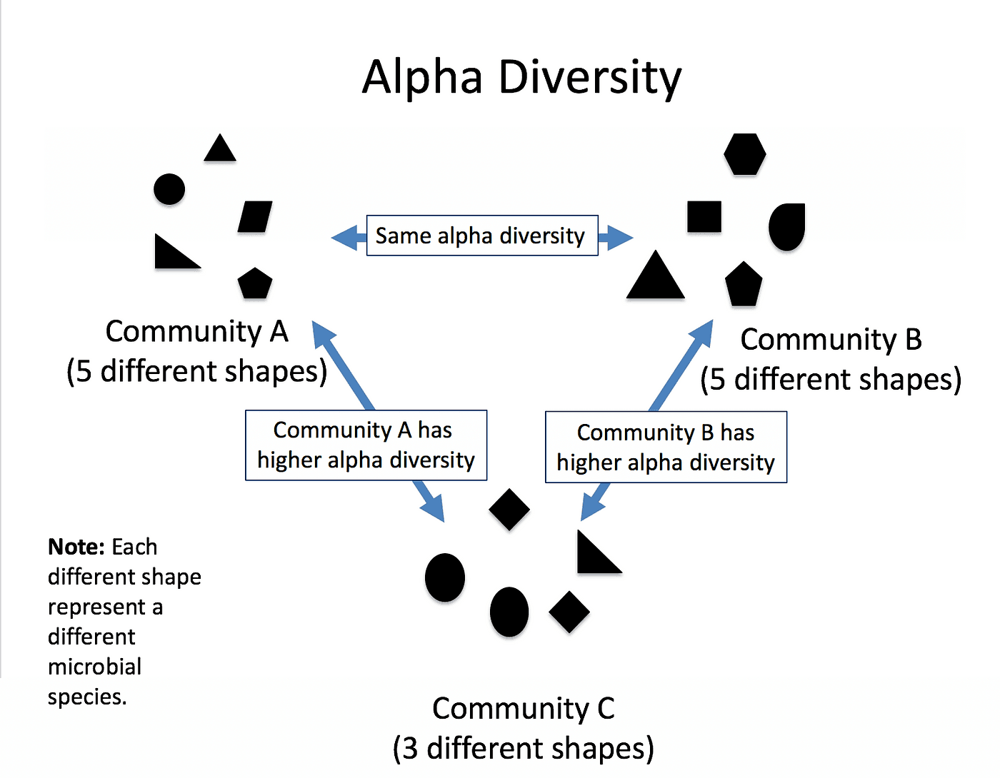

# Prepare the metadata and the phyloseq object

**phyloseq** ([McMurdie & Holmes 2013](https://doi.org/10.1371/journal.pone.0061217)) is an R framework to store, analyse and plot microbiome data. A phyloseq object combines the ASV table, the taxonomy table and a **metadata table** describing the samples. We will use it for the diversity analysis.

## Create the metadata table 


::: {.callout-tip title="Create the metadata table"}
1. Click **Upload** → **Paste/Fetch data** and paste the following table:

    ```
    Sample	sample_name	Metadata
    SRR15702564	012618.SM92 UC
    SRR15702563	012618.SM97 UC
    SRR15702530	SM030818.140    Healthy
    SRR15702529	SM030818.141    Healthy
    ```

2. In the upload settings, set the datatype to `tabular` and check **Convert spaces to tabs** (in case the tabs were replaced by spaces when copying)
3. Rename it `Metadata table`
:::

::: {.callout-tip title="Import the metadata for the 42 samples"}

If you want to do any analysis with 42 samples, you can find here the 42 samples metadata:

1. Click **Upload** → **Paste/Fetch data** and paste the following link:

    ```
https://raw.githubusercontent.com/jhayer/bioinfo_training_infectious_disease/main/data/16s/metadata.txt

    ```
:::


::: {.callout-tip title="Create the phyloseq object"}
1. Open **Create phyloseq object from dada2** with:
    - *"Sequence table"*: output of **dada2: removeBimeraDenovo**
    - *"Taxonomy table"*: output of **dada2: assignTaxonomy and addSpecies**
    - *"Sample table"*: `Metadata table`
2. Click **Run Tool** and rename the output `phyloseq object`
:::


The `phyloseq object` is the starting point of the diversity analysis.

# Diversity analysis

In this part, we explore the ASVs obtained with DADA2 using **phyloseq** ([McMurdie & Holmes 2013](https://doi.org/10.1371/journal.pone.0061217)). We use **Shiny-phyloseq** ([McMurdie & Holmes 2015](https://doi.org/10.1093/bioinformatics/btu616)), an interactive web interface to phyloseq that runs as a Galaxy interactive tool.

::: {.callout-tip title="Launch Shiny-phyloseq"}
1. Open **Phyloseq** (interactive tool) with:
    - *"Phyloseq R object"*: `phyloseq object` (output of **Create phyloseq object from dada2**)
2. Click **Run Tool**
3. Open the interactive tool from **User** → **Active Interactive Tools** (or the link in the dataset) once it is running
:::

A new page opens with Shiny-phyloseq, ready to explore the phyloseq object. The **Data** tab summarises the object: number of samples, ASVs, taxonomic ranks and metadata variables.

::: {.callout-note title="Comparing groups"}
In the plots below, we color the samples by `sequencing_run`, the only grouping variable in our metadata table. Once the disease status of each sample is added to the metadata table, use it instead to compare UC cases and healthy controls, as the authors did.
:::

## Import the history

I have [run the analysis of the 42 samples on this history](https://usegalaxy.org.au/u/mathis-arnal/h/16s-sequencing-42-samples). 

## Alpha diversity

A **diversity index** is a quantitative measure of the variety of species in a community. The **α diversity** describes the diversity *within* a sample. It considers the number of different species (the **richness**) and how evenly the individuals are distributed among them (the **evenness**).



Here we plot the α diversity of each sample with 2 measures:

- The **Shannon** index, which calculates the uncertainty in predicting the species identity of an individual selected from a community. This is the index used by the authors.
- The **Simpson** index, which calculates the probability that two individuals selected from a community belong to different species.

::: {.callout-tip title="Plot α diversity"}
1. Click on the **Alpha Diversity** tab
2. Select the following parameters:
    - *"X"*: `sample_name`
    - *"Color"*: `sequencing_run`
    - *"alpha Measures"*: `Shannon`, `Simpson`
:::

::: {.callout-note title="Alpha diversity and sequencing depth"}
The number of ASVs observed in a sample increases with the number of reads. Our samples have very different depths (from ~42,000 to ~195,000 read pairs before filtering), as in the original study. The authors checked that their alpha diversity results did not change after **rarefying** the samples (randomly subsampling them to the same number of reads). Richness estimates are the most sensitive to depth; the Shannon and Simpson indices are less affected.
:::

:::: {.callout-important title="Question: Alpha diversity" collapse="true"}
1. Which sample has the highest Shannon index?
2. The authors found a lower Shannon index in UC cases than in healthy controls. Can we test this with our 4 samples?

::: {.callout-tip title="Answer" collapse="true"}
1. Read it from the plot.
<!-- TODO: add the Shannon values from your own run -->
2. No. With 2 samples per group, a statistical test has almost no power, and here the groups would also be confounded with the sequencing run. The authors used 42 samples and a Wilcoxon rank-sum test.
:::
::::

## Beta diversity

The **β diversity** measures how different the samples are from each other. A distance (or dissimilarity) is computed between each pair of samples, and the distance matrix is projected in 2 dimensions with an **ordination** method to visualise it. Samples close to each other in the plot have similar communities.

As the authors did, we use the **Bray–Curtis** dissimilarity, which takes the abundance of the ASVs into account, and a **PCoA** (Principal Coordinates Analysis), which projects the samples so that the distances in the plot are as close as possible to the Bray–Curtis distances.

Phyloseq offers several other ordination methods, for example **NMDS** (Non-metric Multidimensional Scaling), which keeps the rank order of the distances rather than their exact values, or constrained methods (**CCA**, **RDA**) that relate the community composition to measured variables.

::: {.callout-tip title="Plot a PCoA"}
1. Click on the **Ordination** tab
2. Select the following parameters:
    - *"Display"*: `Samples`
    - *"Method"*: `PCoA`
    - *"Distance"*: `bray`
    - *"Transform"*: `Prop` (relative abundances, so that differences in sequencing depth do not drive the distances)
    - *"Color"*: `sequencing_run`
:::

:::: {.callout-important title="Question: Ordination" collapse="true"}
1. What percentage of the variation is explained by the first axis?
2. Are the samples from the two sequencing runs separated? Can you conclude that their gut microbiomes are different?

::: {.callout-tip title="Answer" collapse="true"}
1. Read it from the axis label.
<!-- TODO: add the percentage from your own run -->
2. Even if they are separated, we cannot conclude: with 4 samples, the separation cannot be tested, and a difference between runs may be a technical **batch effect** rather than a biological one. The authors used a **PERMANOVA** test on 42 samples to show that UC cases and healthy controls are separated (R² = 0.098, p = 0.001 with the 16S data).
:::
::::

## Taxonomic composition

Abundance barplots display the relative abundance of the taxa in each sample, to compare the composition of the communities.

::: {.callout-tip title="Plot an abundance stacked barplot"}
1. Click on the **Bar** tab
2. Select the following parameters:
    - *"X-axis"*: `sample_name`
    - *"Color"*: `Family`
    - *"Facet Col"*: `sequencing_run`
3. Click on **(Re)Build Graphic**
:::

The barplot is often hard to read: with many families, the color palette is too small to distinguish them. We filter the data to keep only the most abundant taxa.

::: {.callout-tip title="Filter and plot the abundance stacked barplot"}
1. Click on the **Filter** tab
2. Select the following parameters:
    - *"Taxa Min."*: `500`
3. Click on **Execute Filter**
4. Go back to the **Bar** tab and click on **(Re)Build Graphic**
:::

:::: {.callout-important title="Question: Taxonomic composition" collapse="true"}
1. Which families dominate the samples?
2. Do you find the families highlighted by the authors (*Lachnospiraceae*, *Oscillospiraceae*, *Akkermansiaceae*, *Enterobacteriaceae*)?

::: {.callout-tip title="Answer" collapse="true"}
1. and 2. Look at the families with the largest bars.
<!-- TODO: add the main families from your own run -->
:::
::::

::: {.callout-note title="Heatmaps instead of barplots"}
Stacked barplots become hard to read with many taxa. The [ampvis2 team](http://albertsenlab.org/ampvis2-heatmap/) suggests using heatmaps instead. You can plot one in the **Heatmap** tab of Shiny-phyloseq, or with the **ampvis2** tools available in Galaxy.
:::

# Conclusion

We processed raw paired-end 16S amplicon reads with the DADA2 tools in Galaxy:

1. Inspected the read quality and chose truncation lengths that keep enough overlap to merge the reads
2. Filtered the reads, learned the error rates, inferred the sequence variants, merged the pairs and removed the chimeras to obtain an ASV table
3. Assigned a taxonomy to the ASVs with the DADA2 naive Bayesian classifier and SILVA
4. Explored the alpha diversity, beta diversity and taxonomic composition of the samples with phyloseq

::: {.callout-tip title="Key Points"}
- DADA2 models the sequencing errors to infer exact sequence variants (ASVs), which are more accurate and reproducible than OTUs.
- Truncation lengths are chosen from the quality profiles, while keeping enough overlap to merge the reads: with 2 × 150 bp reads on V4, the room for truncation is small.
- Tracking the reads through the pipeline shows whether a step (merging, chimera removal) lost too many reads.
- Species assignment from short 16S fragments is limited; genus or family levels are more reliable.
- Alpha diversity describes each sample, beta diversity compares samples. Group comparisons need enough samples, and groups should not be confounded with sequencing runs.
:::
