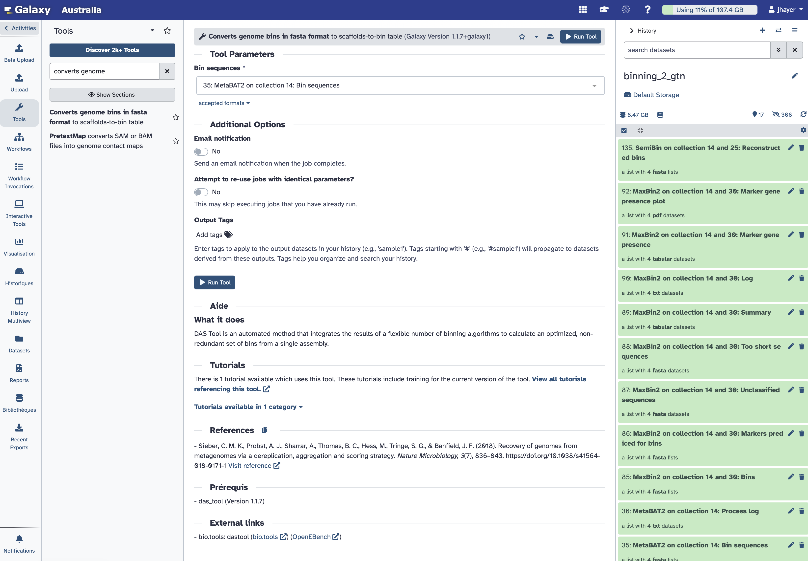

# MAGs: Assembly and binning shotgun metagenomics data

::: {.callout-note}
**Time:** 120 min

**Objectives:** 

- to be able to perform the *de novo* assembly of shotgun metagenomics dataset

- to use several methods for binning the produced contigs

- to refine the obtained bins to get MAGs (Metagenome Assembled Genomes)

- to assess the taxonomy of the obtained MAGs

**Question:**

- how to reconstruct genomes from metagenomes?

**Tools:** 
[megahit]()
[MetaBat2]()
[MaxBin2]()
[SemiBin]()
[Binette]()
[GTDBTk]()

:::

## Foreword about the metagenomics assembly

Reconstructing the genomes of microorganisms in the sampled communities is critical step in analyzing metagenomic data. To do that, we can use **assembly** and assemblers, *i.e.* computational programs that stich together the small fragments of sequenced DNA produced by sequencing instruments.

Assembling seems intuitively similar to putting together a jigsaw puzzle. Essentially, it looks for reads "that work together" or more precisely, reads that overlap. Tasks like this are **not straightforward**, but rather complex because of the complexity of the genomics (specially the repeats), the missing pieces and the errors introduced during sequencing.

**Metagenomic assembly** is further complicated by

*   the large volume of data produced

*   the quality of the sequence

*   the unequal representation of members of the microbial community

*   the presence of closely related microorganisms with similar genomes

*   the presence of several strains of the same microorganism

*   an insufficient amount of data for minor community members

For metagenomic assembly, several tools exist: [metaSPAdes](https://pmc.ncbi.nlm.nih.gov/articles/PMC5411777/), [MEGAHIT](https://academic.oup.com/bioinformatics/article/31/10/1674/177884), etc. 
The different assemblers have different computational characteristics and their performance varies according to the microbiome as shown in by both rounds of  Critical Assessment of Metagenome Interpretation initiative [CAMI](https://www.nature.com/articles/s41592-022-01431-4). The preference of one assembler over another depends on the purpose at hand.

Both tools are available in Galaxy. But currently, only MEGAHIT can be used in individual mode for several samples, as a option in the wrapper. MetaSPAdes performs co-assembly by default if multiple samples are supplied.

In this tutorial, we will learn how to run metagenomic assembly tool and evaluate the quality of the generated assemblies. To do that, we will use data from the study: [16S rRNA and metagenomic shotgun sequencing data revealed consistent patterns of gut microbiome signature in pediatric ulcerative colitis](https://www.nature.com/articles/s41598-022-07995-7). 

We will use the same 4 datasets that we used previously in the taxonomic profiling.

## Prepare the data and run *de novo* assembly using MEGAHIT

::: {.callout-handson}

Create a new history for this tutorial. You can call it **MAG** or **binning**

Use the multiview panel, and use the drag and drop function to retrieve the collection of reads that hs been quality controlled and trimmed using fastp when we did the taxonomic profiling exercise.

Once the fastp reads collection in your new MAG history, you are ready to run Megahit.

* Search for the **Megahit** in the tool menu.

Provide the fastp collection as input after selecting *Paired end collection*
Keep *Run individually*
Select *Yes* to *Generate log file*
::: 

::: {.callout-note}
Please note that this step might take a long time (maybe an hour or two)
:::

Once the assembly done, you can inspect the output files, they contain the produced contigs.

**MEGAHIT** produced a collection of output assemblies - one per sample - that can be used for the subsequent step of **metagenomic binning**. The output contains **contigs**, contiguous lengths of genomic sequences in which bases are known to a high degree of certainty.

::: {.callout-note}
Scaffolds: 
Contrary to **MetaSPAdes**, **MEGAHIT** does not output **scaffolds**. 
**Scaffolds** are segments of genome sequence reconstructed from contigs and gaps. The gaps occur when reads from the two sequenced ends of at least one fragment overlap with other reads from two different contigs (as long as the arrangement is otherwise consistent with the contigs being adjacent). It is possible to estimate the number of bases between contigs based on fragment lengths.

:::

::: {.callout-question}
How many contigs where produced for each sample?

::: 

For getting some metrics from the assembly, we will use Quast.

# Quality control of assembly

Once assembly is done, it is important to check its quality.

Assemblies can be evaluated with **metaQUAST**, the metagenomics mode of **QUAST**.

::: {.callout-handson}

Search for Quast in the tool menu.

- *"Assembly mode?"*: `Individual assembly (1 contig file per samples)`

- *"Use customized names for the input files?"*: `No, use dataset names`

- *"Contigs/scaffolds file"*: `output collection from **MEGAHIT**`

- *"Reads options"*: `Illumina paired-end reads in paired collection`

Tip !!!
        To speed up the processing, you may choose `Disabled` here. In this case, raw reads will **not** be mapped back to the assembly to compute metrics such as read coverage.

- *"FASTQ/FASTA files"*: `Fastp collection of reads`

- *"Type of assembly"*: `Metagenome`

- *"Output files"*: `HTML report`, `Tabular reports`, `Log file`, `Key metric summary (metagenome mode)`, `Krona charts (metagenome mode without reference genomes)`

::: 

You can now inspect the output files from Quast. It should allow you to answer the following questions:

::: {.callout-question}
Statistics without reference

1. How many contigs are produced for each sample?
2. How many sequences are in the output of MEGAHIT for each sample?
3. Why are these numbers different from the number of sequences in the output of MEGAHIT?
4. Which statistics in the metaQUAST report corresponds to number of sequences in the output of MEGAHIT?
5. How long are the largest contigs of each assembly?

:::

For going further with the inspection of the quality control of the metagenome assembly, you can check this [Galaxy tutorial](https://galaxyproject.github.io/training-material/topics/microbiome/tutorials/metagenomics-assembly/tutorial.html) from which this one is largely inspired. 

# About the binning

Metagenomics binning is a process used to classify DNA sequences obtained from metagenomic sequencing into discrete groups, or bins, based on their similarity to each other.

The goal of metagenomics binning is to assign DNA sequences to the organisms or taxonomic groups from which they originate, allowing for a better understanding of the diversity and functions of the microbial communities present in the sample. This is typically achieved through computational methods that include sequence similarity, composition, and other features to group the sequences into bins.

**Binning approaches**

There are several approaches to metagenomics binning, including:

Sequence composition-based binning: This method is based on the observation that different genomes have distinct sequence composition patterns, such as GC content or codon usage bias. By analyzing these patterns in metagenomic data, sequence fragments can be assigned to individual genomes or groups of genomes.

Coverage-based binning: This method uses the depth of coverage of sequencing reads to group them into bins. Sequencing reads that originate from the same genome are expected to have similar coverage, and this information can be used to identify groups of reads that represent individual genomes or genome clusters.

Hybrid binning: This method combines sequence composition-based and coverage-based binning to increase the accuracy of binning results. By using multiple sources of information, hybrid binning can better distinguish closely related genomes that may have similar sequence composition patterns.

Clustering-based binning: This method groups sequence fragments into clusters based on sequence similarity, and then assigns each cluster to a genome or genome cluster based on its sequence composition and coverage. This method is particularly useful for metagenomic data sets with high levels of genomic diversity.

Supervised machine learning-based binning: This method uses machine learning algorithms trained on annotated reference genomes to classify metagenomic data into bins. This approach can achieve high accuracy but requires a large number of annotated genomes for training.

Several binning methods exist, today we will use 3 different methods, and then a bin refinement tool; that will be described later.

## Prepare the data for the binning tools

Metagenomic binners typically take two types of data as input:

* A fasta file containing the assembled contigs, which can be generated from raw metagenomic sequencing reads using an assembler such as MEGAHIT, SPAdes, or IDBA-UD.

* A BAM file containing the read coverage information for each contig, which can be generated from the same sequencing reads using mapping software such as Bowtie2 or BWA.

::: {.callout-note}

Not all binners require coverage information. Some, like MetaBAT2, can operate using only genomic composition (e.g., tetranucleotide frequencies) when coverage files are not available. This is especially useful for single-sample datasets or legacy data where coverage cannot easily be calculated.

That said, including coverage information generally increases binning accuracy, especially for:

- Differentiating closely related strains

- Datasets with uneven abundance
- Multi-sample metagenomics workflows (e.g., differential coverage binning)

In summary: yes, it’s possible to bin without coverage, but coverage-aware workflows are recommended when available, as they reduce contamination and improve completeness.

:::

So let's map the reads back to the assembly using Bowtie2:

::: {.callout-handson}

- *"Is this single or paired library"*: `Paired-end`

- *"FASTQ Paired Dataset"*: `Reads` (Input dataset collection)

- *"Do you want to set paired-end options?"*: `No`

- *"Will you select a reference genome from your history or use a built-in index?"*: `Use a genome from the history and build index`

-  *"Select reference genome"*: `Contigs` (Input dataset collection)

- *"Set read groups information?"*: `Do not set`

- *"Select analysis mode"*: `1: Default setting only`

- *"Do you want to tweak SAM/BAM Options?"*: `No`

- *"Save the bowtie2 mapping statistics to the history"*: `Yes`

::: 

Lets now sort the bam files with Samtools sort

::: {.callout-handson}
Search for *samtools sort** and provide the bam collection produced by Bowtie2.

Primary sort key: `coordinates`
::: 

We are not set and ready for running the binning!

## Run 3 binning methods: MetaBAT2, MaxBin2, SemiBin

We will now run MetaBAT2:

::: {.callout-handson}
We first need to calculate the contigs depth using the tool:

**Calculate contigs depths** for MetaBAT2

Just provide the collection of *MEGAHIT* contigs to **MetaBAT2** 

::: 

Run MaxBin2 directly after, you do not need to wait for MetaBAT2 to complete.

::: {.callout-handson}

Before running **MaxBin2**, we  need to calculate the contigs depth using the tool:

**Calculate contigs depths**

- Mode: `One by one`

- Provide the collection of sorted bam from Samtools
- No reference

Once this step completes, we can search for **MaxBin2** in the tools menu.

- Provide the collection of MEGAHIT contigs to **MaxBin2** and the *contigs depths collection* 

- Input type is `Abundance`, and there you provide the `contigs depths collection`

::: 

Run SemBin directly after, you do not need to wait for MaxBin2 to complete.

::: {.callout-handson}

Search for **SemiBin** in the tools menu.
Setup the parameters as shown on the picture below.

:::

::: {.callout-note}

This step of the 3 binning methods running might take a while to compute.

In the mean time, you can read about these binners and the next step of **binning refinement** on this [Galaxy tutorial](https://galaxyproject.github.io/training-material/topics/microbiome/tutorials/metagenomics-binning/tutorial.html) from which this one is largely inspired.
:::

--

Use the tags for tagging each of the 3 bin2fasta collection: MetaBAT2 MaxBin2 SemiBin

Prep for Binnette:
  build list + insert 3 datasets (2 pics)
Binette 
GTDBTk

Write about co-assembly
Map host??
