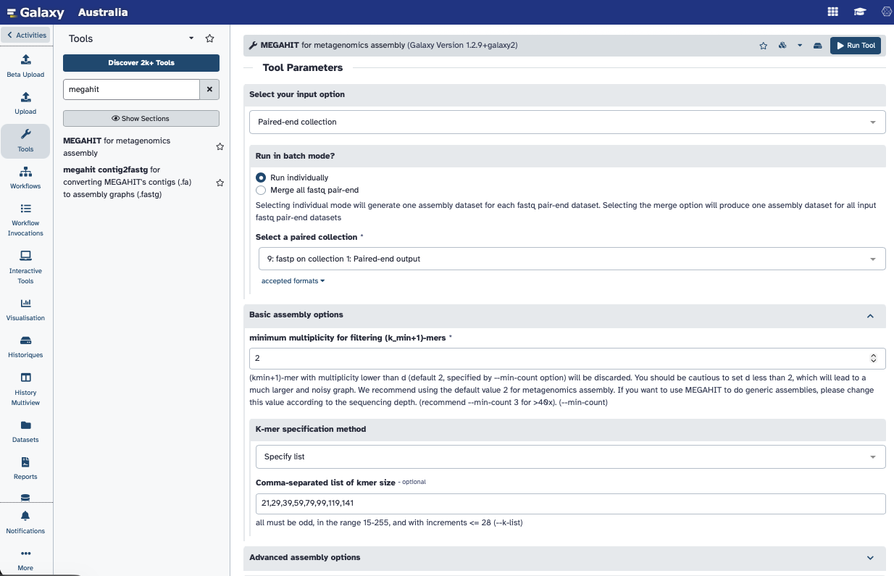
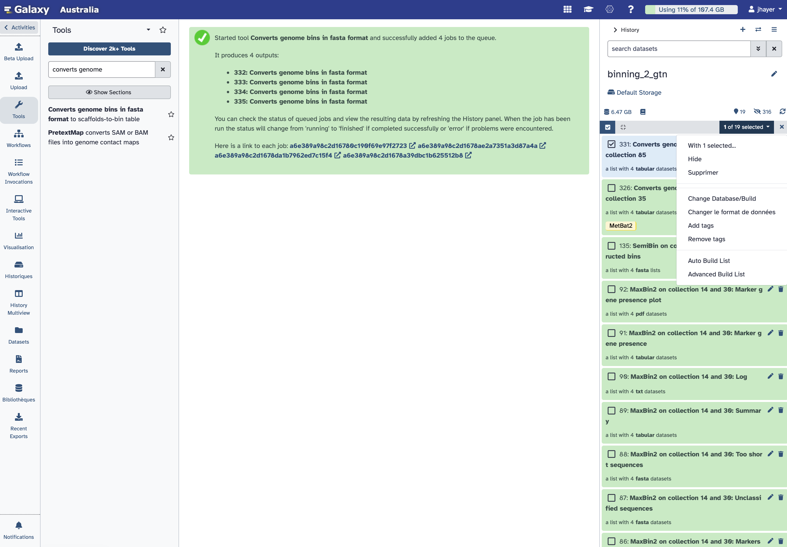
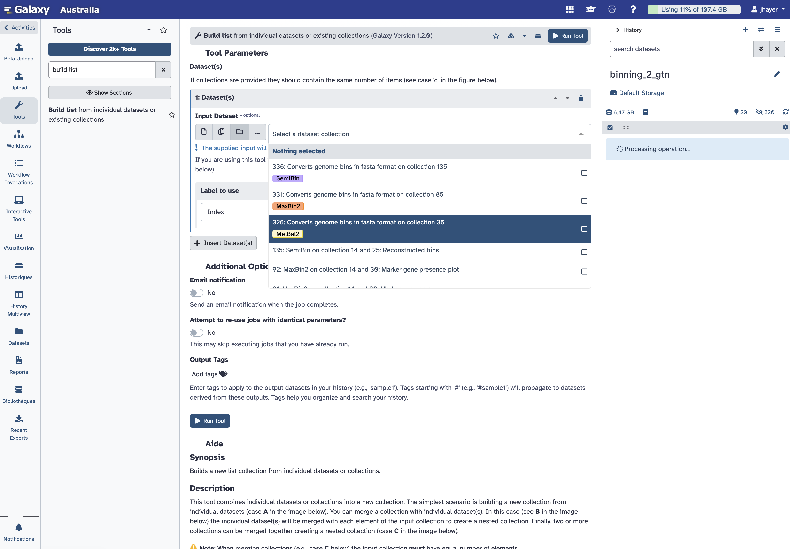

# MAGs: Assembly and binning of shotgun metagenomics data

::: {.callout-note}
**Time:** 120 min

**Objectives:** 

- to be able to perform the *de novo* assembly of shotgun metagenomics dataset

- to use several methods for binning the produced contigs

- to refine the obtained bins to get MAGs (Metagenome Assembled Genomes)

- to assess the taxonomy of the obtained MAGs

**Question:**

- how to reconstruct genomes from metagenomes?

**Tools:** 
[megahit]()
[MetaBat2]()
[MaxBin2]()
[SemiBin]()
[Binette]()
[GTDBTk]()

:::

## Foreword about the metagenomics assembly

Reconstructing the genomes of microorganisms in the sampled communities is critical step in analyzing metagenomic data. To do that, we can use **assembly** and assemblers, *i.e.* computational programs that stich together the small fragments of sequenced DNA produced by sequencing instruments.

Assembling seems intuitively similar to putting together a jigsaw puzzle. Essentially, it looks for reads "that work together" or more precisely, reads that overlap. Tasks like this are **not straightforward**, but rather complex because of the complexity of the genomics (specially the repeats), the missing pieces and the errors introduced during sequencing.

**Metagenomic assembly** is further complicated by

*   the large volume of data produced

*   the quality of the sequence

*   the unequal representation of members of the microbial community

*   the presence of closely related microorganisms with similar genomes

*   the presence of several strains of the same microorganism

*   an insufficient amount of data for minor community members

For metagenomic assembly, several tools exist: [metaSPAdes](https://pmc.ncbi.nlm.nih.gov/articles/PMC5411777/), [MEGAHIT](https://academic.oup.com/bioinformatics/article/31/10/1674/177884), etc. 
The different assemblers have different computational characteristics and their performance varies according to the microbiome as shown in by both rounds of  Critical Assessment of Metagenome Interpretation initiative [CAMI](https://www.nature.com/articles/s41592-022-01431-4). The preference of one assembler over another depends on the purpose at hand.

Both tools are available in Galaxy. But currently, only MEGAHIT can be used in individual mode for several samples, as a option in the wrapper. MetaSPAdes performs co-assembly by default if multiple samples are supplied.

In this tutorial, we will learn how to run metagenomic assembly tool and evaluate the quality of the generated assemblies. To do that, we will use data from the study: [16S rRNA and metagenomic shotgun sequencing data revealed consistent patterns of gut microbiome signature in pediatric ulcerative colitis](https://www.nature.com/articles/s41598-022-07995-7). 

We will use the same 4 datasets that we used previously in the taxonomic profiling.

## Prepare the data and run *de novo* assembly using MEGAHIT

::: {.callout-handson}

Create a new history for this tutorial. You can call it **MAG** or **binning**

Use the multiview panel, and use the drag and drop function to retrieve the collection of reads that hs been quality controlled and trimmed using fastp when we did the taxonomic profiling exercise.

Once the fastp reads collection in your new MAG history, you are ready to run Megahit.

* Search for the **Megahit** in the tool menu.

Provide the fastp collection as input after selecting *Paired end collection*
Keep *Run individually*
Select *Yes* to *Generate log file*
::: 



::: {.callout-note}
Please note that this step might take a long time (maybe an hour or two)
:::

Once the assembly done, you can inspect the output files, they contain the produced contigs.

**MEGAHIT** produced a collection of output assemblies - one per sample - that can be used for the subsequent step of **metagenomic binning**. The output contains **contigs**, contiguous lengths of genomic sequences in which bases are known to a high degree of certainty.


::: {.callout-note}
Scaffolds: 
Contrary to **MetaSPAdes**, **MEGAHIT** does not output **scaffolds**. 
**Scaffolds** are segments of genome sequence reconstructed from contigs and gaps. The gaps occur when reads from the two sequenced ends of at least one fragment overlap with other reads from two different contigs (as long as the arrangement is otherwise consistent with the contigs being adjacent). It is possible to estimate the number of bases between contigs based on fragment lengths.

:::

::: {.callout-question}
How many contigs where produced for each sample?

::: 

For getting some metrics from the assembly, we will use Quast.

# Quality control of assembly

Once assembly is done, it is important to check its quality.

Assemblies can be evaluated with **metaQUAST**, the metagenomics mode of **QUAST**.

::: {.callout-handson}

Search for Quast in the tool menu.

- *"Assembly mode?"*: `Individual assembly (1 contig file per samples)`

- *"Use customized names for the input files?"*: `No, use dataset names`

- *"Contigs/scaffolds file"*: `output collection from **MEGAHIT**`

- *"Reads options"*: `Illumina paired-end reads in paired collection`

Tip !!!
        To speed up the processing, you may choose `Disabled` here. In this case, raw reads will **not** be mapped back to the assembly to compute metrics such as read coverage.


- *"FASTQ/FASTA files"*: `Fastp collection of reads`

- *"Type of assembly"*: `Metagenome`

- *"Output files"*: `HTML report`, `Tabular reports`, `Log file`, `Key metric summary (metagenome mode)`, `Krona charts (metagenome mode without reference genomes)`

::: 

You can now inspect the output files from Quast. It should allow you to answer the following questions:

::: {.callout-question}
Statistics without reference

1. How many contigs are produced for each sample?
2. How many sequences are in the output of MEGAHIT for each sample?
3. Why are these numbers different from the number of sequences in the output of MEGAHIT?
4. Which statistics in the metaQUAST report corresponds to number of sequences in the output of MEGAHIT?
5. How long are the largest contigs of each assembly?

:::


For going further with the inspection of the quality control of the metagenome assembly, you can check this [Galaxy tutorial](https://galaxyproject.github.io/training-material/topics/microbiome/tutorials/metagenomics-assembly/tutorial.html) from which this one is largely inspired. 


# About the binning

Metagenomics binning is a process used to classify DNA sequences obtained from metagenomic sequencing into discrete groups, or bins, based on their similarity to each other.

The goal of metagenomics binning is to assign DNA sequences to the organisms or taxonomic groups from which they originate, allowing for a better understanding of the diversity and functions of the microbial communities present in the sample. This is typically achieved through computational methods that include sequence similarity, composition, and other features to group the sequences into bins.


**Binning approaches**

There are several approaches to metagenomics binning, including:

Sequence composition-based binning: This method is based on the observation that different genomes have distinct sequence composition patterns, such as GC content or codon usage bias. By analyzing these patterns in metagenomic data, sequence fragments can be assigned to individual genomes or groups of genomes.

Coverage-based binning: This method uses the depth of coverage of sequencing reads to group them into bins. Sequencing reads that originate from the same genome are expected to have similar coverage, and this information can be used to identify groups of reads that represent individual genomes or genome clusters.

Hybrid binning: This method combines sequence composition-based and coverage-based binning to increase the accuracy of binning results. By using multiple sources of information, hybrid binning can better distinguish closely related genomes that may have similar sequence composition patterns.

Clustering-based binning: This method groups sequence fragments into clusters based on sequence similarity, and then assigns each cluster to a genome or genome cluster based on its sequence composition and coverage. This method is particularly useful for metagenomic data sets with high levels of genomic diversity.

Supervised machine learning-based binning: This method uses machine learning algorithms trained on annotated reference genomes to classify metagenomic data into bins. This approach can achieve high accuracy but requires a large number of annotated genomes for training.


Several binning methods exist, today we will use 3 different methods, and then a bin refinement tool; that will be described later.


## Prepare the data for the binning tools

Metagenomic binners typically take two types of data as input:

* A fasta file containing the assembled contigs, which can be generated from raw metagenomic sequencing reads using an assembler such as MEGAHIT, SPAdes, or IDBA-UD.

* A BAM file containing the read coverage information for each contig, which can be generated from the same sequencing reads using mapping software such as Bowtie2 or BWA.


::: {.callout-note}

Not all binners require coverage information. Some, like MetaBAT2, can operate using only genomic composition (e.g., tetranucleotide frequencies) when coverage files are not available. This is especially useful for single-sample datasets or legacy data where coverage cannot easily be calculated.

That said, including coverage information generally increases binning accuracy, especially for:

- Differentiating closely related strains

- Datasets with uneven abundance
- Multi-sample metagenomics workflows (e.g., differential coverage binning)

In summary: yes, it’s possible to bin without coverage, but coverage-aware workflows are recommended when available, as they reduce contamination and improve completeness.

:::

So let's map the reads back to the assembly using Bowtie2:

::: {.callout-handson}

- *"Is this single or paired library"*: `Paired-end`

- *"FASTQ Paired Dataset"*: `Reads` (Input dataset collection)

- *"Do you want to set paired-end options?"*: `No`

- *"Will you select a reference genome from your history or use a built-in index?"*: `Use a genome from the history and build index`

-  *"Select reference genome"*: `Contigs` (Input dataset collection)

- *"Set read groups information?"*: `Do not set`

- *"Select analysis mode"*: `1: Default setting only`

- *"Do you want to tweak SAM/BAM Options?"*: `No`

- *"Save the bowtie2 mapping statistics to the history"*: `Yes`

::: 


Lets now sort the bam files with Samtools sort

::: {.callout-handson}
Search for *samtools sort** and provide the bam collection produced by Bowtie2.

Primary sort key: `coordinates`
::: 

We are not set and ready for running the binning!

## Run 3 binning methods: MetaBAT2, MaxBin2, SemiBin

### MetaBAT2
We will now run MetaBAT2:

MetaBAT stands for “Metagenome Binning based on Abundance and Tetranucleotide frequency”. 

MetaBAT is a popular software tool for metagenomics binning, and there are several reasons why it is often used:

High accuracy: MetaBAT uses a combination of tetranucleotide frequency, coverage depth, and read linkage information to bin contigs, which has been shown to be highly accurate and efficient.
Easy to use: MetaBAT has a user-friendly interface and can be run on a standard desktop computer, making it accessible to a wide range of researchers with varying levels of computational expertise.
Flexibility: MetaBAT can be used with a variety of sequencing technologies, including Illumina, PacBio, and Nanopore, and can be applied to both microbial and viral metagenomes.
Scalability: MetaBAT can handle large-scale datasets, and its performance has been shown to improve with increasing sequencing depth.
Compatibility: MetaBAT outputs MAGs in standard formats that can be easily integrated into downstream analyses and tools, such as taxonomic annotation and functional prediction.


::: {.callout-handson}

Just provide the collection of *MEGAHIT* contigs to **MetaBAT2** 

::: 

### MaxBin2 

Run MaxBin2 directly after, you do not need to wait for MetaBAT2 to complete.

MaxBin2 (Wu et al. 2015) is an automated metagenomic binning tool that uses an Expectation-Maximization algorithm to group contigs into genome bins based on abundance, tetranucleotide frequency, and single-copy marker genes.


::: {.callout-handson}

Before running **MaxBin2**, we  need to calculate the contigs depth using the tool:

**Calculate contigs depths**

- Mode: `One by one`

- Provide the collection of sorted bam from Samtools
- No reference

Once this step completes, we can search for **MaxBin2** in the tools menu.

- Provide the collection of MEGAHIT contigs to **MaxBin2** and the *contigs depths collection* 

- Input type is `Abundance`, and there you provide the `contigs depths collection`

::: 


### SemiBin

Run SemBin directly after, you do not need to wait for MaxBin2 to complete.

::: {.callout-handson}

Search for **SemiBin** in the tools menu.
Setup the parameters as shown on the picture below.

:::


SemiBin (Pan et al. 2022) is a semi-supervised deep learning method for metagenomic binning. It uses both must-link and cannot-link constraints derived from single-copy marker genes to guide binning, allowing higher accuracy than purely unsupervised methods.

Metagenome binning is essential for recovering high-quality metagenome-assembled genomes (MAGs) from environmental samples. SemiBin applies a semi-supervised Siamese neural network that learns from both contig features and automatically generated constraints. It has been shown to recover more high-quality and near-complete genomes than MetaBAT2, MaxBin2, or VAMB across multiple benchmark datasets. SemiBin also supports single-sample, co-assembly, and multi-sample binning workflows, demonstrating excellent scalability and versatility.
SemiBin is increasingly popular for metagenomic binning due to:

High reconstruction quality: SemiBin usually recovers more high-quality and near-complete MAGs than traditional binners, including MetaBAT2.

Semi-supervised learning: it combines deep learning with automatically generated constraints to better separate similar genomes.


Support for multiple environments ; SemiBin includes trained models for:

* human gut

* dog gut

* ocean

* soil

* a generic pretrained model.


::: {.callout-note}

This step of the 3 binning methods running might take a while to compute.

In the mean time, you can read about these binners and the next step of **binning refinement** on this [Galaxy tutorial](https://galaxyproject.github.io/training-material/topics/microbiome/tutorials/metagenomics-binning/tutorial.html) from which the current one is largely inspired.
:::


::: {.callout-question}

For each binning, try to answer the 2 following questions:

1. How many bins where produced by SemiBin for our sample?

2. How many contigs are in the bin with most contigs?

:::


## Some words about bin refinement

Bin refinement tools can evaluate, combine, and improve the raw bins produced by primary binners such as MetaBAT2, MaxBin2, or SemiBin. These tools help remove contamination, merge complementary bins, and recover higher-quality MAGs.

Several tools exist for performing this step:
Automatic: MetaWRAP, DASTool and Binette.
Interactive for manual bin refinement: Anvi'o


## Prepare the bins from the 3 binners for bin refinement using Binette


Binette (Mainguy and Hoede 2024): A fast and accurate bin refinement tool that constructs high-quality MAGs from the outputs of multiple binning tools. It generates hybrid bins using set operations on overlapping contigs — intersection, difference, and union — and evaluates their quality with CheckM2 to select the best bins. Compared to metaWRAP, Binette is faster and can process an unlimited number of input bin sets, making it highly scalable for large and complex metagenomic datasets.


Now that we have produced bins with our favorite binners, we can refine the recovered bins. Therefore, we need to: 

1. Convert the bins into a contig-to-bin mapping table,

2. Combine the tables from each binner into one collection, and

3. Use Binette (Mainguy and Hoede 2024) to create consensus bins.


::: {.callout-handson}
For each of the 3 bin collections produced, we will launch the tool:

**Converts genome bins in fasta format** ; you provide the bin collection (bin sequences in fasta).

Then, go to the right panel where you have all the history steps and add a tag to the collection you've just produced using the corresponding binner name tag.

Click on check box on the left to *Select items* and then *add tags*.

You will after each conversion with **Converts genome bins in fasta format** add the tags (*MetaBAT2, MaxBin2 or SemiBin*) to the corresponding collection.
The picture below shows you how to do that.
::: 





Once all 3 collections of bin-table are ready and tagged, we will build the list of collections to provide Binette with.

::: {.callout-handson}
Build a list of the binning tables

Search for the **Build list** tool.

* Input Dataset: output of Converts genome bins in fasta format of the binning tool

* Label to use: `Index`

You will have the possibility to insert 3 datasets, one by one, like on the picture below.
:::




We can now refine the bins with Binette.

::: {.callout-handson}

Search for **Binette** in the tools menu. Provide the list that you have just made, and also the `MEGAHIT contigs collection`.

::: 


::: {.callout-question}
Inspect the results produced by Binette.

1. How many bins are left after refinement?

2. Can you check the bin quality from Binette results?
:::


## Checking the quality of the refined bins

Checking the quality of the bins
Once binning is done, it is important to check its quality.

Binning results can be evaluated with CheckM (Parks et al. 2015). CheckM is a software tool used in metagenomics binning to assess the completeness and contamination of genome bins.

CheckM compares the genome bins to a set of universal single-copy marker genes that are present in nearly all bacterial and archaeal genomes. By identifying the presence or absence of these marker genes in the bins, CheckM can estimate the completeness of each genome bin (i.e., the percentage of the total set of universal single-copy marker genes that are present in the bin) and the degree of contamination (i.e., the percentage of marker genes that are found in more than one bin).

This information can be used to evaluate the quality of genome bins and to select high-quality bins for further analysis, such as genome annotation and comparative genomics. CheckM is widely used in metagenomics research and has been shown to be an effective tool for assessing the quality of genome bins. Some of the key functionalities of CheckM are:

* Estimation of genome completeness: CheckM uses a set of universal single-copy marker genes to estimate the completeness of genome bins. The completeness score indicates the proportion of these marker genes that are present in the bin, providing an estimate of how much of the genome has been recovered.

* Estimation of genome contamination: CheckM uses the same set of marker genes to estimate the degree of contamination in genome bins. The contamination score indicates the proportion of marker genes that are present in multiple bins, suggesting that the genome bin may contain DNA from more than one organism.

* Identification of potential misassemblies: CheckM can identify potential misassemblies in genome bins based on the distribution of marker genes across the genome.

* Visualization of results: CheckM can generate various plots and tables to visualize the completeness, contamination, and other quality metrics for genome bins, making it easier to interpret the results.

Taxonomic classification: CheckM can also be used to classify genome bins taxonomically based on the presence of specific marker genes associated with different taxonomic groups.


::: {.callout-note}
**CheckM VS CheckM2**

CheckM2 (Chklovski et al. 2023) is the successor of CheckM, but CheckM is still widely used, since its marker-based logic can be more interpretable in a biological sense. E.g., to date (2025-11-21), NCBI still allows submitting MAGs to GenBank if either checkM or checkM2 has a completeness of > 90%.

If you’re working with MAGs from underrepresented taxa (novel lineages) or very small genomes (streamlined bacteria/archaea), CheckM2 tends to give more reliable estimates of completeness/contamination. For more “standard” microbial genomes from well-studied taxa, CheckM1 may still work well, but you may benefit from the improved performance with CheckM2.

:::

::: {.callout-handson}

Assign the taxonomy of your refined bins using GTDBTk
:::


::: {.callout-question}
What are the taxa identified? 
Is there any known species?
:::

The bins can be extracted as genomes and can be functionally annotated, to understand their functional role in the community. They can also be compared to others using comparative genomics methods. 
So for complete and good quality bins, you could basically apply many of the analysis steps that we have learnt for bacterial genomics during this training, if suitable to answer your scientific questions :-)


# Diversity Analysis

::: {.callout-tip title="Import the metadata for the 42 samples"}

If you want to do any analysis with 42 samples, you can find here the 42 samples metadata:

1. Click **Upload** → **Paste/Fetch data** and paste the following link:

    ```
https://raw.githubusercontent.com/jhayer/bioinfo_training_infectious_disease/main/data/mg_shotgun/shotgun_metadata.txt

    ```
:::

Then you can convert the Braken report file into the BIOM format, than can be used for visualisation, with the tool **Kraken-biom**. 

A BIOM (Biological Observation Matrix) file is a standard format for storing a table of counts, with samples in one dimension and observations (taxa, OTUs, or ASVs) in the other, along with their metadata.