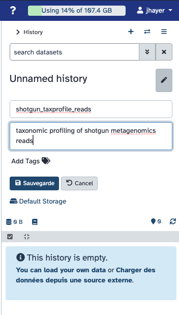
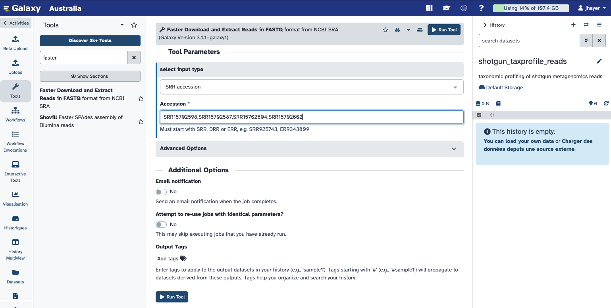
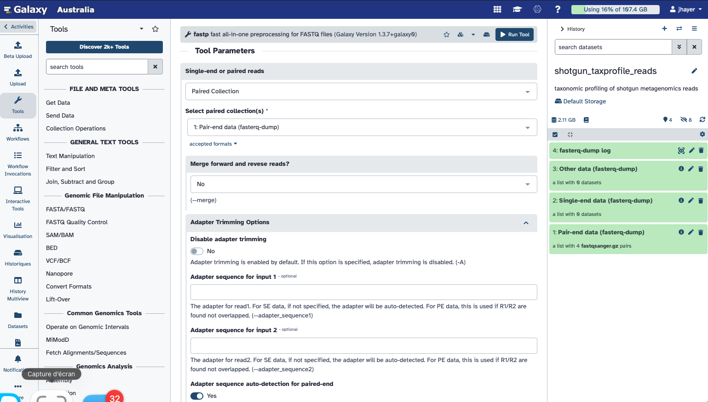
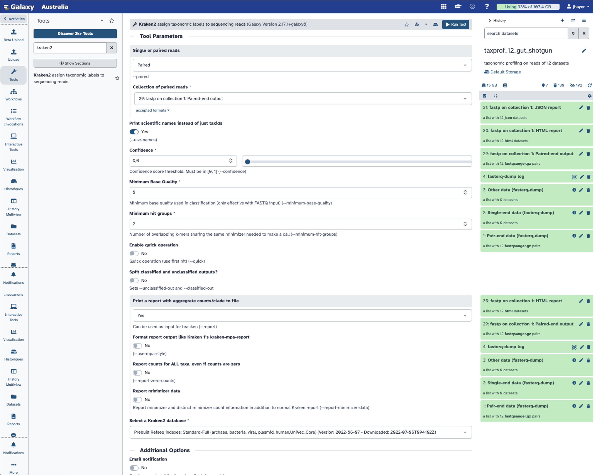
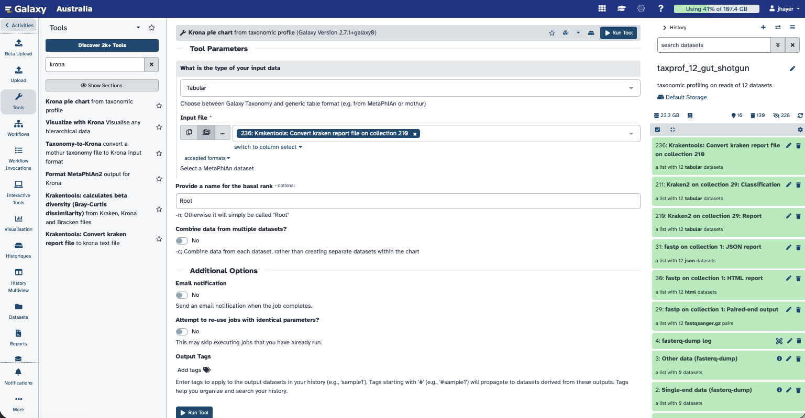
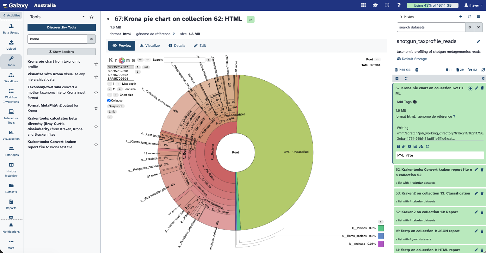
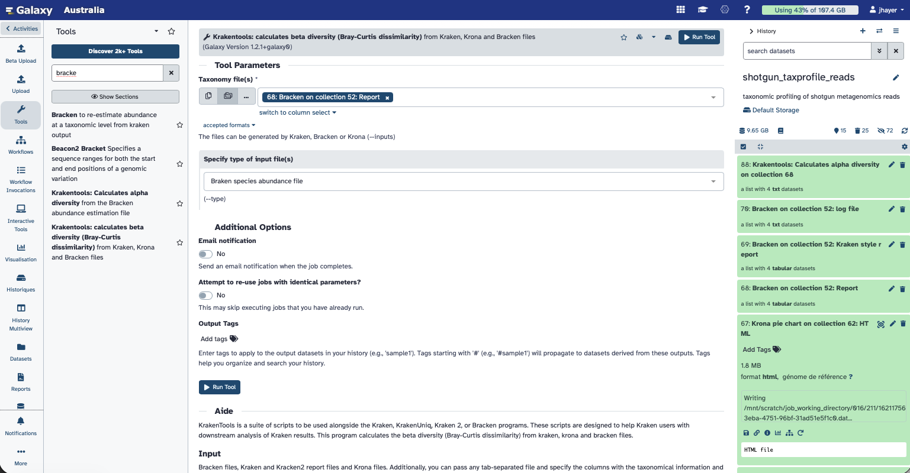

# Taxonomic profiling of (bacterial) shotgun metagenomics data

::: {.callout-note}
**Time:** 60 min

**Objectives:** to be able to perform the taxonomic profiling and visualisation of shotgun metagenomics dataset, and evaluate the taxonomic diversity

**Questions:**
- Which species are present in my sample?

**Tools:** 
[kraken2](https://github.com/DerrickWood/kraken2)
[bracken]()
[krona]()

:::


## Foreword

For metagenomic data analysis we start with sequences derived from DNA fragments that are isolated from the sample of interest. Ideally, the sequences from all microbes in the sample are present. The underlying idea of taxonomic assignment is to compare the DNA sequences found in the sample (reads) to DNA sequences of a database. When a read matches a database DNA sequence of a known microbe, we can derive a list with microbes present in the sample.

When talking about taxonomic assignment or taxonomic classification, most of the time we actually talk about two methods:

- **taxonomic binning**: the clustering of individual sequences (contigs) based on similarities criteria and assignation of clusters to reference taxa

- **taxonomic profiling**: classification of individual reads to reference taxa to extract the relative abundances of the different taxa


The reads can be obtained from **amplicon sequencing**  (e.g. 16S, 18S, ITS), where only specific gene or gene fragments are targeted (using specific primers) or **shotgun metagenomic sequencing**, where all the accessible DNA of a mixed community is amplified (using random primers). 

This tutorial focuses on reads obtained from shotgun metagenomic sequencing. 

## (Optional) Retrieve the Galaxy history

If you want to have a look at all the outputs for the 42 samples, you can find the whole analysis  in [this history](https://usegalaxy.org.au/u/jhayer/h/42-gut-shotgun). 

## The datasets

We will use 4 samples from the following study: [16S rRNA and metagenomic shotgun sequencing data revealed consistent patterns of gut microbiome signature in pediatric ulcerative colitis](https://www.nature.com/articles/s41598-022-07995-7).
In this study, the authors have explored the gut microbiome of pediatrics patients with ulcerative colitis (UC); using both metabarcoding of 16S gene amplicons and shotgun metagenomics.
In this tutorial, we will focus on the taxonomic profiling of 4 samples sequenced using shotgun metagenomics.

We will retrieve the 4 datasets (2 UC samples and 2 healthy samples) using the SRA tool 

The list of accession numbers is the following: 


| SampleID | Accession number | Metadata |
|------|----------|---------------|
| SM030818.92 | SRR15702598 | UC |
| SM030818.97 | SRR15702587 | UC | 
| SM030818.140 | SRR15702604 | Healthy |
| SM030818.141 | SRR15702602 | Healthy | 


You will first create a new history and name it **shotgun_taxprofile_reads** :



## Retrieving the 4 datasets


In Galaxy, you will retrieve the data by their accession numbers using the tool: 
*Faster Download and Extract Reads in FASTQ*

Give the following list of accession numbers: `SRR15702598,SRR15702587,SRR15702604,SRR15702602`





## Quality control using fastp

As done previously during the QC tutorial, you will check the quality of the sequencing reads and trim the potential adapters.

::: {.callout-handson}
Search for *fastp* in the Galaxy tools, select paired-end collection, and provide the collection of 4 paired datasets.

You do not need to change any option except setting *Adapter sequence auto-detection for paired-end* to *Yes*
::: 




Observe the fastp HTML report

::: {.callout-question}
How many reads where filtered?

Did fastp identify any adapters left?

How is the overall quality of these datasets?
:::

## kmer based taxonomic assignment of reads using Kraken2


To find out which microorganisms are present, we will compare the reads of the sample to a reference database, i.e. sequences of known microorganisms stored in a database, using **Kraken2** [Wood et al., 2019](https://pmc.ncbi.nlm.nih.gov/articles/PMC6883579/).


::: {.callout-handson}
Search for Kraken2 tool, and select the paired collection as input.

You can set the parameter *Print scientific names instead of just taxids* to *Yes*.

Set *Print a report with aggregrate counts/clade to file* to *Yes*

For the database, select the *Prebuilt Refseq indexes: Standard-Full (archaea, bacteria, viral, plasmid, human,UniVec_Core) (Version: 2022-06-07 - Downloaded: 2022-07-06T094102Z)*

Then you can Run tool.
::: 





::: {.callout-question}
What kind of output do you get for each sample?

Inspect the kraken2 output files and reports.
:::


**Kraken2** will create two outputs for each dataset

- **Classification**: tabular files with one line for each sequence classified by Kraken and 5 columns:

   1. `C`/`U`: a one letter indicating if the sequence classified or unclassified
   2. Sequence ID as in the input file
   3. NCBI taxonomy ID assigned to the sequence, or 0 if unclassified
   4. Length of sequence in bp (`read1|read2` for paired reads)
   5. A space-delimited list indicating the lowest common ancestor (LCA) mapping of each k-mer in the sequence     
      
      For example, `562:13 561:4 A:31 0:1 562:3` would indicate that:
      1. The first 13 k-mers mapped to taxonomy ID #562
      2. The next 4 k-mers mapped to taxonomy ID #561
      3. The next 31 k-mers contained an ambiguous nucleotide
      4. The next k-mer was not in the database
      5. The last 3 k-mers mapped to taxonomy ID #562     
      
      `|:|` indicates end of first read, start of second read for paired reads


- **Report**: tabular files with one line per taxon and 6 columns or fields

   1. Percentage of fragments covered by the clade rooted at this taxon
   2. Number of fragments covered by the clade rooted at this taxon
   3. Number of fragments assigned directly to this taxon
   4. A rank code, indicating
      - (U)nclassified
      - (R)oot
      - (D)omain
      - (K)ingdom
      - (P)hylum
      - (C)lass
      - (O)rder
      - (F)amily
      - (G)enus, or
      - (S)pecies

      Taxa that are not at any of these 10 ranks have a rank code that is formed by using the rank code of the closest ancestor rank with a number indicating the distance from that rank. E.g., `G2` is a rank code indicating a taxon is between genus and species and the grandparent taxon is at the genus rank.

   5. NCBI taxonomic ID number
   6. Indented scientific name

   ```
   Column 1	Column 2	Column 3	Column 4	Column 5	Column 6
   76.85 	105397 	105397 	U 	0 	unclassified
   23.15 	31742 	1197 	R 	1 	root
   22.20 	30450 	312 	R1 	131567 	cellular organisms
   12.58 	17256 	3768 	D 	2 	Bacteria
   8.77 	12028 	2868 	P 	1224 	Proteobacteria
   4.94 	6779 	3494 	C 	28211 	Alphaproteobacteria
   1.30 	1782 	1085 	O 	204455 	Rhodobacterales
   0.43 	593 	461 	F 	31989 	Rhodobacteraceae
   0.05 	74 	53 	G 	265 	Paracoccus
   ```


Getting an overview of the assignation is not straightforward with the **Kraken2** outputs directly. We can use visualisation tools for that.

Once we have assigned the corresponding taxa to each sequence, the next step is to properly visualize the data. There are several tools for that:
- __Krona__ 
- __Pavian__ 


## Visualisation using Krona

__Krona__ creates an interactive HTML file allowing hierarchical data to be explored with zooming, multi-layered pie charts. With this tool, we can easily visualize the composition of the bacterial communities and compare how the populations of microorganisms are modified according to the conditions of the environment.

Kraken outputs can not be given directly to **Krona**, they first need to be converted.

__Krakentools__ (Lu.2017 %) is a suite of tools to work on Kraken outputs. It include a tool designed to translate results of the Kraken metagenomic classifier to the full representation of NCBI taxonomy. The output of this tool can be directly visualized by the Krona Pie Chart tool.

::: {.callout-handson}
Search for the tool **Krakentools: Convert kraken report file to krona text file**

*"Kraken report file"*: **Report** collection of **Kraken reports**
:::

Now the output of Kraken2 are properly formatted and ready to be used by Krona.

::: {.callout-handson}
Search for the tool **Krona pie chart**from taxonomic profile

Set the type to **Tabular**, and choose the collection of files just produced by KrakenTools
:::




::: {.callout-question}
Inspect the Krona pie chart by viewing the HTML file produced.
:::



## Bracken: to re-estimate abundance at a taxonomic level from kraken output

A “simple and worthwile addition to Kraken for better abundance estimates” (Ye et al. 2019)[https://pmc.ncbi.nlm.nih.gov/articles/PMC6716367/] is called **Bracken** (Bayesian Reestimation of Abundance after Classification with Kraken). Instead of only using proportions of classified reads, it takes a probabilistic approach to generate final abundance profiles. It works by re-distributing reads in the taxonomic tree: “Reads assigned to nodes above the species level are distributed down to the species nodes, while reads assigned at the strain level are re-distributed upward to their parent species” [Lu et al. 2017](https://pmc.ncbi.nlm.nih.gov/articles/PMC12016282/).

::: {.callout-handson}
Search for the Bracken tool and provide the Kraken reports collection as input
Set up the same database as the one used for the Kraken2 classification.
Set *Produce Kraken-Style Bracken report* and *Add log file output* to *Yes*
:::


The Bracken abundance results will allow us to compute alpha and beta diversity of our samples.


Once we know which taxons are present in a metagenomic sample, we can do diversity analyses.

Related to ecology, the term diversity describes the number of different species present in one particular area and their relative abundance. More specifically, several different metrics of diversity can be calculated. The most common ones are α, β and γ diversity:

* α diversity describes the diversity within a community

It considers the number of different species in an environment (also referred to as species richness). Additionally, it can take the abundance of each species into account to measure how evenly individuals are distributed across the sample (also referred to as species evenness).

* β diversity compare the diversity between different communities by measuring their distance

* γ diversity is a measure of the overall diversity for the different ecosystems within a region.

In a nutshell, taxonomic labels have been assigned to the metagenomics data using Kraken2 to find out which species are present in the samples. Finally, species abundance was estimated using Bracken. For this tutorial, we will use the output file of Bracken.


::: {.callout-handson}

**Krakentools: Calculates alpha diversity** from the Bracken abundance estimation file

You need to select the collection of Bracken report (not kraken style, but the tabular abundance one)
Select the *Shannon* index for computing the alpha diversity.
:::

We will now compute the beta diversity based on Bracken abundances

::: {.callout-handson}
**Krakentools: calculates beta diversity (Bray-Curtis dissimilarity)** from Kraken, Krona and Bracken files

You need to select the collection of Bracken report (not kraken style, but the tabular abundance one)
Select the *Bracken species abundance files* for as input file type.
:::




::: {.callout-note}
You can read more about the calculation of α and β diversity on this [Galaxy Training material](https://galaxyproject.github.io/training-material/topics/microbiome/tutorials/diversity/tutorial.html), from which this current tutorial is inspired.
:::


# Diversity Analysis

::: {.callout-tip title="Import the metadata for the 42 samples"}

If you want to do any analysis with 42 samples, you can find here the 42 samples metadata:

1. Click **Upload** → **Paste/Fetch data** and paste the following link:

    ```
https://raw.githubusercontent.com/jhayer/bioinfo_training_infectious_disease/main/data/mg_shotgun/shotgun_metadata.txt

    ```
:::

Then you can convert the Braken report file into the BIOM format, than can be used for visualisation, with the tool **Kraken-biom**. 

A BIOM (Biological Observation Matrix) file is a standard format for storing a table of counts, with samples in one dimension and observations (taxa, OTUs, or ASVs) in the other, along with their metadata.

