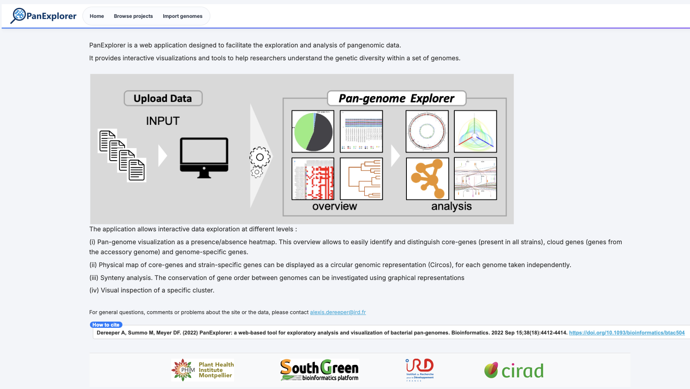
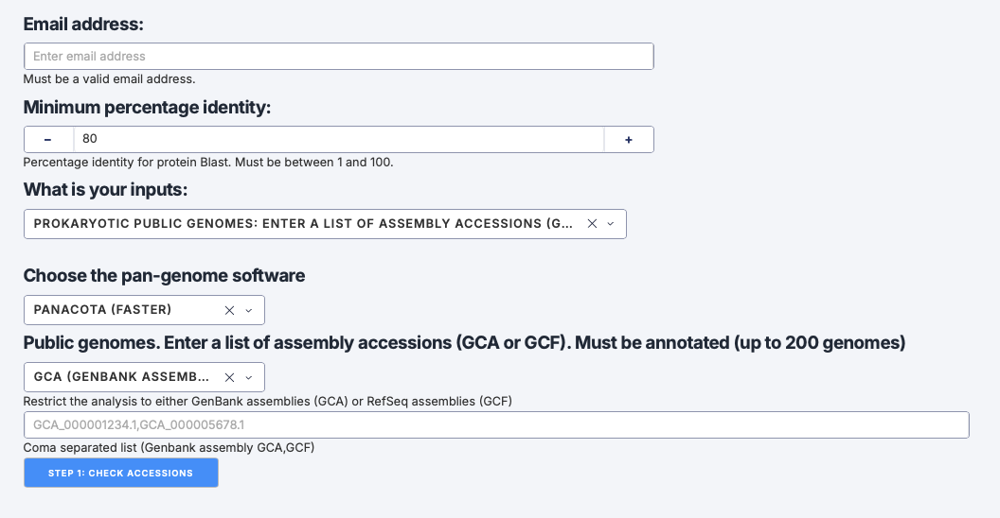
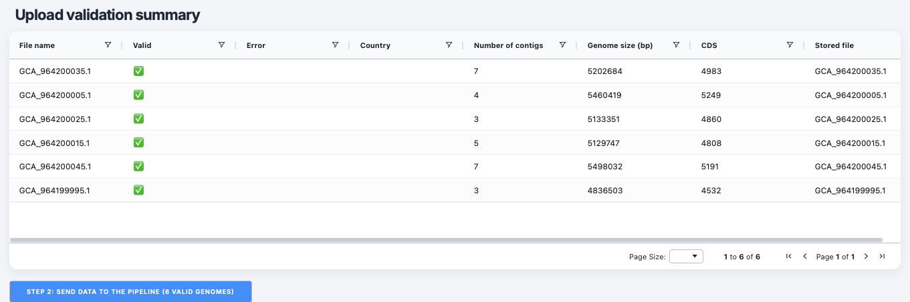
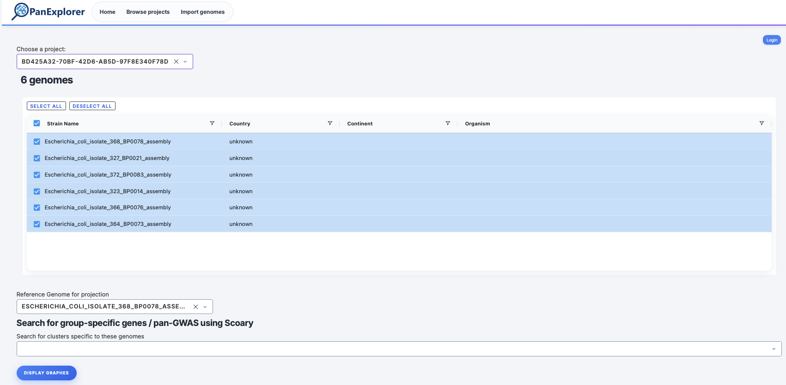
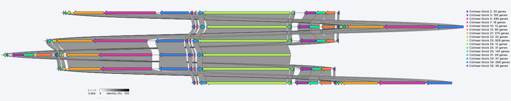
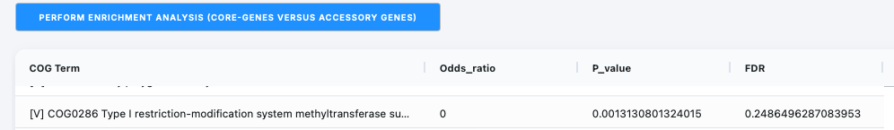

# Panexplorer

::: {.callout-note}
**Time:** 30 min

**Objectives:** Be able to have a quick comparative analysis of many genomes

**Questions:**

- How to run Panexplorer?

**Tools:** [PanExplorer](https://panexplorer.southgreen.fr)
:::

## Foreword 

PanExplorer is a web application designed to facilitate the exploration and analysis of pangenomic data.
It provides interactive visualizations and tools to help researchers understand the genetic diversity within a set of genomes.


The application allows interactive data exploration at different levels :

* Pan-genome visualization as a presence/absence heatmap. This overview allows to easily identify and distinguish core-genes (present in all strains), cloud genes (genes from the accessory genome) and genome-specific genes.
* Physical map of core-genes and strain-specific genes can be displayed as a circular genomic representation (Circos), for each genome taken independently.
* Synteny analysis. The conservation of gene order between genomes can be investigated using graphical representations
* Visual inspection of a specific cluster.

## Concept

<iframe id="iframepdf" src="poster_PanExplorer_JOBIM2026.pdf" frameborder="0" width="1280" height="960" allowfullscreen="true" mozallowfullscreen="true" webkitallowfullscreen="true"></iframe>

## Run panexplorer

Go to the PanExplorer web application to start exploring your pangenomic data: [PanExplorer](https://panexplorer.southgreen.fr).

{style="width:75%"}

* Go to the "Import genomes" section to upload your genome data.
* Enter an email address to receive notifications about the analysis.
* Choose "Prokaryotic public genomes: Enter a list of assembly accessions (GCA or GCF)" as input.
* Enter list of assembly accessions (GCA or GCF): 
bash
```
GCA_964200045.1,GCA_964200025.1,GCA_964200035.1,GCA_964200015.1,GCA_964199995.1,GCA_964200005.1
```

{style="width:75%"}

Now click **STEP 1: Check accessions**.  
You should get a confirmation that the accessions are valid and ready for import.

{style="width:75%"}

You can now proceed to start the analysis by clicking **STEP 2: SEND DATA TO THE PIPELINE** button in the PanExplorer interface.

You will get a confirmation message indicating that the data has been successfully sent to the pipeline for analysis, and an URL allowing you to visualise the data once the analysis is complete.

{style="width:100%"} 

## Explore the visualizations

Let's Explore the visualizations and analyses provided by PanExplorer to gain insights into your pangenomic data.
You will access a dashboard that provides:  

* an overview of your current projet on panexplorer (currently only one).  
* a view of the genomes available in your pangenomic analysis (we can keep all of them as it is by default).  
* a drop-down menu to select you reference genome (for projection).  

{style="width:75%"}

Click "DISPLAY GRAPHES" to visualize the different analyses and visualizations available for your pangenomic data.

* Navigate through the two main sections: "GENES (PANGENE ATLAS)" and "ANI".
* Within the GENES "(PANGENE ATLAS)" Navigate between the various visualizations and analyses, such as "PAV MATRIX", "HIERARCHICAL CLUSTERING", "MACRP-SYNTENY", etc.

::: {.callout-caution }
## How many Core-genes, Strain specific genes, Accessory genes are there?
:::
::: {.callout-caution }
## What can we observe in the "rarefaction curve"?
More genome we add more pan-genes and core-genes number tends to stabilize.
:::
::: {.callout-caution }
## Can you find the upset plot?
:::
::: {.callout-caution }
## Can you see the two genomes that are really close to each other?
:::
::: {.callout-caution collapse="true"}
## Can the synteny visualization be improved?
Yes by flipping the orientation of the synteny blocks.
{style="width:75%"}
:::


* Go to the statistics section an run an enrichment analysis (CORE-GENES VERSUS ACCESSORY GENES). In other term, it investigates whether a particular functional categories of genes are statistically overrepresented in the core genome or the accessory genome.

::: {.callout-caution collapse="true"}
## Can you find enriched functions?
example of result:
{style="width:75%"}
:::
